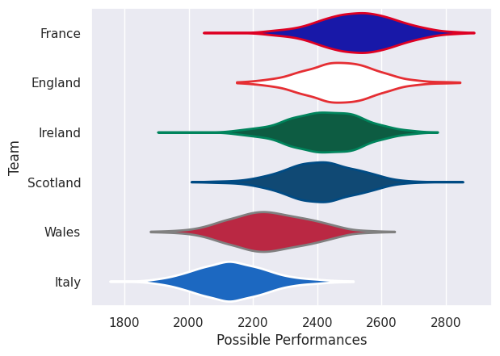
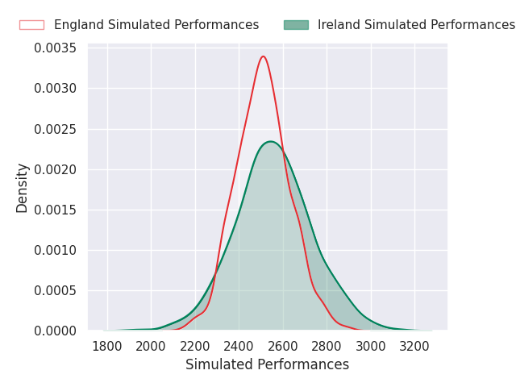
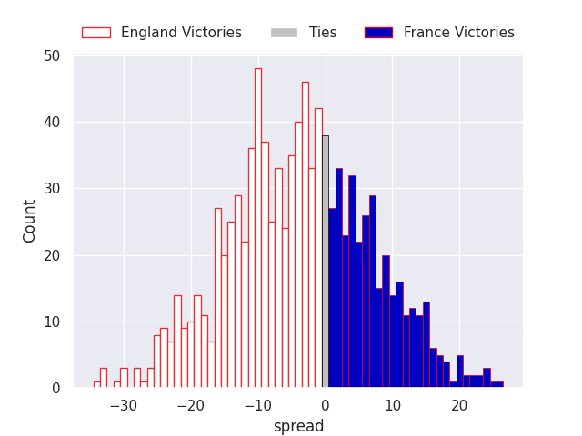
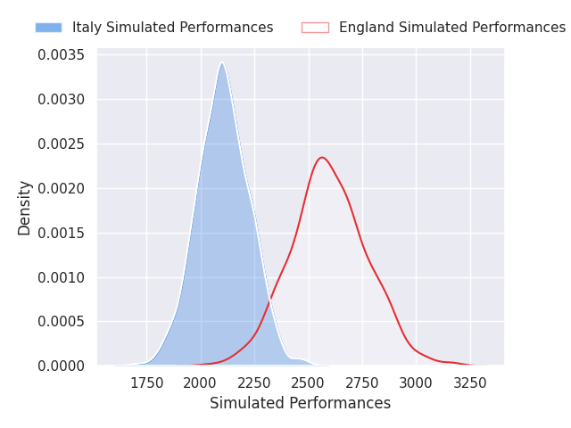
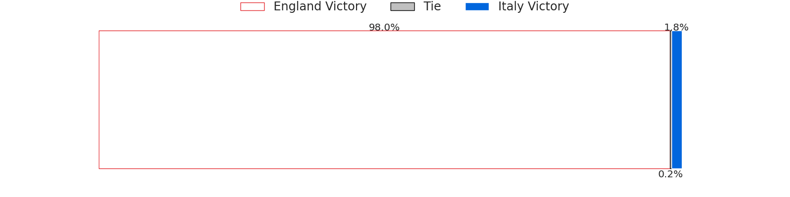
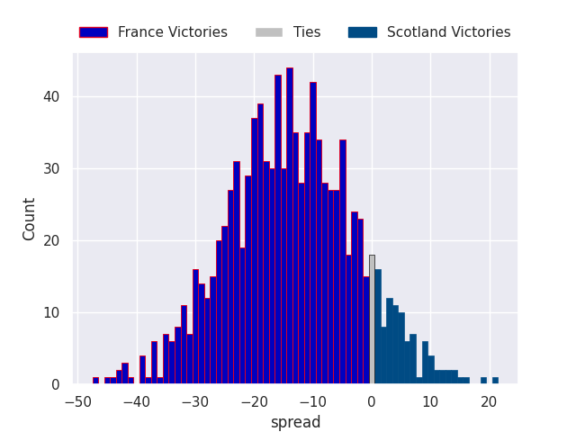
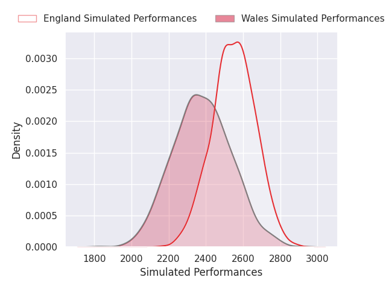
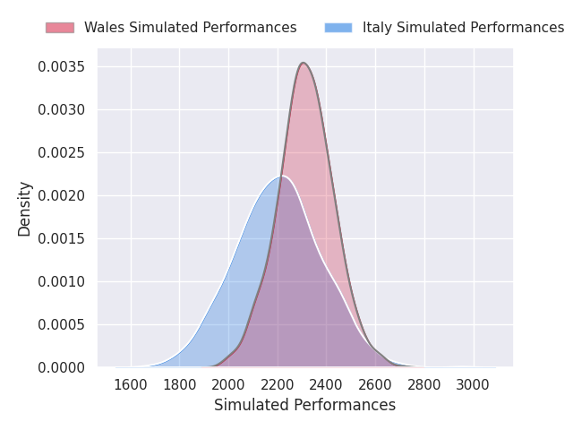

## Team Rankings

## Standings
### Projected Remaining Table

| Club     |   To Play |   Projected Wins |   Projected Differential |   Projected Losing Bonus Points | Projected Try Bonus Points   |   Projected Competition Points |
|:---------|----------:|-----------------:|-------------------------:|--------------------------------:|:-----------------------------|-------------------------------:|
| England  |         5 |            3.827 |                   57.45  |                           0.621 |                              |                         16.199 |
| France   |         5 |            3.461 |                   40.39  |                           0.669 |                              |                         14.725 |
| Ireland  |         5 |            3.084 |                   22.251 |                           0.957 |                              |                         13.617 |
| Scotland |         5 |            2.373 |                   -1.951 |                           0.75  |                              |                         10.452 |
| Wales    |         5 |            1.496 |                  -30.312 |                           1.048 |                              |                          7.33  |
| Italy    |         5 |            0.401 |                  -87.828 |                           0.596 |                              |                          2.318 |

### Projected Total Table

| Club     |   Played |   Wins |   Point Differential |   Losing Bonus Points | Try Bonus Points   |   Competition Points |
|:---------|---------:|-------:|---------------------:|----------------------:|:-------------------|---------------------:|
| England  |        5 |  3.827 |               57.45  |                 0.621 |                    |               16.199 |
| France   |        5 |  3.461 |               40.39  |                 0.669 |                    |               14.725 |
| Ireland  |        5 |  3.084 |               22.251 |                 0.957 |                    |               13.617 |
| Scotland |        5 |  2.373 |               -1.951 |                 0.75  |                    |               10.452 |
| Wales    |        5 |  1.496 |              -30.312 |                 1.048 |                    |                7.33  |
| Italy    |        5 |  0.401 |              -87.828 |                 0.596 |                    |                2.318 |

## Future Predictions
### Week 1
#### Ireland V England on 2027/02/05

Average Margin: Ireland by 0.2

#### Scotland V Italy on 2027/02/05

Average Margin: Scotland by 18.8

#### France V Wales on 2027/02/05

Average Margin: France by 16.9

### Week 2
#### England V France on 2027/02/12

Average Margin: England by 6.0

#### Italy V Ireland on 2027/02/12

Average Margin: Ireland by 15.6

#### Scotland V Wales on 2027/02/12

Average Margin: Scotland by 7.8

### Week 3
#### England V Italy on 2027/02/19

Average Margin: England by 29.4

#### Wales V Ireland on 2027/02/19

Average Margin: Ireland by 4.5

#### France V Scotland on 2027/02/19

Average Margin: France by 13.4

### Week 4
#### Italy V France on 2027/03/05

Average Margin: France by 17.5

#### Wales V England on 2027/03/05

Average Margin: England by 7.8

### Week 5
#### England V Scotland on 2027/03/12

Average Margin: England by 14.4

#### Italy V Wales on 2027/03/12

Average Margin: Wales by 6.6

#### Ireland V France on 2027/03/12

Average Margin: Ireland by 1.3

