## Team Rankings

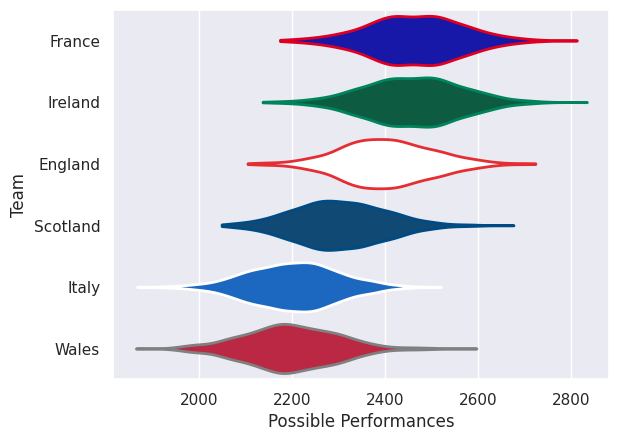
## Standings
### Projected Remaining Table

| Club     |   To Play |   Projected Wins |   Projected Differential |   Projected Losing Bonus Points | Projected Try Bonus Points   |   Projected Competition Points |
|:---------|----------:|-----------------:|-------------------------:|--------------------------------:|:-----------------------------|-------------------------------:|
| France   |         5 |            3.557 |                   38.881 |                           0.676 |                              |                         15.142 |
| England  |         5 |            3.248 |                   31.336 |                           0.814 |                              |                         14.1   |
| Ireland  |         5 |            2.885 |                   14.637 |                           0.991 |                              |                         12.833 |
| Scotland |         5 |            2.785 |                   14.654 |                           0.81  |                              |                         12.178 |
| Wales    |         5 |            1.318 |                  -37.717 |                           1.022 |                              |                          6.584 |
| Italy    |         5 |            0.818 |                  -61.791 |                           0.838 |                              |                          4.314 |

### Projected Total Table

| Club     |   Played |   Wins |   Point Differential |   Losing Bonus Points | Try Bonus Points   |   Competition Points |
|:---------|---------:|-------:|---------------------:|----------------------:|:-------------------|---------------------:|
| France   |        5 |  3.557 |               38.881 |                 0.676 |                    |               15.142 |
| England  |        5 |  3.248 |               31.336 |                 0.814 |                    |               14.1   |
| Ireland  |        5 |  2.885 |               14.637 |                 0.991 |                    |               12.833 |
| Scotland |        5 |  2.785 |               14.654 |                 0.81  |                    |               12.178 |
| Wales    |        5 |  1.318 |              -37.717 |                 1.022 |                    |                6.584 |
| Italy    |        5 |  0.818 |              -61.791 |                 0.838 |                    |                4.314 |

## Future Predictions
### Week 1
#### Scotland V Italy on 2027/02/05

Average Margin: Scotland by 16.8

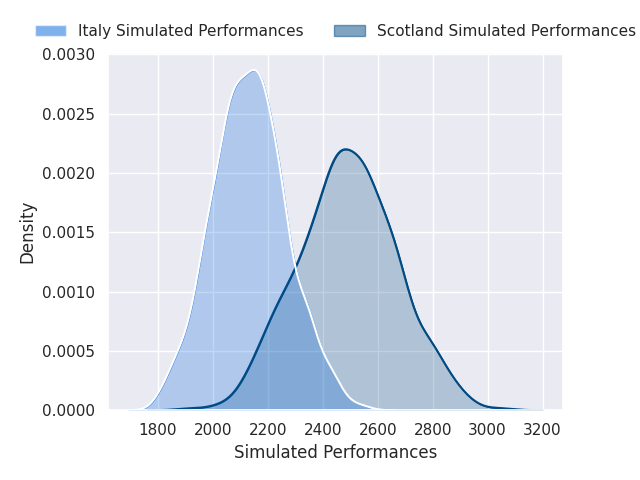

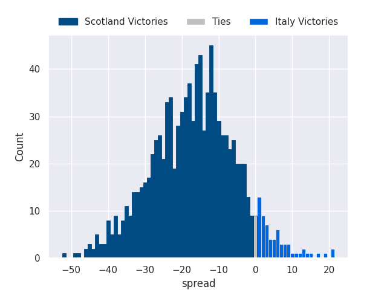

#### France V Wales on 2027/02/05

Average Margin: France by 17.3

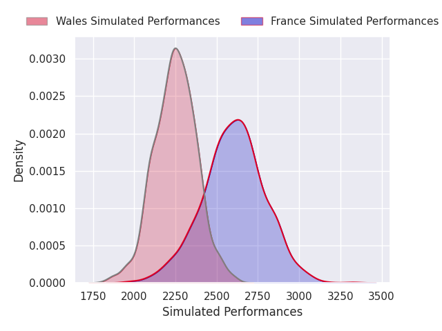
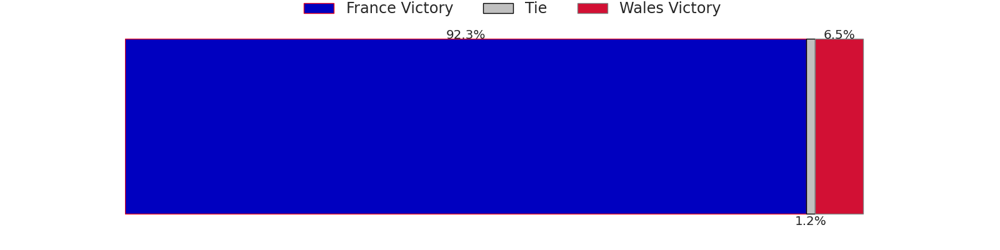
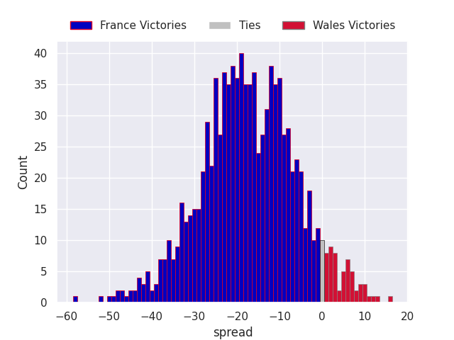

### Week 2
#### Scotland V Wales on 2027/02/12

Average Margin: Scotland by 12.1

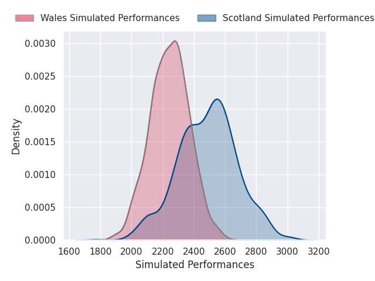
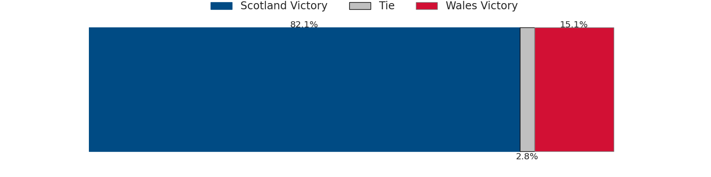
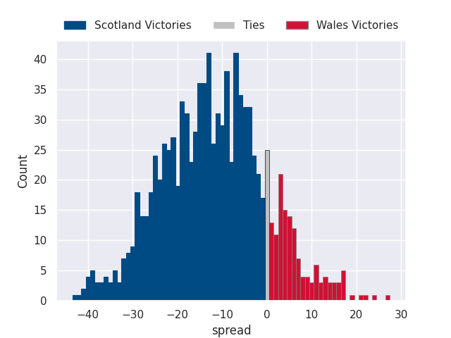

#### England V France on 2027/02/12

Average Margin: England by 1.5

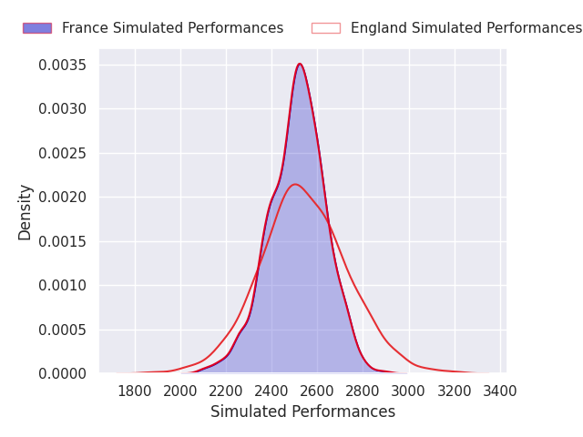

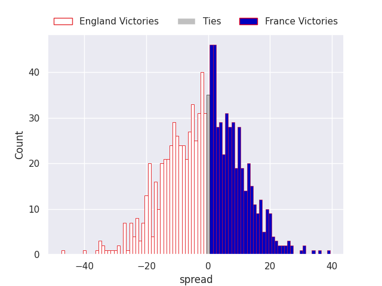

#### Italy V Ireland on 2027/02/12

Average Margin: Ireland by 10.2

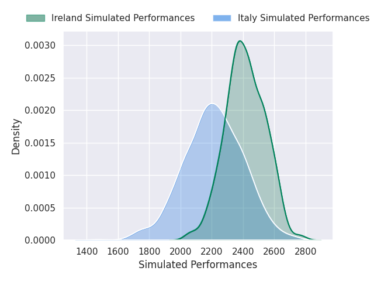

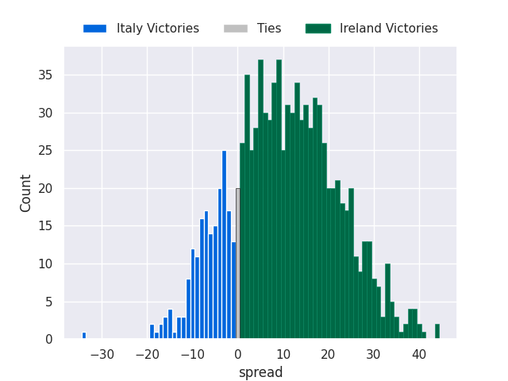

### Week 3
#### France V Scotland on 2027/02/19

Average Margin: France by 10.4

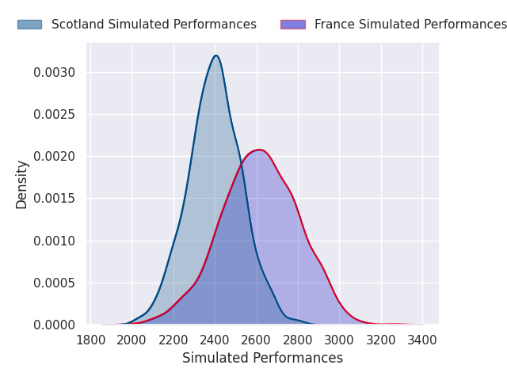
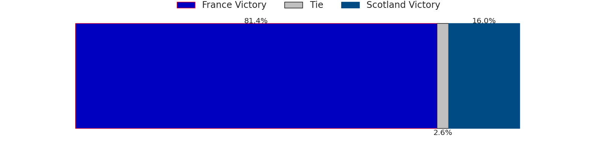
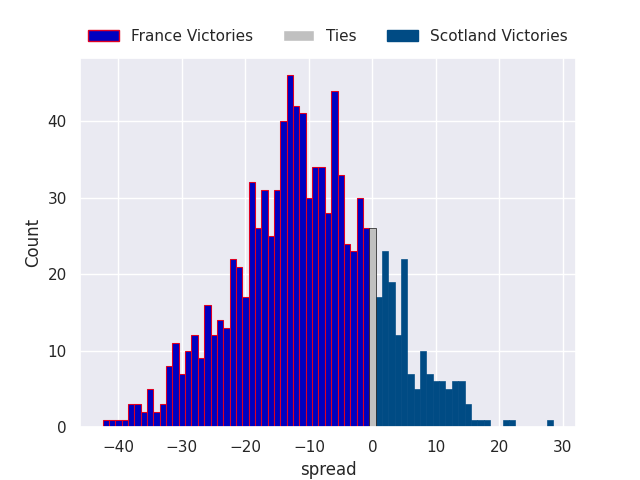

#### Wales V Ireland on 2027/02/19

Average Margin: Ireland by 4.9

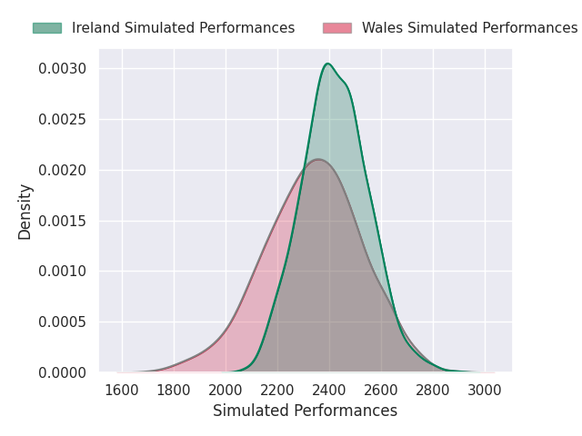

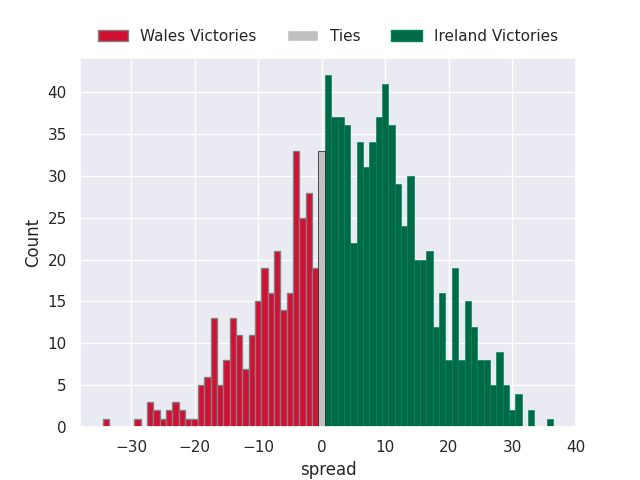

#### England V Italy on 2027/02/19

Average Margin: England by 20.8

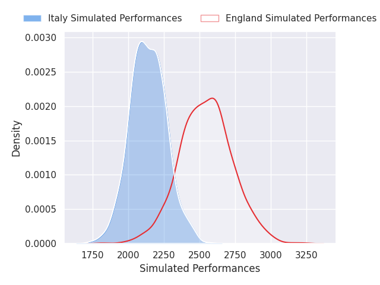
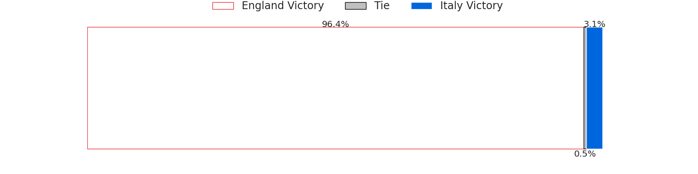
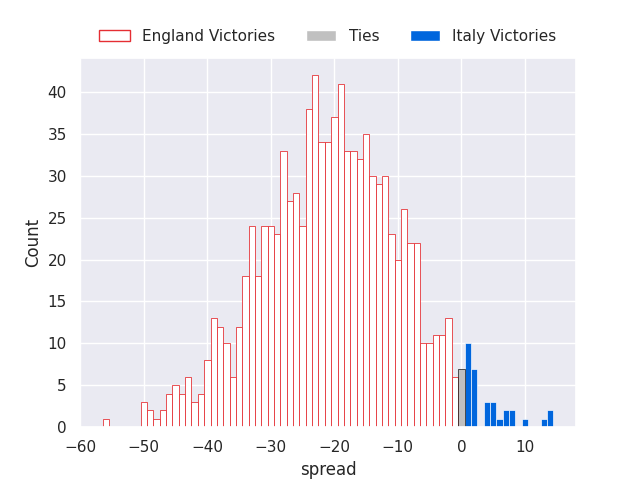

### Week 4
#### Italy V France on 2027/03/05

Average Margin: France by 12.6

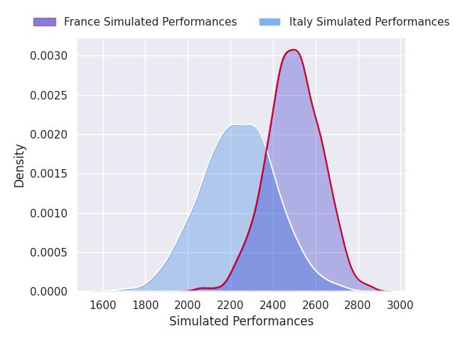
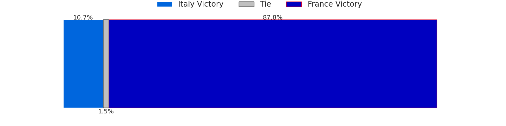
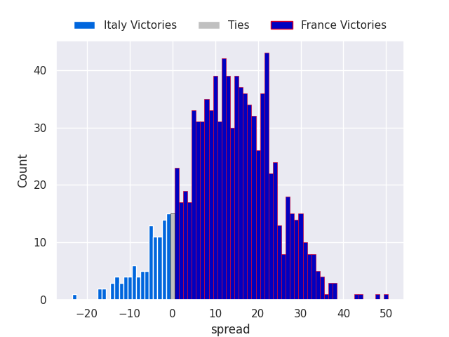

#### Wales V England on 2027/03/05

Average Margin: England by 4.8

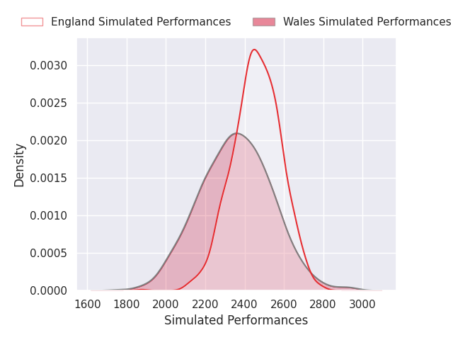
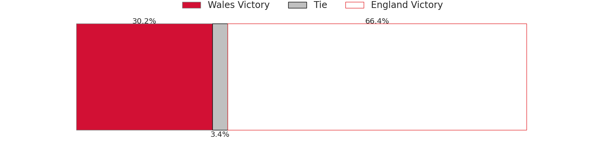
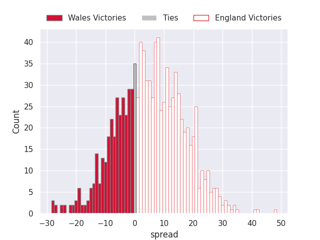

### Week 5
#### England V Scotland on 2027/03/12

Average Margin: England by 7.3

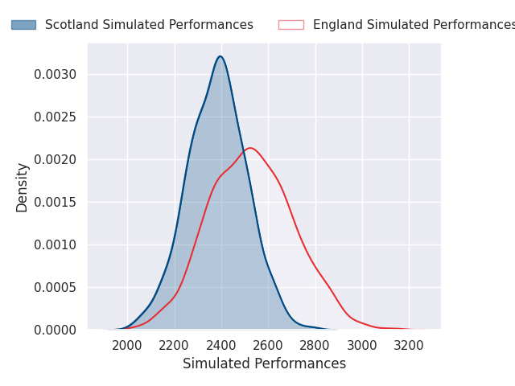
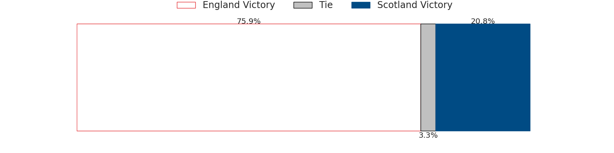
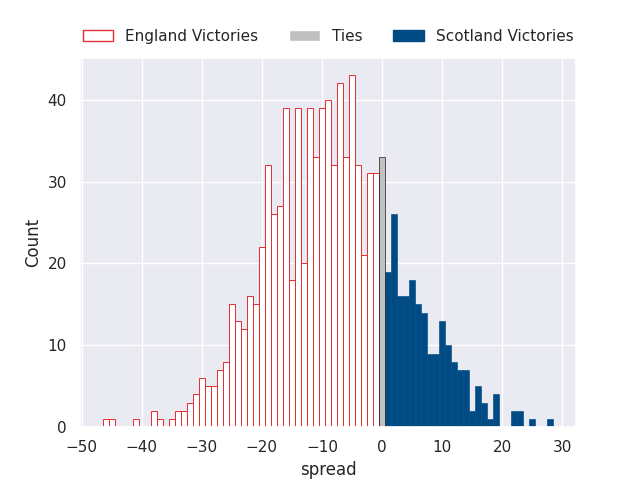

#### Italy V Wales on 2027/03/12

Average Margin: Wales by 1.3

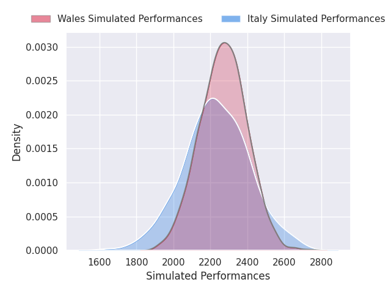

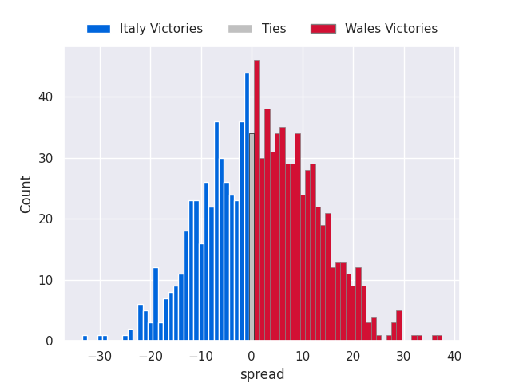

#### Ireland V France on 2027/03/12

Average Margin: France by 0.0

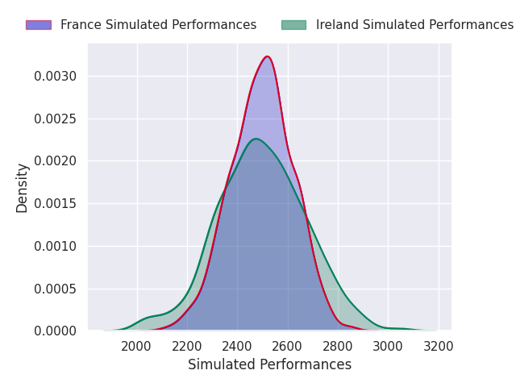

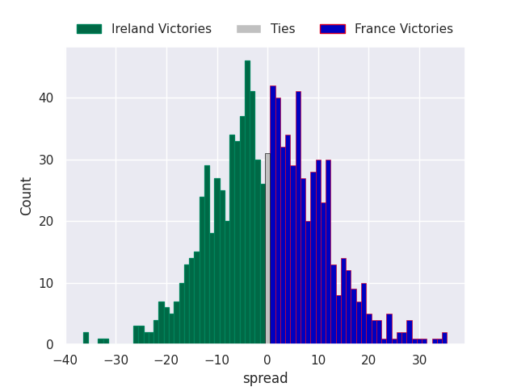

