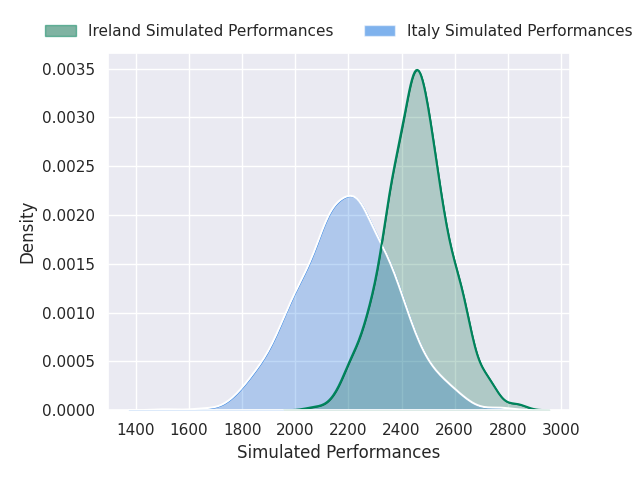
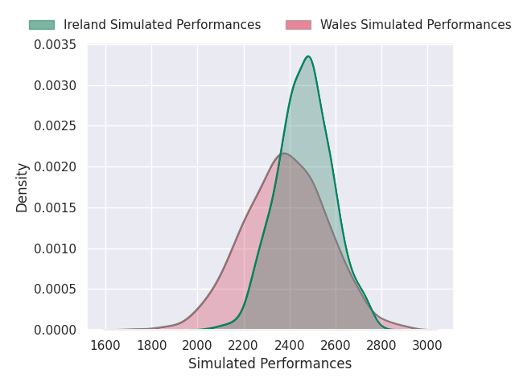
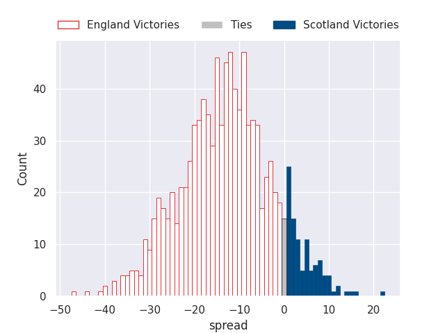

## Team Rankings

## Standings
### Projected Remaining Table

| Club     |   To Play |   Projected Wins |   Projected Differential |   Projected Losing Bonus Points | Projected Try Bonus Points   |   Projected Competition Points |
|:---------|----------:|-----------------:|-------------------------:|--------------------------------:|:-----------------------------|-------------------------------:|
| England  |         5 |            3.867 |                   56.411 |                           0.575 |                              |                         16.265 |
| France   |         5 |            3.531 |                   41.342 |                           0.647 |                              |                         14.995 |
| Ireland  |         5 |            3.081 |                   21.589 |                           0.98  |                              |                         13.63  |
| Scotland |         5 |            2.32  |                   -2.608 |                           0.789 |                              |                         10.291 |
| Wales    |         5 |            1.471 |                  -30.572 |                           1.084 |                              |                          7.26  |
| Italy    |         5 |            0.37  |                  -86.162 |                           0.657 |                              |                          2.291 |

### Projected Total Table

| Club     |   Played |   Wins |   Point Differential |   Losing Bonus Points | Try Bonus Points   |   Competition Points |
|:---------|---------:|-------:|---------------------:|----------------------:|:-------------------|---------------------:|
| England  |        5 |  3.867 |               56.411 |                 0.575 |                    |               16.265 |
| France   |        5 |  3.531 |               41.342 |                 0.647 |                    |               14.995 |
| Ireland  |        5 |  3.081 |               21.589 |                 0.98  |                    |               13.63  |
| Scotland |        5 |  2.32  |               -2.608 |                 0.789 |                    |               10.291 |
| Wales    |        5 |  1.471 |              -30.572 |                 1.084 |                    |                7.26  |
| Italy    |        5 |  0.37  |              -86.162 |                 0.657 |                    |                2.291 |

## Future Predictions
### Week 1
#### France V Wales on 2027/02/05

Average Margin: France by 16.6

#### Scotland V Italy on 2027/02/05

Average Margin: Scotland by 18.9

### Week 2
#### England V France on 2027/02/12

Average Margin: England by 5.2

#### Scotland V Wales on 2027/02/12

Average Margin: Scotland by 7.3

#### Italy V Ireland on 2027/02/12

Average Margin: Ireland by 15.1

### Week 3
#### England V Italy on 2027/02/19

Average Margin: England by 28.5

#### Wales V Ireland on 2027/02/19

Average Margin: Ireland by 4.7

#### France V Scotland on 2027/02/19

Average Margin: France by 13.5

### Week 4
#### Wales V England on 2027/03/05

Average Margin: England by 8.5

#### Italy V France on 2027/03/05

Average Margin: France by 17.2

### Week 5
#### England V Scotland on 2027/03/12

Average Margin: England by 14.4

#### Italy V Wales on 2027/03/12

Average Margin: Wales by 6.5

#### Ireland V France on 2027/03/12

Average Margin: Ireland by 0.7

