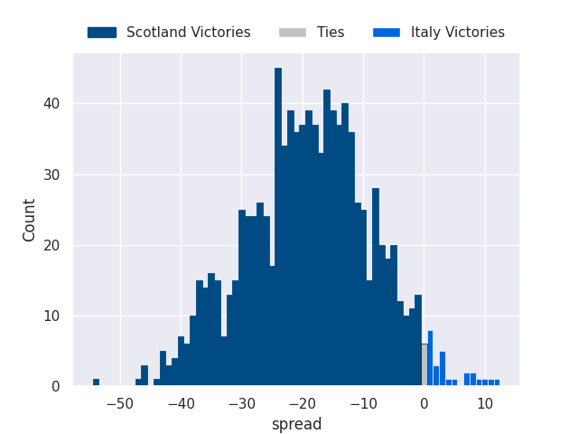
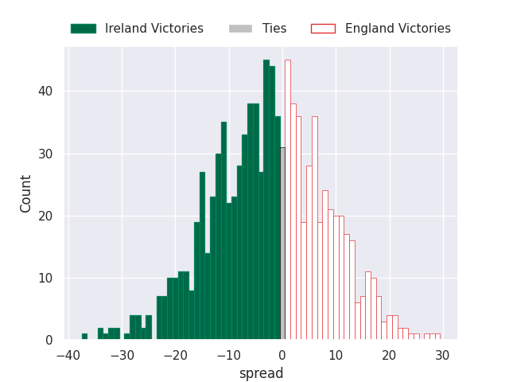
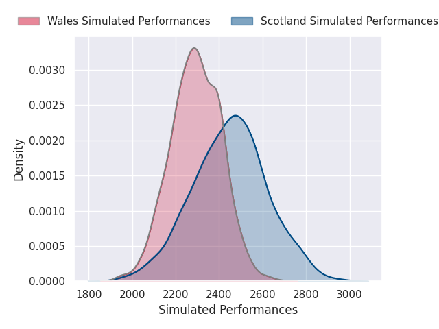
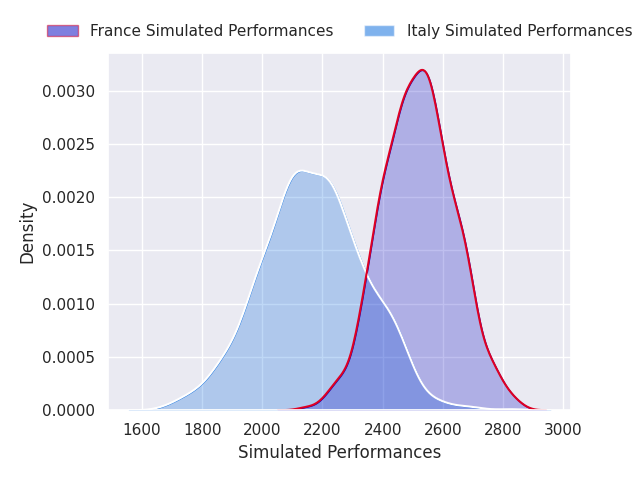
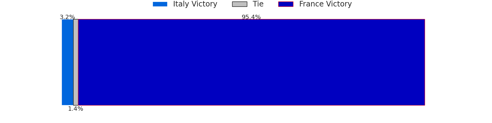
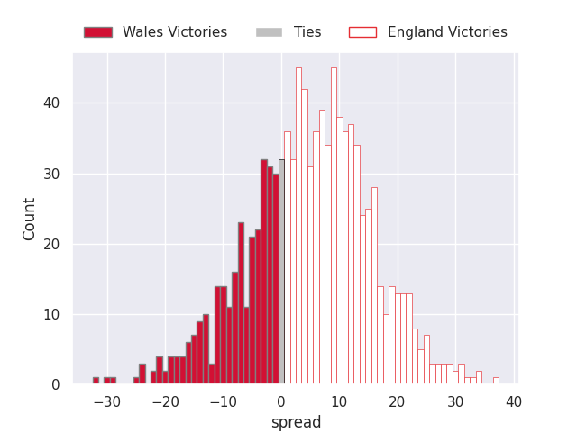
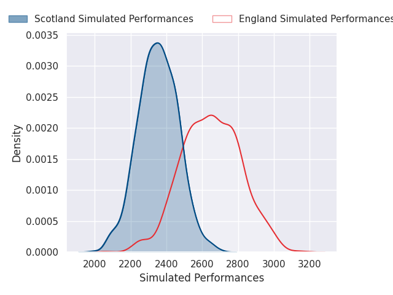

## Team Rankings

## Standings
### Projected Remaining Table

| Club     |   To Play |   Projected Wins |   Projected Differential |   Projected Losing Bonus Points | Projected Try Bonus Points   |   Projected Competition Points |
|:---------|----------:|-----------------:|-------------------------:|--------------------------------:|:-----------------------------|-------------------------------:|
| England  |         5 |            3.548 |                   43.172 |                           0.724 |                              |                         15.188 |
| France   |         5 |            3.475 |                   37.831 |                           0.676 |                              |                         14.8   |
| Ireland  |         5 |            3.19  |                   23.027 |                           0.924 |                              |                         14.002 |
| Scotland |         5 |            2.17  |                   -7.699 |                           0.877 |                              |                          9.815 |
| Wales    |         5 |            1.685 |                  -23.764 |                           1.098 |                              |                          8.178 |
| Italy    |         5 |            0.542 |                  -72.567 |                           0.761 |                              |                          3.077 |

### Projected Total Table

| Club     |   Played |   Wins |   Point Differential |   Losing Bonus Points | Try Bonus Points   |   Competition Points |
|:---------|---------:|-------:|---------------------:|----------------------:|:-------------------|---------------------:|
| England  |        5 |  3.548 |               43.172 |                 0.724 |                    |               15.188 |
| France   |        5 |  3.475 |               37.831 |                 0.676 |                    |               14.8   |
| Ireland  |        5 |  3.19  |               23.027 |                 0.924 |                    |               14.002 |
| Scotland |        5 |  2.17  |               -7.699 |                 0.877 |                    |                9.815 |
| Wales    |        5 |  1.685 |              -23.764 |                 1.098 |                    |                8.178 |
| Italy    |        5 |  0.542 |              -72.567 |                 0.761 |                    |                3.077 |

## Future Predictions
### Week 1
#### Scotland V Italy on 2027/02/05

Average Margin: Scotland by 15.6

#### France V Wales on 2027/02/05

Average Margin: France by 15.1

#### Ireland V England on 2027/02/05

Average Margin: Ireland by 2.4

### Week 2
#### England V France on 2027/02/12

Average Margin: England by 3.7

#### Italy V Ireland on 2027/02/12

Average Margin: Ireland by 13.0

#### Scotland V Wales on 2027/02/12

Average Margin: Scotland by 5.3

### Week 3
#### England V Italy on 2027/02/19

Average Margin: England by 24.0

#### Wales V Ireland on 2027/02/19

Average Margin: Ireland by 4.1

#### France V Scotland on 2027/02/19

Average Margin: France by 13.8

### Week 4
#### Scotland V Ireland on 2027/03/05

Average Margin: Ireland by 1.8

#### Italy V France on 2027/03/05

Average Margin: France by 14.5

#### Wales V England on 2027/03/05

Average Margin: England by 4.9

### Week 5
#### England V Scotland on 2027/03/12

Average Margin: England by 13.0

#### Italy V Wales on 2027/03/12

Average Margin: Wales by 5.6

#### Ireland V France on 2027/03/12

Average Margin: Ireland by 1.7

