## Team Rankings

## Standings
### Current Standings

| Club                 |   Played |   Wins |   Point Differential |   Losing Bonus Points |   Try Bonus Points |   Competition Points |
|:---------------------|---------:|-------:|---------------------:|----------------------:|-------------------:|---------------------:|
| CASI                 |       24 |     16 |                  173 |                     4 |                 13 |                   81 |
| Alumni               |       24 |     14 |                  159 |                     5 |                 15 |                   76 |
| Newman               |       17 |     15 |                  227 |                     0 |                 13 |                   73 |
| SIC                  |       21 |     14 |                  210 |                     4 |                  9 |                   69 |
| Hindu                |       20 |     16 |                  188 |                     1 |                  1 |                   66 |
| Belgrano AC          |       25 |      9 |                  -70 |                     7 |                 13 |                   56 |
| CUBA                 |       23 |      8 |                   29 |                     9 |                 13 |                   54 |
| Buenos Aires         |       21 |     11 |                   -8 |                     5 |                  2 |                   51 |
| Los Tilos            |       16 |      9 |                  -31 |                     2 |                  8 |                   46 |
| Atlético del Rosario |       25 |      9 |                 -140 |                     7 |                  2 |                   45 |
| Los Matreros         |       22 |      7 |                 -265 |                     2 |                  9 |                   39 |
| Regatas Bella Vista  |       17 |      7 |                  -54 |                     3 |                  6 |                   37 |
| La Plata             |       21 |      8 |                 -175 |                     4 |                  1 |                   37 |
| Champagnat           |       18 |      4 |                 -243 |                     2 |                  3 |                   21 |

### Projected Remaining Table

| Club                 |   To Play |   Projected Wins |   Projected Differential |   Projected Losing Bonus Points |   Projected Try Bonus Points |   Projected Competition Points |
|:---------------------|----------:|-----------------:|-------------------------:|--------------------------------:|-----------------------------:|-------------------------------:|
| SIC                  |         5 |            4.447 |                   53.017 |                           0.376 |                            3 |                         21.368 |
| Los Tilos            |         5 |            3.268 |                   21.519 |                           1.027 |                            3 |                         17.427 |
| Newman               |         5 |            3.773 |                   48.169 |                           0.708 |                            1 |                         17.038 |
| Hindu                |         5 |            3.87  |                   49.292 |                           0.743 |                              |                         16.489 |
| CASI                 |         5 |            2.696 |                   17.692 |                           1.217 |                            3 |                         15.279 |
| Alumni               |         5 |            2.725 |                    6.422 |                           1.214 |                            2 |                         14.492 |
| Belgrano AC          |         5 |            2.423 |                    7.859 |                           1.114 |                            1 |                         12.13  |
| CUBA                 |         5 |            1.24  |                  -37.462 |                           1.047 |                            3 |                          9.201 |
| Champagnat           |         5 |            1.56  |                  -24.024 |                           1.087 |                            1 |                          8.575 |
| Regatas Bella Vista  |         5 |            1.648 |                  -19.364 |                           1.369 |                              |                          8.293 |
| Atlético del Rosario |         5 |            1.777 |                  -27.016 |                           0.878 |                              |                          8.25  |
| La Plata             |         5 |            1.75  |                  -26.307 |                           0.947 |                              |                          8.231 |
| Buenos Aires         |         5 |            1.682 |                  -22.63  |                           1.15  |                              |                          8.2   |
| Los Matreros         |         5 |            1.178 |                  -47.167 |                           0.781 |                            2 |                          7.685 |

### Projected Total Table

| Club                 |   Played |   Wins |   Point Differential |   Losing Bonus Points |   Try Bonus Points |   Competition Points |
|:---------------------|---------:|-------:|---------------------:|----------------------:|-------------------:|---------------------:|
| CASI                 |       29 | 18.696 |              190.692 |                 5.217 |                 16 |               96.279 |
| Alumni               |       29 | 16.725 |              165.422 |                 6.214 |                 17 |               90.492 |
| SIC                  |       26 | 18.447 |              263.017 |                 4.376 |                 12 |               90.368 |
| Newman               |       22 | 18.773 |              275.169 |                 0.708 |                 14 |               90.038 |
| Hindu                |       25 | 19.87  |              237.292 |                 1.743 |                  1 |               82.489 |
| Belgrano AC          |       30 | 11.423 |              -62.141 |                 8.114 |                 14 |               68.13  |
| Los Tilos            |       21 | 12.268 |               -9.481 |                 3.027 |                 11 |               63.427 |
| CUBA                 |       28 |  9.24  |               -8.462 |                10.047 |                 16 |               63.201 |
| Buenos Aires         |       26 | 12.682 |              -30.63  |                 6.15  |                  2 |               59.2   |
| Atlético del Rosario |       30 | 10.777 |             -167.016 |                 7.878 |                  2 |               53.25  |
| Los Matreros         |       27 |  8.178 |             -312.167 |                 2.781 |                 11 |               46.685 |
| Regatas Bella Vista  |       22 |  8.648 |              -73.364 |                 4.369 |                  6 |               45.293 |
| La Plata             |       26 |  9.75  |             -201.307 |                 4.947 |                  1 |               45.231 |
| Champagnat           |       23 |  5.56  |             -267.024 |                 3.087 |                  4 |               29.575 |

## Completed Match Review

| Model | Percent Correct Predictions | Spread Error |
| ------ | ------ | ------ |
| Club Level | 69.2% | 11.4 |
| Player Level: Lineup | nan% | nan |
| Player Level: Minutes | nan% | nan |

## Future Predictions
### Week 26
#### Hindu V Newman on 2026/05/09

Average Margin: Hindu by 2.1

#### Los Matreros V CASI on 2026/05/09

Average Margin: CASI by 9.5

#### La Plata V SIC on 2026/05/09

Average Margin: SIC by 12.4

#### Regatas Bella Vista V Belgrano AC on 2026/05/09

Average Margin: Regatas Bella Vista by 5.1

#### Atlético del Rosario V Buenos Aires on 2026/05/09

Average Margin: Atlético del Rosario by 5.4

#### Champagnat V Alumni on 2026/05/09

Average Margin: Alumni by 1.3

#### Los Tilos V CUBA on 2026/05/09

Average Margin: Los Tilos by 4.9

### Week 27
#### Newman V La Plata on 2026/05/16

Average Margin: Newman by 19.6

#### Belgrano AC V Atlético del Rosario on 2026/05/16

Average Margin: Belgrano AC by 6.8

#### Alumni V Hindu on 2026/05/16

Average Margin: Hindu by 3.9

#### CUBA V CASI on 2026/05/16

Average Margin: CASI by 2.6

#### Champagnat V Los Matreros on 2026/05/16

Average Margin: Champagnat by 9.4

#### SIC V Regatas Bella Vista on 2026/05/16

Average Margin: SIC by 11.7

#### Buenos Aires V Los Tilos on 2026/05/16

Average Margin: Los Tilos by 0.5

### Week 28
#### Hindu V Champagnat on 2026/05/23

Average Margin: Hindu by 16.3

#### Los Tilos V Belgrano AC on 2026/05/23

Average Margin: Los Tilos by 4.8

#### Atlético del Rosario V SIC on 2026/05/23

Average Margin: SIC by 10.0

#### CASI V Buenos Aires on 2026/05/23

Average Margin: CASI by 14.4

#### Regatas Bella Vista V Newman on 2026/05/23

Average Margin: Newman by 5.3

#### Los Matreros V CUBA on 2026/05/23

Average Margin: CUBA by 2.3

#### La Plata V Alumni on 2026/05/23

Average Margin: Alumni by 4.7

### Week 29
#### Los Tilos V Alumni on 2026/10/10

Average Margin: Los Tilos by 1.2

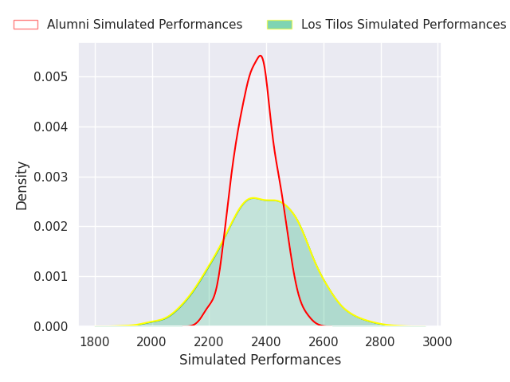

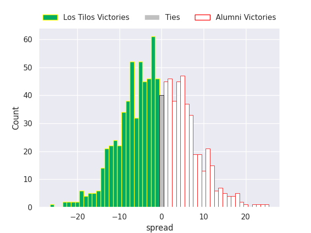

#### Buenos Aires V Belgrano AC on 2026/10/10

Average Margin: Buenos Aires by 6.5

#### Regatas Bella Vista V Hindu on 2026/10/10

Average Margin: Hindu by 5.8

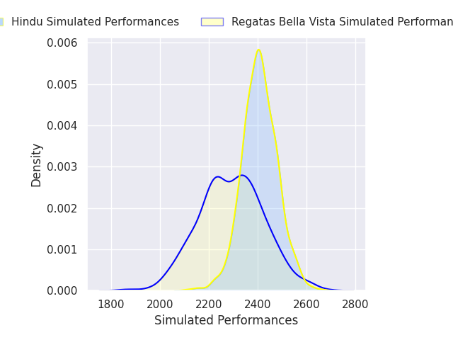
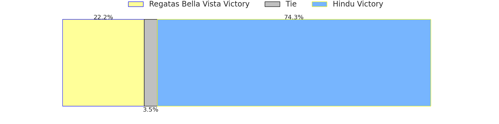
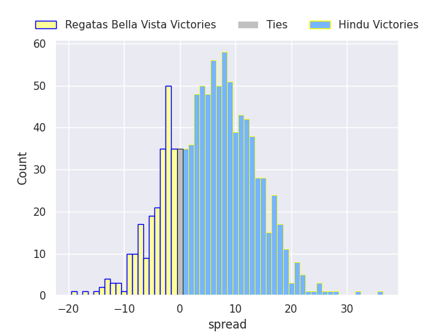

#### CUBA V SIC on 2026/10/10

Average Margin: SIC by 10.2

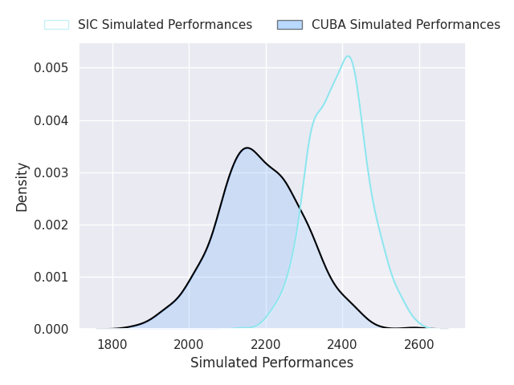
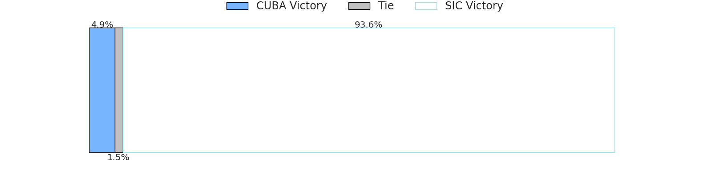
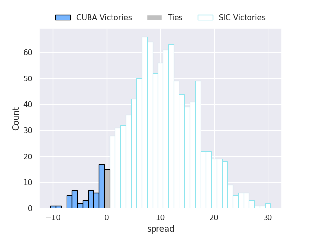

#### Los Matreros V La Plata on 2026/10/10

Average Margin: La Plata by 8.6

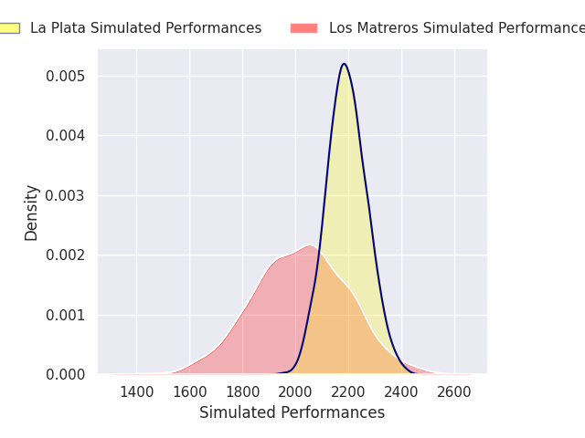
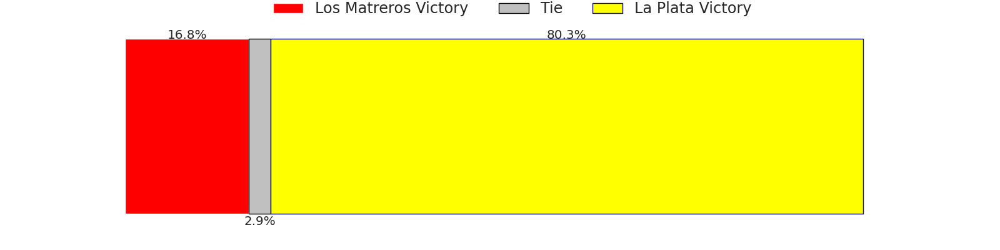
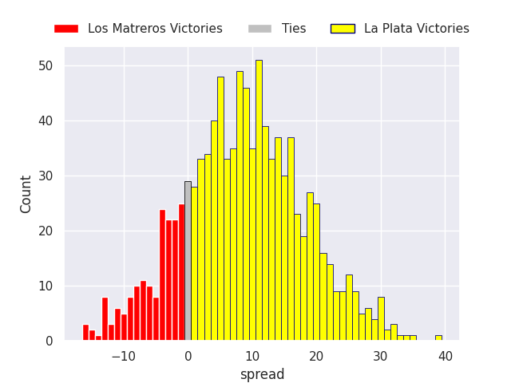

#### CASI V Newman on 2026/10/10

Average Margin: Newman by 3.4

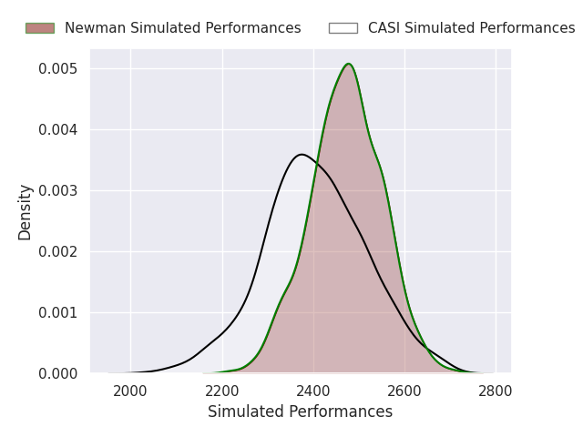

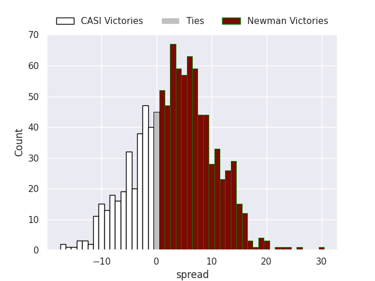

#### Atlético del Rosario V Champagnat on 2026/10/10

Average Margin: Atlético del Rosario by 5.6

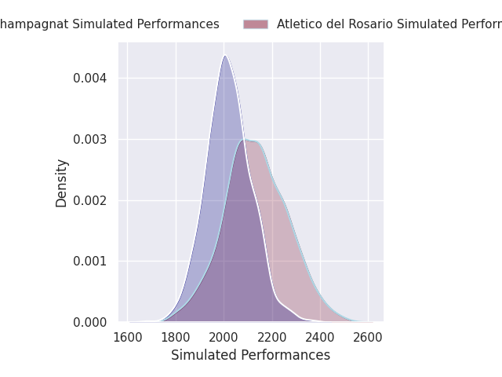

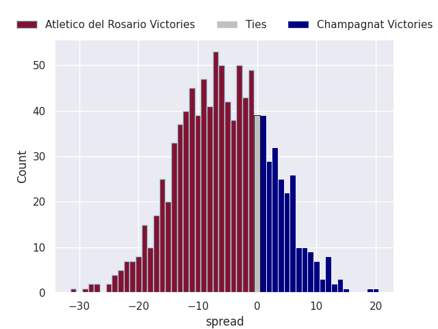

### Week 30
#### Alumni V CASI on 2026/10/17

Average Margin: Alumni by 5.4

#### SIC V Buenos Aires on 2026/10/17

Average Margin: SIC by 8.7

#### Newman V CUBA on 2026/10/17

Average Margin: Newman by 21.9

#### Champagnat V Los Tilos on 2026/10/17

Average Margin: Los Tilos by 10.1

#### Belgrano AC V Los Matreros on 2026/10/17

Average Margin: Belgrano AC by 17.4

#### La Plata V Regatas Bella Vista on 2026/10/17

Average Margin: La Plata by 1.7

#### Hindu V Atlético del Rosario on 2026/10/17

Average Margin: Hindu by 21.3

