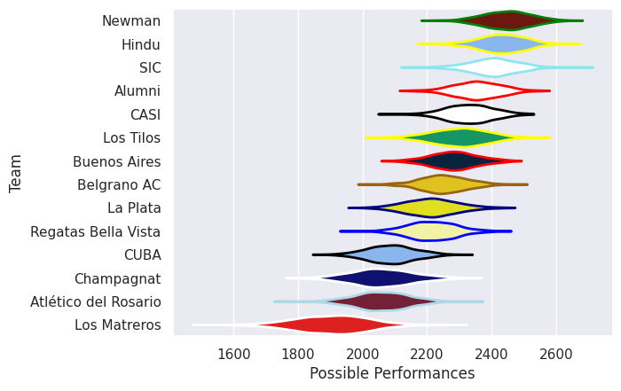

## Team Rankings

## Standings
### Current Standings

| Club                 |   Played |   Wins |   Point Differential |   Losing Bonus Points |   Try Bonus Points |   Competition Points |
|:---------------------|---------:|-------:|---------------------:|----------------------:|-------------------:|---------------------:|
| Newman               |       21 |     18 |                  243 |                     0 |                 14 |                   88 |
| CASI                 |       27 |     17 |                  167 |                     5 |                 13 |                   86 |
| Alumni               |       27 |     15 |                  165 |                     6 |                 16 |                   82 |
| Hindu                |       24 |     19 |                  256 |                     2 |                  1 |                   79 |
| SIC                  |       23 |     16 |                  247 |                     4 |                 11 |                   79 |
| Belgrano AC          |       27 |     11 |                  -37 |                     7 |                 15 |                   66 |
| CUBA                 |       25 |      8 |                   15 |                     9 |                 13 |                   56 |
| Los Tilos            |       18 |     10 |                  -15 |                     2 |                  9 |                   51 |
| Buenos Aires         |       23 |     11 |                  -55 |                     5 |                  2 |                   51 |
| Atlético del Rosario |       27 |     10 |                 -155 |                     7 |                  2 |                   49 |
| Los Matreros         |       24 |      8 |                 -258 |                     2 |                 10 |                   44 |
| La Plata             |       23 |      9 |                 -158 |                     4 |                  1 |                   41 |
| Regatas Bella Vista  |       19 |      7 |                 -117 |                     3 |                  6 |                   37 |
| Champagnat           |       20 |      4 |                 -298 |                     2 |                  5 |                   23 |

### Projected Remaining Table

| Club                 |   To Play |   Projected Wins |   Projected Differential |   Projected Losing Bonus Points |   Projected Try Bonus Points |   Projected Competition Points |
|:---------------------|----------:|-----------------:|-------------------------:|--------------------------------:|-----------------------------:|-------------------------------:|
| SIC                  |         3 |            2.597 |                   32.961 |                           0.258 |                            3 |                         13.798 |
| CASI                 |         3 |            2.245 |                   26.127 |                           0.374 |                            3 |                         12.5   |
| Los Tilos            |         3 |            1.861 |                   10.386 |                           0.632 |                            3 |                         11.322 |
| Newman               |         3 |            2.051 |                   23.19  |                           0.496 |                            1 |                          9.876 |
| Hindu                |         3 |            2.174 |                   21.587 |                           0.468 |                              |                          9.356 |
| Alumni               |         3 |            1.505 |                    1.702 |                           0.733 |                            2 |                          8.961 |
| CUBA                 |         3 |            1.202 |                   -4.747 |                           0.719 |                            3 |                          8.759 |
| Belgrano AC          |         3 |            1.305 |                   -2.734 |                           0.742 |                            1 |                          7.16  |
| Los Matreros         |         3 |            0.999 |                  -20.405 |                           0.503 |                            2 |                          6.611 |
| Champagnat           |         3 |            1.203 |                   -7.957 |                           0.521 |                            1 |                          6.471 |
| Regatas Bella Vista  |         3 |            1.043 |                  -11.883 |                           0.671 |                              |                          5.039 |
| Atlético del Rosario |         3 |            1.027 |                  -12.174 |                           0.679 |                              |                          4.967 |
| Buenos Aires         |         3 |            0.746 |                  -20.64  |                           0.704 |                              |                          3.86  |
| La Plata             |         3 |            0.422 |                  -35.413 |                           0.555 |                              |                          2.375 |

### Projected Total Table

| Club                 |   Played |   Wins |   Point Differential |   Losing Bonus Points |   Try Bonus Points |   Competition Points |
|:---------------------|---------:|-------:|---------------------:|----------------------:|-------------------:|---------------------:|
| CASI                 |       30 | 19.245 |              193.127 |                 5.374 |                 16 |               98.5   |
| Newman               |       24 | 20.051 |              266.19  |                 0.496 |                 15 |               97.876 |
| SIC                  |       26 | 18.597 |              279.961 |                 4.258 |                 14 |               92.798 |
| Alumni               |       30 | 16.505 |              166.702 |                 6.733 |                 18 |               90.961 |
| Hindu                |       27 | 21.174 |              277.587 |                 2.468 |                  1 |               88.356 |
| Belgrano AC          |       30 | 12.305 |              -39.734 |                 7.742 |                 16 |               73.16  |
| CUBA                 |       28 |  9.202 |               10.253 |                 9.719 |                 16 |               64.759 |
| Los Tilos            |       21 | 11.861 |               -4.614 |                 2.632 |                 12 |               62.322 |
| Buenos Aires         |       26 | 11.746 |              -75.64  |                 5.704 |                  2 |               54.86  |
| Atlético del Rosario |       30 | 11.027 |             -167.174 |                 7.679 |                  2 |               53.967 |
| Los Matreros         |       27 |  8.999 |             -278.405 |                 2.503 |                 12 |               50.611 |
| La Plata             |       26 |  9.422 |             -193.413 |                 4.555 |                  1 |               43.375 |
| Regatas Bella Vista  |       22 |  8.043 |             -128.883 |                 3.671 |                  6 |               42.039 |
| Champagnat           |       23 |  5.203 |             -305.957 |                 2.521 |                  6 |               29.471 |

## Completed Match Review

| Model | Percent Correct Predictions | Spread Error |
| ------ | ------ | ------ |
| Club Level | 68.1% | 12.3 |
| Player Level: Lineup | nan% | nan |
| Player Level: Minutes | nan% | nan |

## Future Predictions
### Week 28
#### Hindu V Newman on 2026/05/09

Average Margin: Hindu by 2.5

#### Atlético del Rosario V Buenos Aires on 2026/05/09

Average Margin: Atlético del Rosario by 5.2

#### La Plata V SIC on 2026/05/09

Average Margin: SIC by 11.5

#### Champagnat V Alumni on 2026/05/09

Average Margin: Alumni by 0.7

#### Los Tilos V CUBA on 2026/05/09

Average Margin: Los Tilos by 4.6

#### Los Matreros V CASI on 2026/05/09

Average Margin: CASI by 8.8

#### Regatas Bella Vista V Belgrano AC on 2026/05/09

Average Margin: Regatas Bella Vista by 5.1

### Week 29
#### Newman V La Plata on 2026/05/16

Average Margin: Newman by 20.0

#### SIC V Regatas Bella Vista on 2026/05/16

Average Margin: SIC by 11.3

#### CUBA V CASI on 2026/05/16

Average Margin: CASI by 2.9

#### Champagnat V Los Matreros on 2026/05/16

Average Margin: Champagnat by 8.9

#### Belgrano AC V Atlético del Rosario on 2026/05/16

Average Margin: Belgrano AC by 7.2

#### Alumni V Hindu on 2026/05/16

Average Margin: Hindu by 2.9

#### Buenos Aires V Los Tilos on 2026/05/16

Average Margin: Los Tilos by 1.0

### Week 30
#### La Plata V Alumni on 2026/05/23

Average Margin: Alumni by 3.9

#### Regatas Bella Vista V Newman on 2026/05/23

Average Margin: Newman by 5.7

#### CASI V Buenos Aires on 2026/05/23

Average Margin: CASI by 14.5

#### Los Matreros V CUBA on 2026/05/23

Average Margin: CUBA by 2.7

#### Hindu V Champagnat on 2026/05/23

Average Margin: Hindu by 16.2

#### Atlético del Rosario V SIC on 2026/05/23

Average Margin: SIC by 10.2

#### Los Tilos V Belgrano AC on 2026/05/23

Average Margin: Los Tilos by 4.8

