## Team Rankings

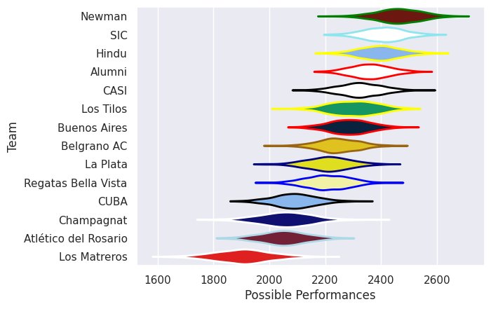
## Standings
### Current Standings

| Club                 |   Played |   Wins |   Point Differential |   Losing Bonus Points |   Try Bonus Points |   Competition Points |
|:---------------------|---------:|-------:|---------------------:|----------------------:|-------------------:|---------------------:|
| Alumni               |       25 |     15 |                  178 |                     5 |                 16 |                   81 |
| CASI                 |       25 |     16 |                  163 |                     4 |                 13 |                   81 |
| Newman               |       18 |     16 |                  237 |                     0 |                 14 |                   78 |
| SIC                  |       22 |     15 |                  224 |                     4 |                 10 |                   74 |
| Hindu                |       21 |     17 |                  218 |                     1 |                  1 |                   70 |
| Belgrano AC          |       26 |     10 |                  -46 |                     7 |                 14 |                   61 |
| CUBA                 |       24 |      8 |                   15 |                     9 |                 13 |                   54 |
| Buenos Aires         |       22 |     11 |                  -32 |                     5 |                  2 |                   51 |
| Atlético del Rosario |       26 |     10 |                 -120 |                     7 |                  2 |                   49 |
| Los Tilos            |       17 |      9 |                  -50 |                     2 |                  8 |                   46 |
| Los Matreros         |       23 |      8 |                 -249 |                     2 |                  9 |                   43 |
| Regatas Bella Vista  |       18 |      7 |                  -84 |                     3 |                  6 |                   37 |
| La Plata             |       22 |      8 |                 -191 |                     4 |                  1 |                   37 |
| Champagnat           |       19 |      4 |                 -263 |                     2 |                  4 |                   22 |

### Projected Remaining Table

| Club                 |   To Play |   Projected Wins |   Projected Differential |   Projected Losing Bonus Points |   Projected Try Bonus Points |   Projected Competition Points |
|:---------------------|----------:|-----------------:|-------------------------:|--------------------------------:|-----------------------------:|-------------------------------:|
| SIC                  |         4 |            3.543 |                   44.819 |                           0.308 |                            3 |                         17.644 |
| Los Tilos            |         4 |            2.626 |                   19.117 |                           0.794 |                            3 |                         14.592 |
| Newman               |         4 |            3.097 |                   45.478 |                           0.473 |                            1 |                         13.993 |
| CASI                 |         4 |            2.347 |                   18.74  |                           0.772 |                            3 |                         13.38  |
| Hindu                |         4 |            3.171 |                   42.567 |                           0.492 |                              |                         13.356 |
| Alumni               |         4 |            2.317 |                    8.545 |                           0.825 |                            2 |                         12.419 |
| Belgrano AC          |         4 |            2.294 |                   12.817 |                           0.753 |                            1 |                         11.163 |
| CUBA                 |         4 |            1.19  |                  -27.146 |                           0.79  |                            3 |                          8.732 |
| Champagnat           |         4 |            1.356 |                  -17.426 |                           0.732 |                            1 |                          7.348 |
| Regatas Bella Vista  |         4 |            1.444 |                  -13.257 |                           1.024 |                              |                          7.104 |
| Los Matreros         |         4 |            1.029 |                  -34.999 |                           0.631 |                            2 |                          6.887 |
| Atlético del Rosario |         4 |            1.01  |                  -33.639 |                           0.722 |                              |                          4.94  |
| La Plata             |         4 |            0.928 |                  -35.555 |                           0.84  |                              |                          4.798 |
| Buenos Aires         |         4 |            0.895 |                  -30.061 |                           0.966 |                              |                          4.766 |

### Projected Total Table

| Club                 |   Played |   Wins |   Point Differential |   Losing Bonus Points |   Try Bonus Points |   Competition Points |
|:---------------------|---------:|-------:|---------------------:|----------------------:|-------------------:|---------------------:|
| CASI                 |       29 | 18.347 |              181.74  |                 4.772 |                 16 |               94.38  |
| Alumni               |       29 | 17.317 |              186.545 |                 5.825 |                 18 |               93.419 |
| Newman               |       22 | 19.097 |              282.478 |                 0.473 |                 15 |               91.993 |
| SIC                  |       26 | 18.543 |              268.819 |                 4.308 |                 13 |               91.644 |
| Hindu                |       25 | 20.171 |              260.567 |                 1.492 |                  1 |               83.356 |
| Belgrano AC          |       30 | 12.294 |              -33.183 |                 7.753 |                 15 |               72.163 |
| CUBA                 |       28 |  9.19  |              -12.146 |                 9.79  |                 16 |               62.732 |
| Los Tilos            |       21 | 11.626 |              -30.883 |                 2.794 |                 11 |               60.592 |
| Buenos Aires         |       26 | 11.895 |              -62.061 |                 5.966 |                  2 |               55.766 |
| Atlético del Rosario |       30 | 11.01  |             -153.639 |                 7.722 |                  2 |               53.94  |
| Los Matreros         |       27 |  9.029 |             -283.999 |                 2.631 |                 11 |               49.887 |
| Regatas Bella Vista  |       22 |  8.444 |              -97.257 |                 4.024 |                  6 |               44.104 |
| La Plata             |       26 |  8.928 |             -226.555 |                 4.84  |                  1 |               41.798 |
| Champagnat           |       23 |  5.356 |             -280.426 |                 2.732 |                  5 |               29.348 |

## Completed Match Review

| Model | Percent Correct Predictions | Spread Error |
| ------ | ------ | ------ |
| Club Level | 65.9% | 12.0 |
| Player Level: Lineup | nan% | nan |
| Player Level: Minutes | nan% | nan |

## Future Predictions
### Week 27
#### Atlético del Rosario V Buenos Aires on 2026/05/09

Average Margin: Atlético del Rosario by 5.1

#### Hindu V Newman on 2026/05/09

Average Margin: Hindu by 2.6

#### Los Matreros V CASI on 2026/05/09

Average Margin: CASI by 8.3

#### Regatas Bella Vista V Belgrano AC on 2026/05/09

Average Margin: Regatas Bella Vista by 5.4

#### Los Tilos V CUBA on 2026/05/09

Average Margin: Los Tilos by 4.5

#### La Plata V SIC on 2026/05/09

Average Margin: SIC by 11.9

#### Champagnat V Alumni on 2026/05/09

Average Margin: Alumni by 1.1

### Week 28
#### Buenos Aires V Los Tilos on 2026/05/16

Average Margin: Los Tilos by 0.3

#### CUBA V CASI on 2026/05/16

Average Margin: CASI by 2.6

#### Alumni V Hindu on 2026/05/16

Average Margin: Hindu by 3.3

#### Champagnat V Los Matreros on 2026/05/16

Average Margin: Champagnat by 9.0

#### Newman V La Plata on 2026/05/16

Average Margin: Newman by 20.1

#### Belgrano AC V Atlético del Rosario on 2026/05/16

Average Margin: Belgrano AC by 7.0

#### SIC V Regatas Bella Vista on 2026/05/16

Average Margin: SIC by 11.8

### Week 29
#### La Plata V Alumni on 2026/05/23

Average Margin: Alumni by 4.3

#### CASI V Buenos Aires on 2026/05/23

Average Margin: CASI by 14.3

#### Los Matreros V CUBA on 2026/05/23

Average Margin: CUBA by 1.9

#### Atlético del Rosario V SIC on 2026/05/23

Average Margin: SIC by 10.7

#### Hindu V Champagnat on 2026/05/23

Average Margin: Hindu by 15.7

#### Regatas Bella Vista V Newman on 2026/05/23

Average Margin: Newman by 6.0

#### Los Tilos V Belgrano AC on 2026/05/23

Average Margin: Los Tilos by 4.6

### Week 30
#### SIC V Buenos Aires on 2026/10/17

Average Margin: SIC by 10.4

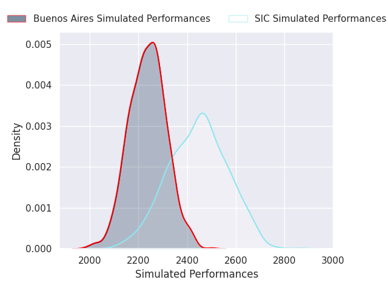
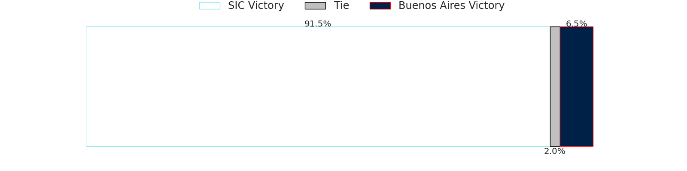
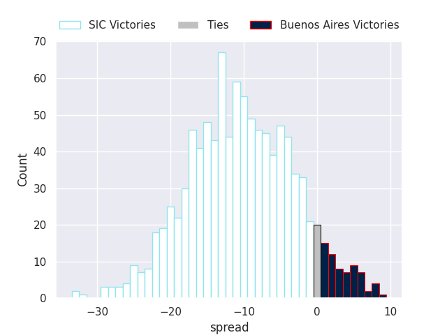

#### Hindu V Atlético del Rosario on 2026/10/17

Average Margin: Hindu by 21.0

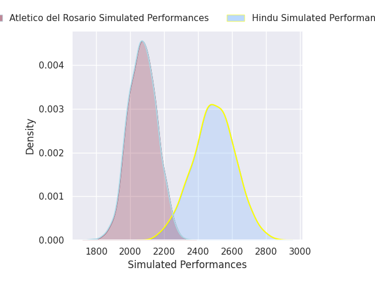
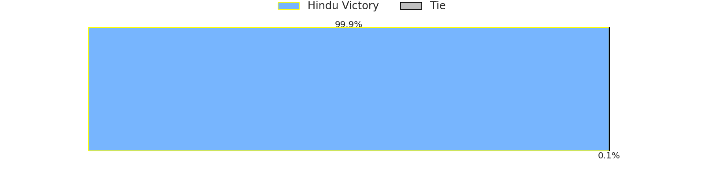
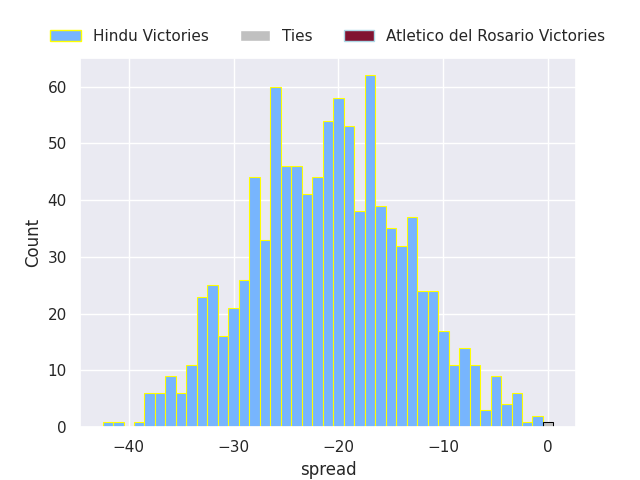

#### La Plata V Regatas Bella Vista on 2026/10/17

Average Margin: La Plata by 0.8

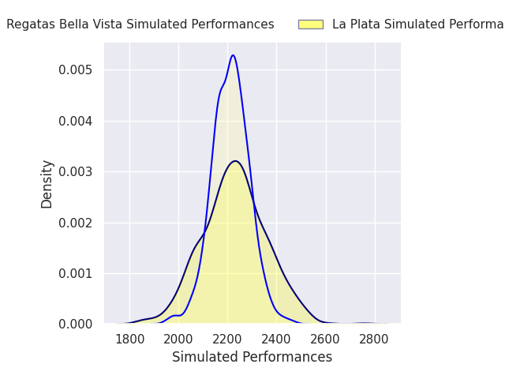

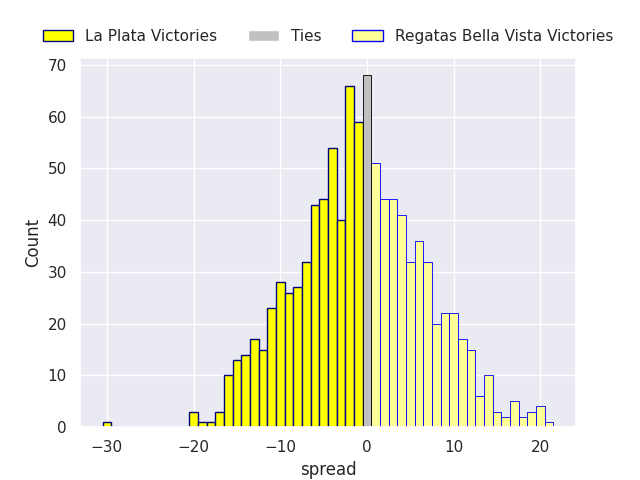

#### Alumni V CASI on 2026/10/17

Average Margin: Alumni by 6.5

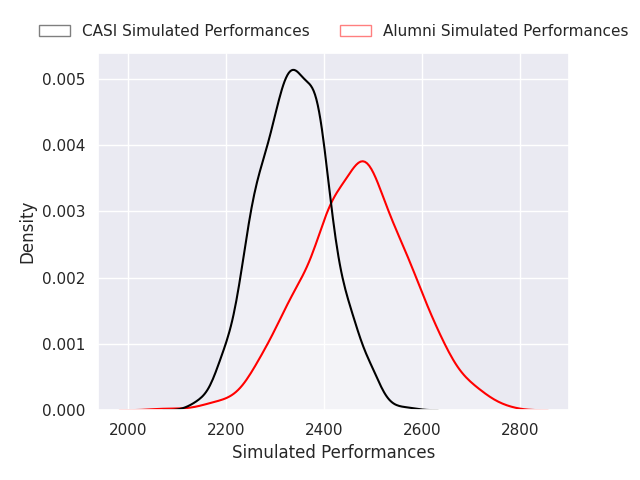
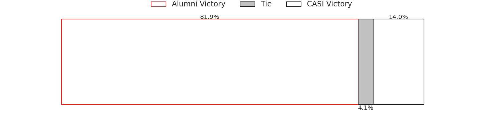
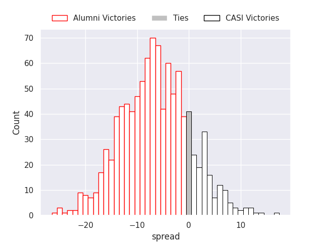

#### Belgrano AC V Los Matreros on 2026/10/17

Average Margin: Belgrano AC by 15.8

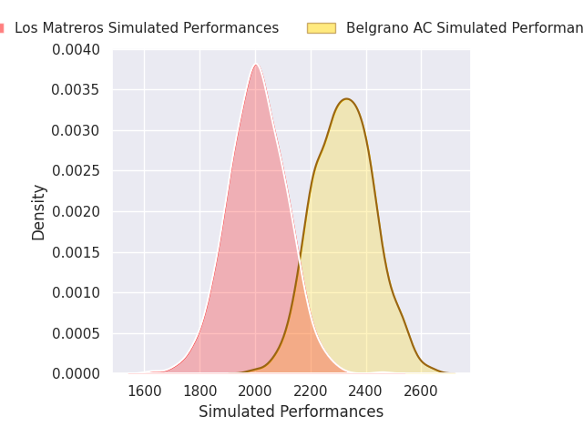
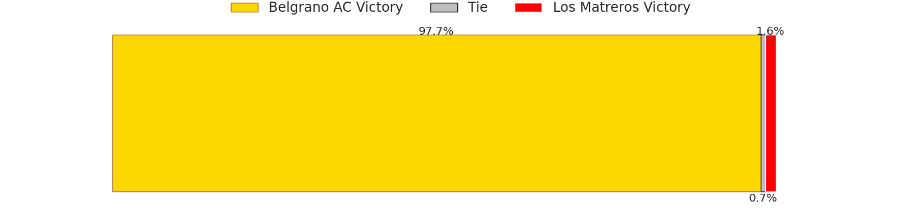
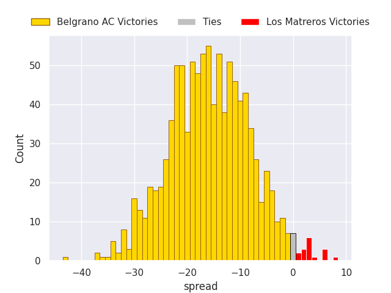

#### Newman V CUBA on 2026/10/17

Average Margin: Newman by 22.0

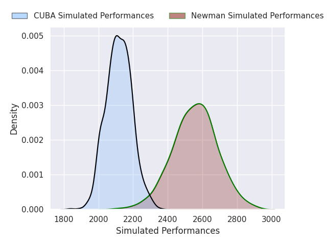

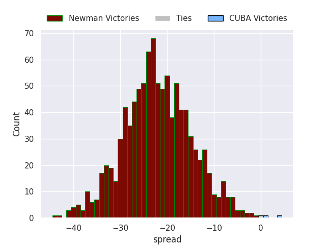

#### Champagnat V Los Tilos on 2026/10/17

Average Margin: Los Tilos by 9.7

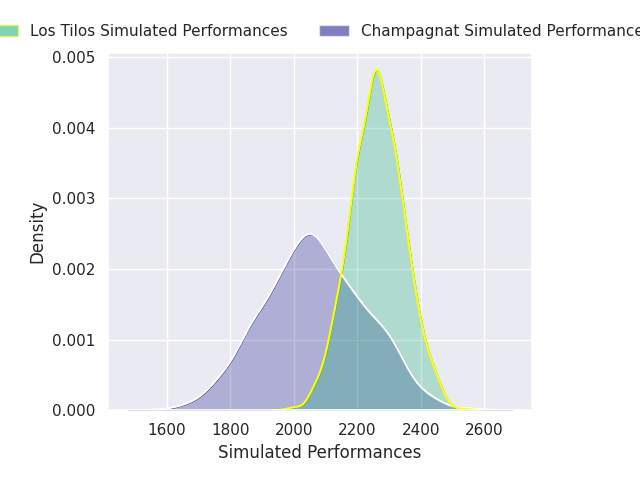
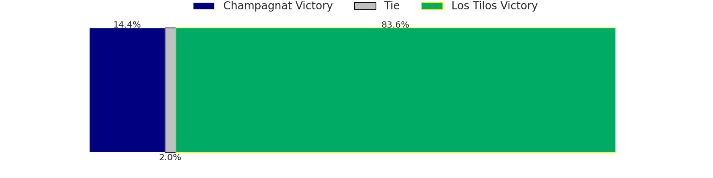
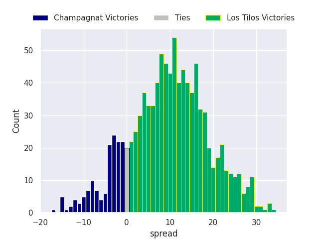

