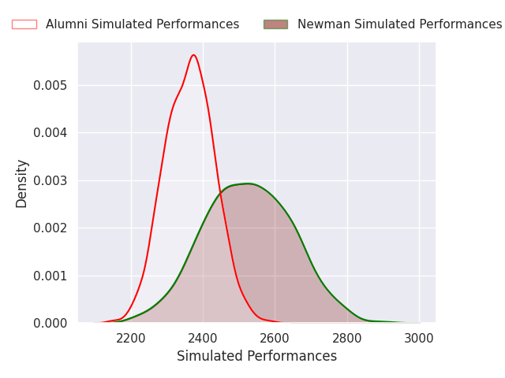
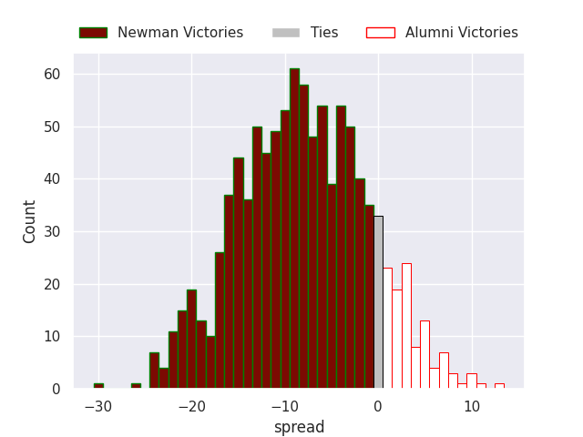
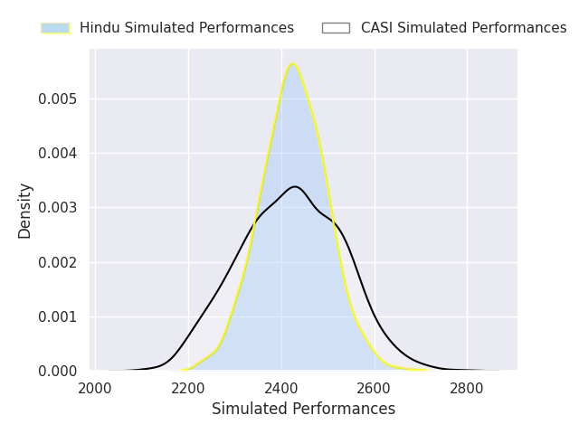
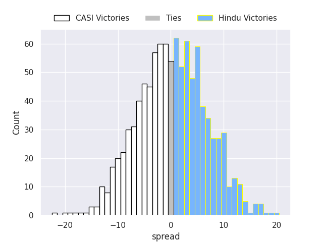

## Team Rankings

## Standings
### Current Standings

| Club                 |   Played |   Wins |   Point Differential |   Losing Bonus Points |   Try Bonus Points |   Competition Points |
|:---------------------|---------:|-------:|---------------------:|----------------------:|-------------------:|---------------------:|
| CASI                 |       26 |     17 |                  171 |                     4 |                 13 |                   85 |
| Alumni               |       26 |     15 |                  170 |                     5 |                 16 |                   81 |
| Newman               |       19 |     16 |                  237 |                     0 |                 14 |                   80 |
| SIC                  |       23 |     16 |                  247 |                     4 |                 11 |                   79 |
| Hindu                |       22 |     18 |                  253 |                     1 |                  1 |                   74 |
| Belgrano AC          |       27 |     11 |                  -37 |                     7 |                 15 |                   66 |
| CUBA                 |       25 |      8 |                   15 |                     9 |                 13 |                   56 |
| Los Tilos            |       18 |     10 |                  -15 |                     2 |                  9 |                   51 |
| Buenos Aires         |       23 |     11 |                  -55 |                     5 |                  2 |                   51 |
| Atlético del Rosario |       27 |     10 |                 -155 |                     7 |                  2 |                   49 |
| Los Matreros         |       24 |      8 |                 -258 |                     2 |                 10 |                   44 |
| La Plata             |       23 |      9 |                 -158 |                     4 |                  1 |                   41 |
| Regatas Bella Vista  |       19 |      7 |                 -117 |                     3 |                  6 |                   37 |
| Champagnat           |       20 |      4 |                 -298 |                     2 |                  5 |                   23 |

### Projected Remaining Table

| Club                 |   To Play |   Projected Wins |   Projected Differential |   Projected Losing Bonus Points |   Projected Try Bonus Points |   Projected Competition Points |
|:---------------------|----------:|-----------------:|-------------------------:|--------------------------------:|-----------------------------:|-------------------------------:|
| CASI                 |         4 |            2.728 |                   27.708 |                           0.717 |                            3 |                         14.905 |
| SIC                  |         3 |            2.589 |                   32.511 |                           0.261 |                            3 |                         13.747 |
| Newman               |         4 |            2.95  |                   32.375 |                           0.582 |                            1 |                         13.64  |
| Hindu                |         4 |            2.629 |                   21.758 |                           0.841 |                              |                         11.711 |
| Los Tilos            |         3 |            1.826 |                    9.38  |                           0.674 |                            3 |                         11.258 |
| Alumni               |         4 |            1.595 |                   -6.099 |                           1.077 |                            2 |                          9.753 |
| CUBA                 |         3 |            1.154 |                   -5.073 |                           0.749 |                            3 |                          8.605 |
| Belgrano AC          |         3 |            1.337 |                   -1.415 |                           0.728 |                            1 |                          7.3   |
| Champagnat           |         3 |            1.261 |                   -7.788 |                           0.454 |                            1 |                          6.632 |
| Los Matreros         |         3 |            0.969 |                  -21.624 |                           0.468 |                            2 |                          6.484 |
| Atlético del Rosario |         3 |            1.048 |                  -12.51  |                           0.647 |                              |                          5.025 |
| Regatas Bella Vista  |         3 |            1     |                  -13.016 |                           0.681 |                              |                          4.869 |
| Buenos Aires         |         3 |            0.757 |                  -20.035 |                           0.754 |                              |                          3.99  |
| La Plata             |         3 |            0.399 |                  -36.172 |                           0.615 |                              |                          2.329 |

### Projected Total Table

| Club                 |   Played |   Wins |   Point Differential |   Losing Bonus Points |   Try Bonus Points |   Competition Points |
|:---------------------|---------:|-------:|---------------------:|----------------------:|-------------------:|---------------------:|
| CASI                 |       30 | 19.728 |              198.708 |                 4.717 |                 16 |               99.905 |
| Newman               |       23 | 18.95  |              269.375 |                 0.582 |                 15 |               93.64  |
| SIC                  |       26 | 18.589 |              279.511 |                 4.261 |                 14 |               92.747 |
| Alumni               |       30 | 16.595 |              163.901 |                 6.077 |                 18 |               90.753 |
| Hindu                |       26 | 20.629 |              274.758 |                 1.841 |                  1 |               85.711 |
| Belgrano AC          |       30 | 12.337 |              -38.415 |                 7.728 |                 16 |               73.3   |
| CUBA                 |       28 |  9.154 |                9.927 |                 9.749 |                 16 |               64.605 |
| Los Tilos            |       21 | 11.826 |               -5.62  |                 2.674 |                 12 |               62.258 |
| Buenos Aires         |       26 | 11.757 |              -75.035 |                 5.754 |                  2 |               54.99  |
| Atlético del Rosario |       30 | 11.048 |             -167.51  |                 7.647 |                  2 |               54.025 |
| Los Matreros         |       27 |  8.969 |             -279.624 |                 2.468 |                 12 |               50.484 |
| La Plata             |       26 |  9.399 |             -194.172 |                 4.615 |                  1 |               43.329 |
| Regatas Bella Vista  |       22 |  8     |             -130.016 |                 3.681 |                  6 |               41.869 |
| Champagnat           |       23 |  5.261 |             -305.788 |                 2.454 |                  6 |               29.632 |

## Completed Match Review

| Model | Percent Correct Predictions | Spread Error |
| ------ | ------ | ------ |
| Club Level | 67.4% | 12.3 |
| Player Level: Lineup | nan% | nan |
| Player Level: Minutes | nan% | nan |

## Future Predictions
### Week 28
#### Atlético del Rosario V Buenos Aires on 2026/05/09

Average Margin: Atlético del Rosario by 4.7

#### La Plata V SIC on 2026/05/09

Average Margin: SIC by 11.5

#### Hindu V Newman on 2026/05/09

Average Margin: Hindu by 2.4

#### Los Matreros V CASI on 2026/05/09

Average Margin: CASI by 9.9

#### Champagnat V Alumni on 2026/05/09

Average Margin: Alumni by 0.7

#### Los Tilos V CUBA on 2026/05/09

Average Margin: Los Tilos by 4.7

#### Regatas Bella Vista V Belgrano AC on 2026/05/09

Average Margin: Regatas Bella Vista by 4.7

### Week 29
#### Buenos Aires V Los Tilos on 2026/05/16

Average Margin: Los Tilos by 0.5

#### SIC V Regatas Bella Vista on 2026/05/16

Average Margin: SIC by 11.3

#### Newman V La Plata on 2026/05/16

Average Margin: Newman by 20.2

#### Belgrano AC V Atlético del Rosario on 2026/05/16

Average Margin: Belgrano AC by 7.5

#### Alumni V Hindu on 2026/05/16

Average Margin: Hindu by 3.2

#### Champagnat V Los Matreros on 2026/05/16

Average Margin: Champagnat by 8.9

#### CUBA V CASI on 2026/05/16

Average Margin: CASI by 3.2

### Week 30
#### Regatas Bella Vista V Newman on 2026/05/23

Average Margin: Newman by 6.5

#### CASI V Buenos Aires on 2026/05/23

Average Margin: CASI by 14.8

#### La Plata V Alumni on 2026/05/23

Average Margin: Alumni by 4.4

#### Los Matreros V CUBA on 2026/05/23

Average Margin: CUBA by 2.8

#### Los Tilos V Belgrano AC on 2026/05/23

Average Margin: Los Tilos by 4.2

#### Hindu V Champagnat on 2026/05/23

Average Margin: Hindu by 15.9

#### Atlético del Rosario V SIC on 2026/05/23

Average Margin: SIC by 9.7

### Week 31
#### Newman V Alumni on 2026/10/30

Average Margin: Newman by 8.1

#### CASI V Hindu on 2026/10/31

Average Margin: Hindu by 0.3

