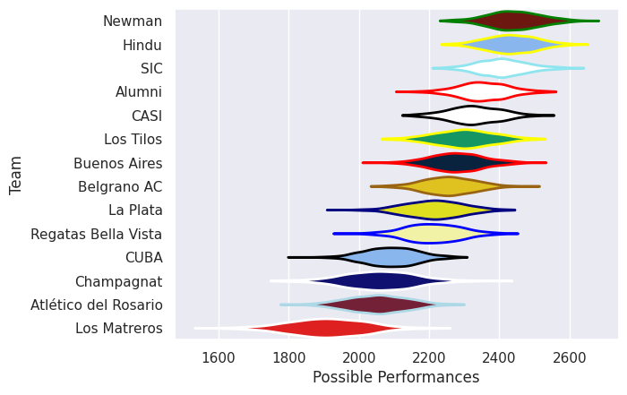
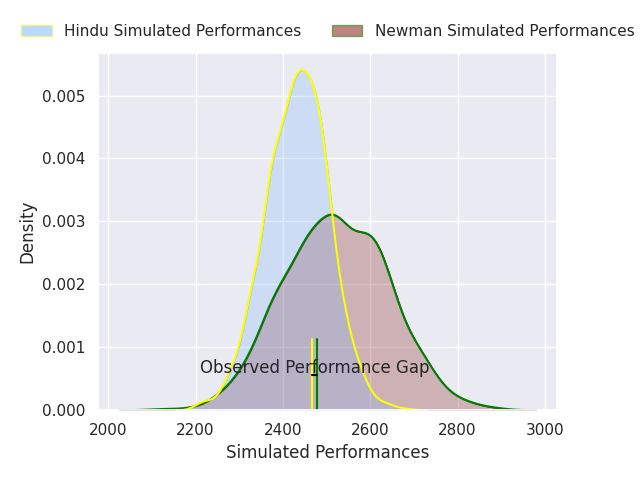
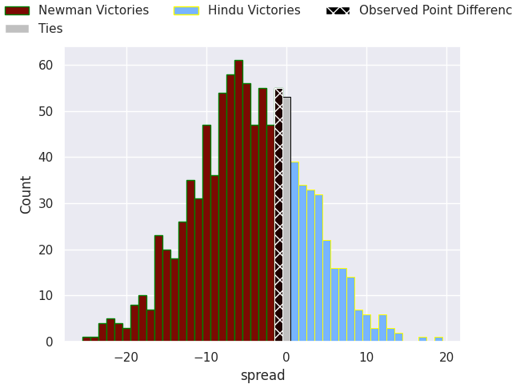

## Team Rankings

## Standings
### Current Standings

| Club                 |   Played |   Wins |   Point Differential |   Losing Bonus Points |   Try Bonus Points |   Competition Points |
|:---------------------|---------:|-------:|---------------------:|----------------------:|-------------------:|---------------------:|
| CASI                 |       27 |     17 |                  167 |                     5 |                 13 |                   86 |
| Newman               |       20 |     17 |                  242 |                     0 |                 14 |                   84 |
| Alumni               |       27 |     15 |                  165 |                     6 |                 16 |                   82 |
| SIC                  |       23 |     16 |                  247 |                     4 |                 11 |                   79 |
| Hindu                |       23 |     19 |                  257 |                     1 |                  1 |                   78 |
| Belgrano AC          |       27 |     11 |                  -37 |                     7 |                 15 |                   66 |
| CUBA                 |       25 |      8 |                   15 |                     9 |                 13 |                   56 |
| Los Tilos            |       18 |     10 |                  -15 |                     2 |                  9 |                   51 |
| Buenos Aires         |       23 |     11 |                  -55 |                     5 |                  2 |                   51 |
| Atlético del Rosario |       27 |     10 |                 -155 |                     7 |                  2 |                   49 |
| Los Matreros         |       24 |      8 |                 -258 |                     2 |                 10 |                   44 |
| La Plata             |       23 |      9 |                 -158 |                     4 |                  1 |                   41 |
| Regatas Bella Vista  |       19 |      7 |                 -117 |                     3 |                  6 |                   37 |
| Champagnat           |       20 |      4 |                 -298 |                     2 |                  5 |                   23 |

### Projected Remaining Table

| Club                 |   To Play |   Projected Wins |   Projected Differential |   Projected Losing Bonus Points |   Projected Try Bonus Points |   Projected Competition Points |
|:---------------------|----------:|-----------------:|-------------------------:|--------------------------------:|-----------------------------:|-------------------------------:|
| SIC                  |         3 |            2.631 |                   33.555 |                           0.25  |                            3 |                         13.89  |
| Newman               |         4 |            2.794 |                   27.868 |                           0.701 |                            1 |                         13.133 |
| CASI                 |         3 |            2.254 |                   27.607 |                           0.402 |                            3 |                         12.57  |
| Los Tilos            |         3 |            1.827 |                    8.986 |                           0.653 |                            3 |                         11.169 |
| Hindu                |         4 |            2.395 |                   16.585 |                           0.911 |                              |                         10.779 |
| Alumni               |         3 |            1.487 |                    1.687 |                           0.752 |                            2 |                          8.924 |
| CUBA                 |         3 |            1.18  |                   -6.094 |                           0.764 |                            3 |                          8.672 |
| Belgrano AC          |         3 |            1.331 |                   -2.102 |                           0.743 |                            1 |                          7.295 |
| Champagnat           |         3 |            1.25  |                   -6.568 |                           0.503 |                            1 |                          6.631 |
| Los Matreros         |         3 |            0.968 |                  -20.904 |                           0.477 |                            2 |                          6.489 |
| Regatas Bella Vista  |         3 |            1.029 |                  -11.697 |                           0.698 |                              |                          5.014 |
| Atlético del Rosario |         3 |            0.996 |                  -12.335 |                           0.704 |                              |                          4.888 |
| Buenos Aires         |         3 |            0.793 |                  -20.18  |                           0.691 |                              |                          4.031 |
| La Plata             |         3 |            0.416 |                  -36.408 |                           0.549 |                              |                          2.313 |

### Projected Total Table

| Club                 |   Played |   Wins |   Point Differential |   Losing Bonus Points |   Try Bonus Points |   Competition Points |
|:---------------------|---------:|-------:|---------------------:|----------------------:|-------------------:|---------------------:|
| CASI                 |       30 | 19.254 |              194.607 |                 5.402 |                 16 |               98.57  |
| Newman               |       24 | 19.794 |              269.868 |                 0.701 |                 15 |               97.133 |
| SIC                  |       26 | 18.631 |              280.555 |                 4.25  |                 14 |               92.89  |
| Alumni               |       30 | 16.487 |              166.687 |                 6.752 |                 18 |               90.924 |
| Hindu                |       27 | 21.395 |              273.585 |                 1.911 |                  1 |               88.779 |
| Belgrano AC          |       30 | 12.331 |              -39.102 |                 7.743 |                 16 |               73.295 |
| CUBA                 |       28 |  9.18  |                8.906 |                 9.764 |                 16 |               64.672 |
| Los Tilos            |       21 | 11.827 |               -6.014 |                 2.653 |                 12 |               62.169 |
| Buenos Aires         |       26 | 11.793 |              -75.18  |                 5.691 |                  2 |               55.031 |
| Atlético del Rosario |       30 | 10.996 |             -167.335 |                 7.704 |                  2 |               53.888 |
| Los Matreros         |       27 |  8.968 |             -278.904 |                 2.477 |                 12 |               50.489 |
| La Plata             |       26 |  9.416 |             -194.408 |                 4.549 |                  1 |               43.313 |
| Regatas Bella Vista  |       22 |  8.029 |             -128.697 |                 3.698 |                  6 |               42.014 |
| Champagnat           |       23 |  5.25  |             -304.568 |                 2.503 |                  6 |               29.631 |

## Completed Match Review

| Model | Percent Correct Predictions | Spread Error |
| ------ | ------ | ------ |
| Club Level | 68.6% | 12.3 |
| Player Level: Lineup | nan% | nan |
| Player Level: Minutes | nan% | nan |

## Future Predictions
### Week 28
#### Los Tilos V CUBA on 2026/05/09

Average Margin: Los Tilos by 4.5

#### Regatas Bella Vista V Belgrano AC on 2026/05/09

Average Margin: Regatas Bella Vista by 5.3

#### Atlético del Rosario V Buenos Aires on 2026/05/09

Average Margin: Atlético del Rosario by 5.0

#### Los Matreros V CASI on 2026/05/09

Average Margin: CASI by 10.0

#### La Plata V SIC on 2026/05/09

Average Margin: SIC by 12.1

#### Champagnat V Alumni on 2026/05/09

Average Margin: Alumni by 0.6

#### Hindu V Newman on 2026/05/09

Average Margin: Hindu by 2.2

### Week 29
#### SIC V Regatas Bella Vista on 2026/05/16

Average Margin: SIC by 11.3

#### CUBA V CASI on 2026/05/16

Average Margin: CASI by 3.0

#### Champagnat V Los Matreros on 2026/05/16

Average Margin: Champagnat by 9.5

#### Buenos Aires V Los Tilos on 2026/05/16

Average Margin: Los Tilos by 0.6

#### Alumni V Hindu on 2026/05/16

Average Margin: Hindu by 3.1

#### Newman V La Plata on 2026/05/16

Average Margin: Newman by 20.1

#### Belgrano AC V Atlético del Rosario on 2026/05/16

Average Margin: Belgrano AC by 7.2

### Week 30
#### La Plata V Alumni on 2026/05/23

Average Margin: Alumni by 4.2

#### CASI V Buenos Aires on 2026/05/23

Average Margin: CASI by 14.6

#### Los Tilos V Belgrano AC on 2026/05/23

Average Margin: Los Tilos by 3.9

#### Regatas Bella Vista V Newman on 2026/05/23

Average Margin: Newman by 5.7

#### Atlético del Rosario V SIC on 2026/05/23

Average Margin: SIC by 10.2

#### Hindu V Champagnat on 2026/05/23

Average Margin: Hindu by 15.5

#### Los Matreros V CUBA on 2026/05/23

Average Margin: CUBA by 1.4

### Week 31
#### Newman V Hindu on 2026/11/07

Average Margin: Newman by 4.2

