## Team Rankings

## Standings
### Current Standings

| Club                 |   Played |   Wins |   Point Differential |   Losing Bonus Points |   Try Bonus Points |   Competition Points |
|:---------------------|---------:|-------:|---------------------:|----------------------:|-------------------:|---------------------:|
| CASI                 |       23 |     15 |                  168 |                     4 |                 13 |                   77 |
| Alumni               |       23 |     13 |                  125 |                     5 |                 14 |                   71 |
| SIC                  |       20 |     14 |                  215 |                     3 |                  9 |                   68 |
| Newman               |       16 |     14 |                  209 |                     0 |                 12 |                   68 |
| Hindu                |       19 |     15 |                  137 |                     1 |                  1 |                   62 |
| Belgrano AC          |       24 |      9 |                  -58 |                     7 |                 13 |                   56 |
| CUBA                 |       22 |      7 |                   17 |                     9 |                 12 |                   49 |
| Buenos Aires         |       20 |     10 |                  -16 |                     5 |                  2 |                   47 |
| Los Tilos            |       15 |      9 |                  -13 |                     2 |                  8 |                   46 |
| Atlético del Rosario |       24 |      9 |                 -106 |                     7 |                  2 |                   45 |
| Los Matreros         |       21 |      7 |                 -257 |                     2 |                  9 |                   39 |
| La Plata             |       20 |      8 |                 -124 |                     4 |                  1 |                   37 |
| Regatas Bella Vista  |       16 |      6 |                  -87 |                     3 |                  5 |                   32 |
| Champagnat           |       17 |      4 |                 -210 |                     2 |                  3 |                   21 |

### Projected Remaining Table

| Club                 |   To Play |   Projected Wins |   Projected Differential |   Projected Losing Bonus Points |   Projected Try Bonus Points |   Projected Competition Points |
|:---------------------|----------:|-----------------:|-------------------------:|--------------------------------:|-----------------------------:|-------------------------------:|
| SIC                  |         6 |            5.257 |                   62.995 |                           0.473 |                            3 |                         24.779 |
| Newman               |         6 |            4.656 |                   62.253 |                           0.773 |                            1 |                         20.697 |
| Hindu                |         6 |            4.855 |                   60.125 |                           0.7   |                              |                         20.4   |
| Alumni               |         6 |            3.66  |                   24.327 |                           1.202 |                            2 |                         18.25  |
| Los Tilos            |         6 |            3.295 |                    8.343 |                           1.205 |                            3 |                         17.823 |
| Belgrano AC          |         6 |            3.459 |                   24.524 |                           1.146 |                            1 |                         16.306 |
| CASI                 |         6 |            2.832 |                    8.123 |                           1.395 |                            3 |                         16.145 |
| Buenos Aires         |         6 |            2.607 |                   -1.031 |                           1.184 |                              |                         11.93  |
| Champagnat           |         6 |            2.077 |                  -22.713 |                           1.345 |                            1 |                         10.957 |
| Regatas Bella Vista  |         6 |            2.143 |                  -18.676 |                           1.605 |                              |                         10.619 |
| CUBA                 |         6 |            1.261 |                  -51.904 |                           1.157 |                            3 |                          9.489 |
| La Plata             |         6 |            1.973 |                  -33.875 |                           1.065 |                              |                          9.249 |
| Atlético del Rosario |         6 |            1.651 |                  -48.697 |                           0.999 |                              |                          7.885 |
| Los Matreros         |         6 |            1.133 |                  -73.794 |                           0.827 |                            2 |                          7.547 |

### Projected Total Table

| Club                 |   Played |   Wins |   Point Differential |   Losing Bonus Points |   Try Bonus Points |   Competition Points |
|:---------------------|---------:|-------:|---------------------:|----------------------:|-------------------:|---------------------:|
| CASI                 |       29 | 17.832 |              176.123 |                 5.395 |                 16 |               93.145 |
| SIC                  |       26 | 19.257 |              277.995 |                 3.473 |                 12 |               92.779 |
| Alumni               |       29 | 16.66  |              149.327 |                 6.202 |                 16 |               89.25  |
| Newman               |       22 | 18.656 |              271.253 |                 0.773 |                 13 |               88.697 |
| Hindu                |       25 | 19.855 |              197.125 |                 1.7   |                  1 |               82.4   |
| Belgrano AC          |       30 | 12.459 |              -33.476 |                 8.146 |                 14 |               72.306 |
| Los Tilos            |       21 | 12.295 |               -4.657 |                 3.205 |                 11 |               63.823 |
| Buenos Aires         |       26 | 12.607 |              -17.031 |                 6.184 |                  2 |               58.93  |
| CUBA                 |       28 |  8.261 |              -34.904 |                10.157 |                 15 |               58.489 |
| Atlético del Rosario |       30 | 10.651 |             -154.697 |                 7.999 |                  2 |               52.885 |
| Los Matreros         |       27 |  8.133 |             -330.794 |                 2.827 |                 11 |               46.547 |
| La Plata             |       26 |  9.973 |             -157.875 |                 5.065 |                  1 |               46.249 |
| Regatas Bella Vista  |       22 |  8.143 |             -105.676 |                 4.605 |                  5 |               42.619 |
| Champagnat           |       23 |  6.077 |             -232.713 |                 3.345 |                  4 |               31.957 |

## Completed Match Review

| Model | Percent Correct Predictions | Spread Error |
| ------ | ------ | ------ |
| Club Level | 69.8% | 10.9 |
| Player Level: Lineup | nan% | nan |
| Player Level: Minutes | nan% | nan |

## Future Predictions
### Week 25
#### La Plata V SIC on 2026/05/09

Average Margin: SIC by 11.7

#### Hindu V Newman on 2026/05/09

Average Margin: Hindu by 2.2

#### Los Tilos V CUBA on 2026/05/09

Average Margin: Los Tilos by 4.3

#### Atlético del Rosario V Buenos Aires on 2026/05/09

Average Margin: Atlético del Rosario by 4.5

#### Champagnat V Alumni on 2026/05/09

Average Margin: Alumni by 0.5

#### Regatas Bella Vista V Belgrano AC on 2026/05/09

Average Margin: Regatas Bella Vista by 5.0

#### Los Matreros V CASI on 2026/05/09

Average Margin: CASI by 7.4

### Week 26
#### Newman V La Plata on 2026/05/16

Average Margin: Newman by 20.0

#### Buenos Aires V Los Tilos on 2026/05/16

Average Margin: Los Tilos by 0.9

#### Alumni V Hindu on 2026/05/16

Average Margin: Hindu by 3.3

#### SIC V Regatas Bella Vista on 2026/05/16

Average Margin: SIC by 11.5

#### Champagnat V Los Matreros on 2026/05/16

Average Margin: Champagnat by 9.4

#### Belgrano AC V Atlético del Rosario on 2026/05/16

Average Margin: Belgrano AC by 7.3

#### CUBA V CASI on 2026/05/16

Average Margin: CASI by 3.1

### Week 27
#### Atlético del Rosario V SIC on 2026/05/23

Average Margin: SIC by 10.7

#### Los Matreros V CUBA on 2026/05/23

Average Margin: CUBA by 2.6

#### CASI V Buenos Aires on 2026/05/23

Average Margin: CASI by 14.1

#### Hindu V Champagnat on 2026/05/23

Average Margin: Hindu by 15.9

#### Los Tilos V Belgrano AC on 2026/05/23

Average Margin: Los Tilos by 4.9

#### La Plata V Alumni on 2026/05/23

Average Margin: Alumni by 4.3

#### Regatas Bella Vista V Newman on 2026/05/23

Average Margin: Newman by 6.0

### Week 28
#### Champagnat V Regatas Bella Vista on 2026/10/03

Average Margin: Regatas Bella Vista by 3.5

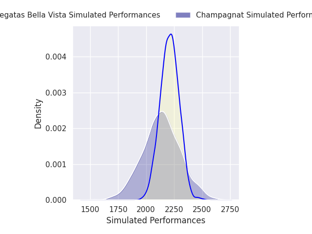
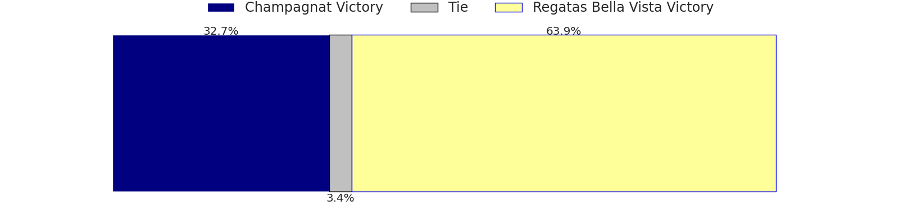
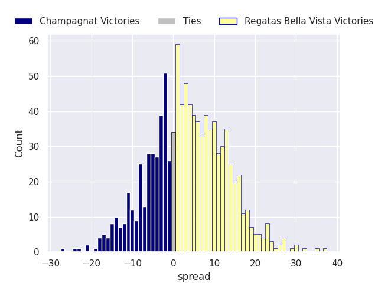

#### Alumni V Atlético del Rosario on 2026/10/03

Average Margin: Alumni by 18.8

#### Newman V Los Tilos on 2026/10/03

Average Margin: Newman by 12.0

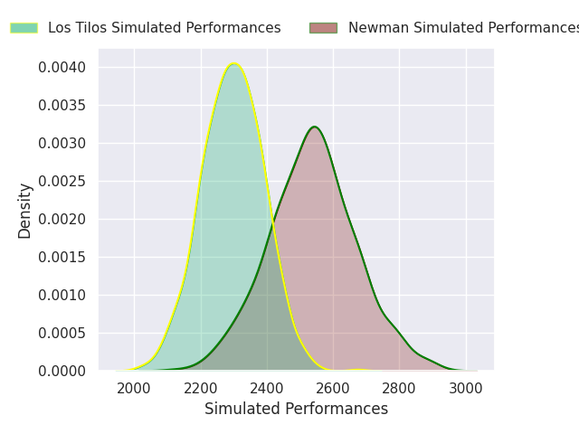
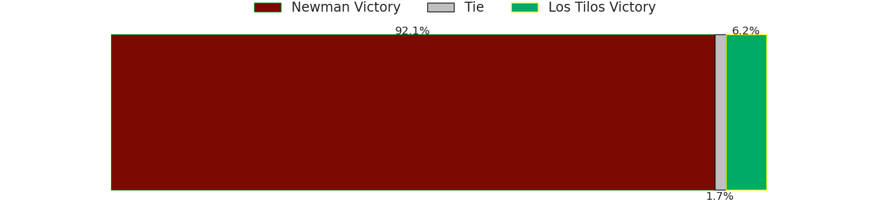
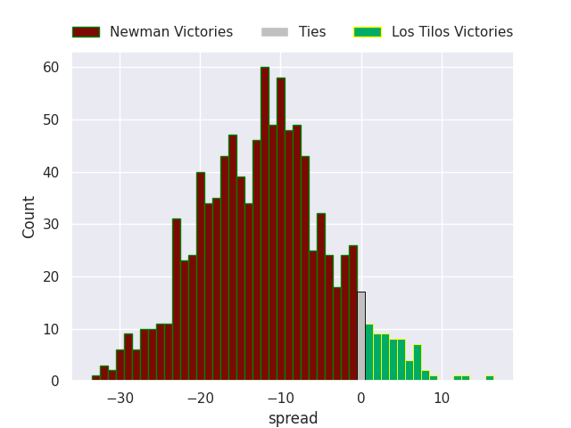

#### Buenos Aires V Los Matreros on 2026/10/03

Average Margin: Buenos Aires by 22.7

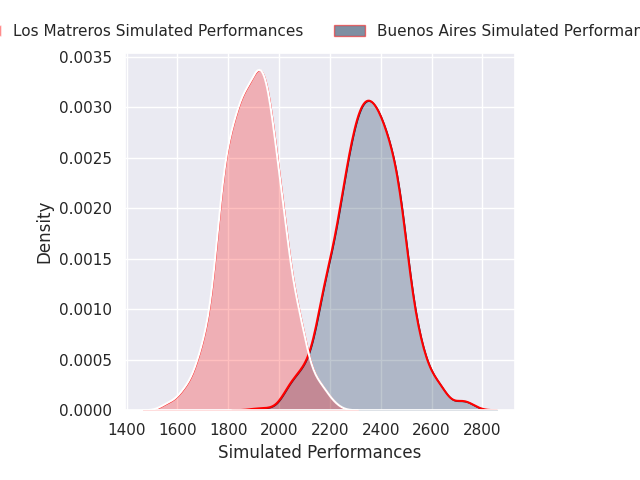
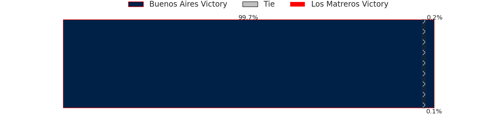
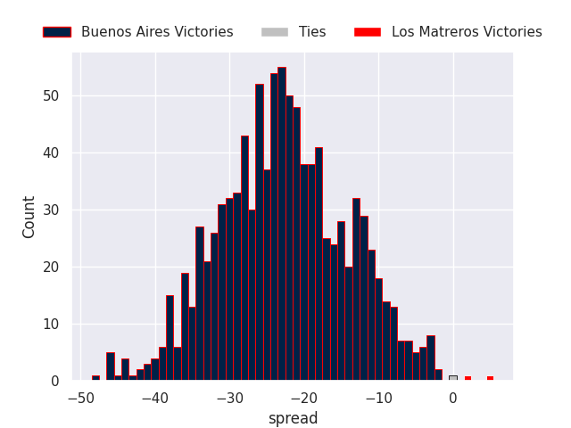

#### SIC V CASI on 2026/10/03

Average Margin: SIC by 7.0

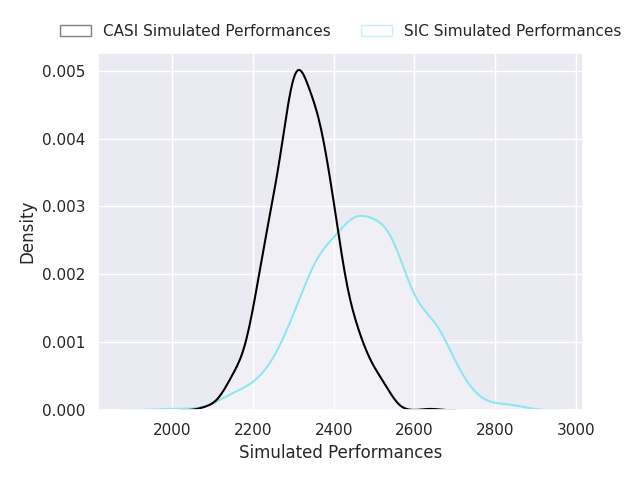
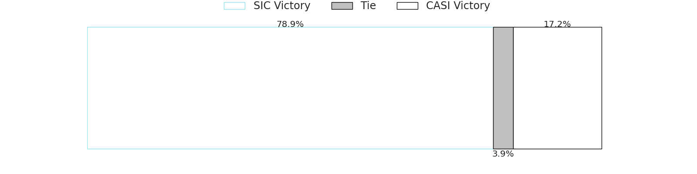
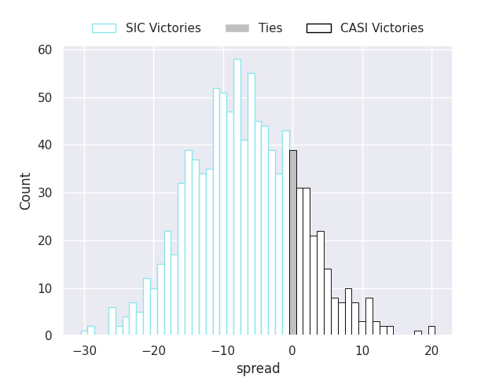

#### Hindu V La Plata on 2026/10/03

Average Margin: Hindu by 12.5

#### Belgrano AC V CUBA on 2026/10/03

Average Margin: Belgrano AC by 11.5

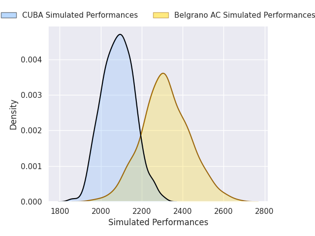
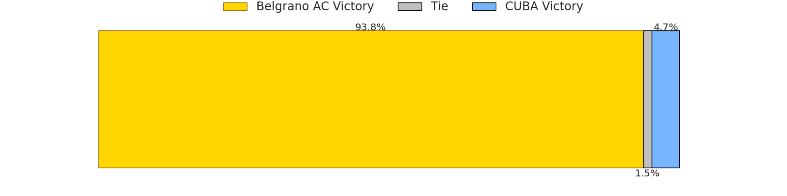
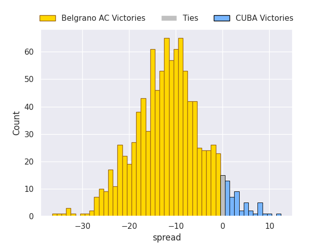

### Week 29
#### Los Tilos V Alumni on 2026/10/10

Average Margin: Los Tilos by 1.9

#### CUBA V SIC on 2026/10/10

Average Margin: SIC by 12.7

#### Buenos Aires V Belgrano AC on 2026/10/10

Average Margin: Buenos Aires by 5.3

#### Atlético del Rosario V Champagnat on 2026/10/10

Average Margin: Atlético del Rosario by 3.9

#### Regatas Bella Vista V Hindu on 2026/10/10

Average Margin: Hindu by 5.9

#### Los Matreros V La Plata on 2026/10/10

Average Margin: La Plata by 10.7

#### CASI V Newman on 2026/10/10

Average Margin: Newman by 3.6

### Week 30
#### Hindu V Atlético del Rosario on 2026/10/17

Average Margin: Hindu by 20.4

#### SIC V Buenos Aires on 2026/10/17

Average Margin: SIC by 9.5

#### La Plata V Regatas Bella Vista on 2026/10/17

Average Margin: La Plata by 3.9

#### Belgrano AC V Los Matreros on 2026/10/17

Average Margin: Belgrano AC by 21.0

#### Alumni V CASI on 2026/10/17

Average Margin: Alumni by 6.0

#### Champagnat V Los Tilos on 2026/10/17

Average Margin: Los Tilos by 8.4

#### Newman V CUBA on 2026/10/17

Average Margin: Newman by 22.8

