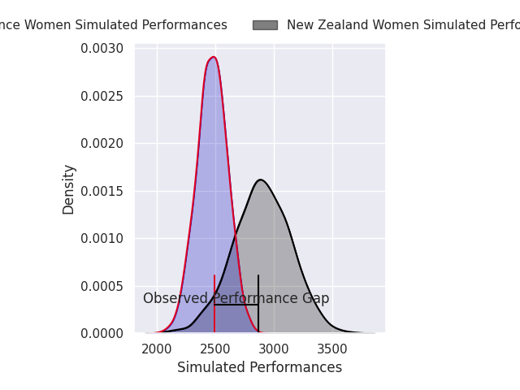
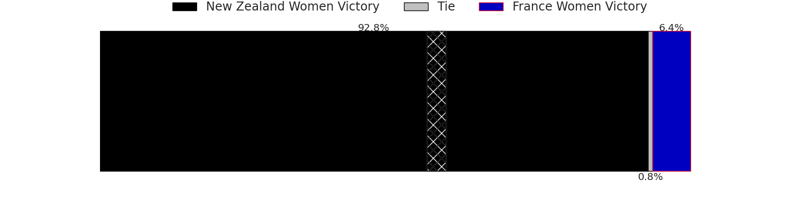
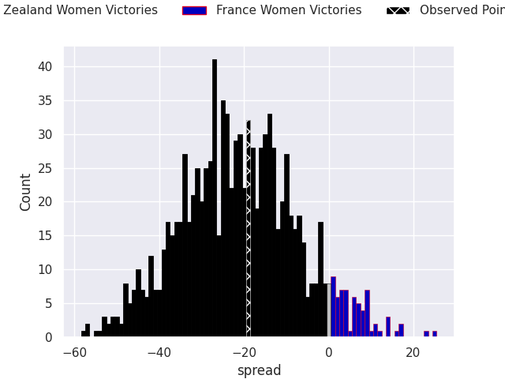

## Team Rankings

## Standings
### Current Standings

| Club               |   Played |   Wins |   Point Differential |   Losing Bonus Points | Try Bonus Points   |   Competition Points |
|:-------------------|---------:|-------:|---------------------:|----------------------:|:-------------------|---------------------:|
| New Zealand Women  |        4 |      3 |                  128 |                     1 |                    |                   13 |
| USA Women          |        3 |      3 |                   15 |                     0 |                    |                   12 |
| England Women      |        4 |      2 |                   37 |                     1 |                    |                   11 |
| Canada Women       |        4 |      2 |                   25 |                     0 |                    |                   10 |
| Australia Women    |        4 |      2 |                   28 |                     1 |                    |                    9 |
| South Africa Women |        3 |      2 |                    1 |                     0 |                    |                    8 |
| France Women       |        4 |      2 |                  -64 |                     0 |                    |                    8 |
| Wales Women        |        2 |      1 |                   29 |                     1 |                    |                    5 |
| Ireland Women      |        2 |      1 |                    3 |                     1 |                    |                    5 |
| Italy Women        |        3 |      1 |                   13 |                     0 |                    |                    4 |
| Japan Women        |        2 |      0 |                  -41 |                     1 |                    |                    1 |
| Spain Women        |        1 |      0 |                  -20 |                     0 |                    |                    0 |
| Scotland Women     |        4 |      0 |                 -154 |                     0 |                    |                    0 |

### Projected Remaining Table

| Club               |   To Play |   Projected Wins |   Projected Differential |   Projected Losing Bonus Points | Projected Try Bonus Points   |   Projected Competition Points |
|:-------------------|----------:|-----------------:|-------------------------:|--------------------------------:|:-----------------------------|-------------------------------:|
| New Zealand Women  |         2 |            1.906 |                   46.395 |                           0.061 |                              |                          7.711 |
| Japan Women        |         2 |            1.423 |                   16.113 |                           0.267 |                              |                          6.071 |
| England Women      |         2 |            1.36  |                   19.691 |                           0.235 |                              |                          5.733 |
| South Africa Women |         2 |            1.049 |                    3.332 |                           0.391 |                              |                          4.701 |
| Ireland Women      |         2 |            0.894 |                   -3.332 |                           0.38  |                              |                          4.07  |
| Australia Women    |         1 |            0.973 |                   25.267 |                           0.015 |                              |                          3.913 |
| USA Women          |         2 |            0.782 |                  -13.105 |                           0.222 |                              |                          3.428 |
| Wales Women        |         2 |            0.521 |                  -16.113 |                           0.428 |                              |                          2.624 |
| Canada Women       |         1 |            0.556 |                    2.261 |                           0.175 |                              |                          2.441 |
| Italy Women        |         1 |            0.242 |                   -8.847 |                           0.186 |                              |                          1.216 |
| France Women       |         2 |            0.081 |                  -46.395 |                           0.144 |                              |                          0.494 |
| Scotland Women     |         1 |            0.024 |                  -25.267 |                           0.054 |                              |                          0.156 |

### Projected Total Table

| Club               |   Played |   Wins |   Point Differential |   Losing Bonus Points | Try Bonus Points   |   Competition Points |
|:-------------------|---------:|-------:|---------------------:|----------------------:|:-------------------|---------------------:|
| New Zealand Women  |        6 |  4.906 |              174.395 |                 1.061 |                    |               20.711 |
| England Women      |        6 |  3.36  |               56.691 |                 1.235 |                    |               16.733 |
| USA Women          |        5 |  3.782 |                1.895 |                 0.222 |                    |               15.428 |
| Australia Women    |        5 |  2.973 |               53.267 |                 1.015 |                    |               12.913 |
| South Africa Women |        5 |  3.049 |                4.332 |                 0.391 |                    |               12.701 |
| Canada Women       |        5 |  2.556 |               27.261 |                 0.175 |                    |               12.441 |
| Ireland Women      |        4 |  1.894 |               -0.332 |                 1.38  |                    |                9.07  |
| France Women       |        6 |  2.081 |             -110.395 |                 0.144 |                    |                8.494 |
| Wales Women        |        4 |  1.521 |               12.887 |                 1.428 |                    |                7.624 |
| Japan Women        |        4 |  1.423 |              -24.887 |                 1.267 |                    |                7.071 |
| Italy Women        |        4 |  1.242 |                4.153 |                 0.186 |                    |                5.216 |
| Scotland Women     |        5 |  0.024 |             -179.267 |                 0.054 |                    |                0.156 |
| Spain Women        |        1 |  0     |              -20     |                 0     |                    |                0     |

## Completed Match Review

| Model | Percent Correct Predictions | Spread Error |
| ------ | ------ | ------ |
| Club Level | 66.7% | 16.8 |
| Player Level: Lineup | nan% | nan |
| Player Level: Minutes | nan% | nan |

## Future Predictions
### Week 5
#### Australia Women V Scotland Women on 2026/10/23

Average Margin: Australia Women by 25.3

#### South Africa Women V Ireland Women on 2026/10/24

Average Margin: South Africa Women by 1.8

#### Japan Women V Wales Women on 2026/10/24

Average Margin: Japan Women by 8.2

#### New Zealand Women V France Women on 2026/10/24

Average Margin: New Zealand Women by 23.1

#### Canada Women V England Women on 2026/10/24

Average Margin: Canada Women by 2.3

#### USA Women V Italy Women on 2026/10/24

Average Margin: USA Women by 8.8

### Week 6
#### USA Women V England Women on 2026/10/30

Average Margin: England Women by 22.0

#### South Africa Women V Ireland Women on 2026/10/31

Average Margin: South Africa Women by 1.5

#### New Zealand Women V France Women on 2026/10/31

Average Margin: New Zealand Women by 23.3

#### Japan Women V Wales Women on 2026/10/31

Average Margin: Japan Women by 7.9

