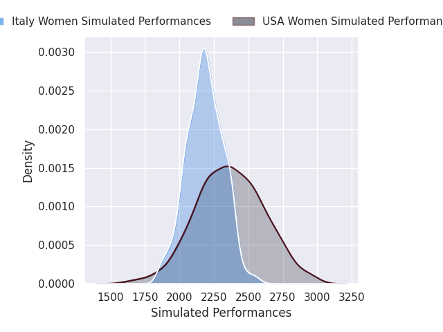
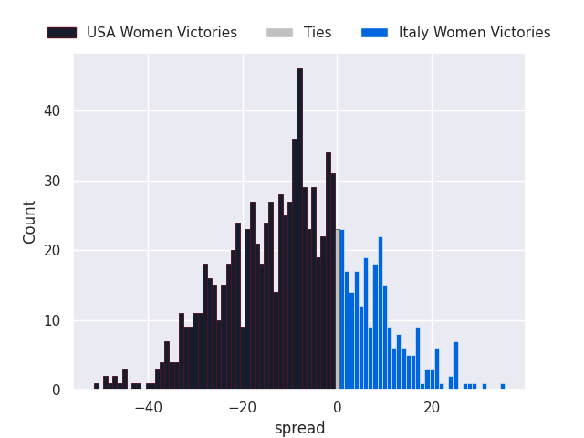

## Team Rankings

## Standings
### Current Standings

| Club               |   Played |   Wins |   Point Differential |   Losing Bonus Points | Try Bonus Points   |   Competition Points |
|:-------------------|---------:|-------:|---------------------:|----------------------:|:-------------------|---------------------:|
| England Women      |        3 |      2 |                   40 |                     0 |                    |                   10 |
| New Zealand Women  |        3 |      2 |                   59 |                     1 |                    |                    9 |
| USA Women          |        2 |      2 |                    6 |                     0 |                    |                    8 |
| France Women       |        3 |      2 |                    5 |                     0 |                    |                    8 |
| Canada Women       |        3 |      1 |                   22 |                     0 |                    |                    6 |
| Wales Women        |        2 |      1 |                   29 |                     1 |                    |                    5 |
| Ireland Women      |        2 |      1 |                    3 |                     1 |                    |                    5 |
| Australia Women    |        3 |      1 |                  -16 |                     1 |                    |                    5 |
| Italy Women        |        2 |      1 |                   22 |                     0 |                    |                    4 |
| South Africa Women |        2 |      1 |                  -19 |                     0 |                    |                    4 |
| Japan Women        |        2 |      0 |                  -41 |                     1 |                    |                    1 |
| Scotland Women     |        3 |      0 |                 -110 |                     0 |                    |                    0 |

### Projected Remaining Table

| Club              |   To Play |   Projected Wins |   Projected Differential |   Projected Losing Bonus Points | Projected Try Bonus Points   |   Projected Competition Points |
|:------------------|----------:|-----------------:|-------------------------:|--------------------------------:|:-----------------------------|-------------------------------:|
| New Zealand Women |         1 |            0.942 |                   21.157 |                           0.033 |                              |                          3.821 |
| Australia Women   |         1 |            0.936 |                   20.29  |                           0.038 |                              |                          3.804 |
| USA Women         |         1 |            0.751 |                   10.293 |                           0.131 |                              |                          3.191 |
| Canada Women      |         1 |            0.543 |                    2.363 |                           0.17  |                              |                          2.416 |
| England Women     |         1 |            0.42  |                   -2.363 |                           0.171 |                              |                          1.925 |
| Italy Women       |         1 |            0.221 |                  -10.293 |                           0.17  |                              |                          1.11  |
| Scotland Women    |         1 |            0.053 |                  -20.29  |                           0.104 |                              |                          0.338 |
| France Women      |         1 |            0.048 |                  -21.157 |                           0.09  |                              |                          0.302 |

### Projected Total Table

| Club               |   Played |   Wins |   Point Differential |   Losing Bonus Points | Try Bonus Points   |   Competition Points |
|:-------------------|---------:|-------:|---------------------:|----------------------:|:-------------------|---------------------:|
| New Zealand Women  |        4 |  2.942 |               80.157 |                 1.033 |                    |               12.821 |
| England Women      |        4 |  2.42  |               37.637 |                 0.171 |                    |               11.925 |
| USA Women          |        3 |  2.751 |               16.293 |                 0.131 |                    |               11.191 |
| Australia Women    |        4 |  1.936 |                4.29  |                 1.038 |                    |                8.804 |
| Canada Women       |        4 |  1.543 |               24.363 |                 0.17  |                    |                8.416 |
| France Women       |        4 |  2.048 |              -16.157 |                 0.09  |                    |                8.302 |
| Italy Women        |        3 |  1.221 |               11.707 |                 0.17  |                    |                5.11  |
| Wales Women        |        2 |  1     |               29     |                 1     |                    |                5     |
| Ireland Women      |        2 |  1     |                3     |                 1     |                    |                5     |
| South Africa Women |        2 |  1     |              -19     |                 0     |                    |                4     |
| Japan Women        |        2 |  0     |              -41     |                 1     |                    |                1     |
| Scotland Women     |        4 |  0.053 |             -130.29  |                 0.104 |                    |                0.338 |

## Completed Match Review

| Model | Percent Correct Predictions | Spread Error |
| ------ | ------ | ------ |
| Club Level | 68.4% | 17.9 |
| Player Level: Lineup | nan% | nan |
| Player Level: Minutes | nan% | nan |

## Future Predictions
### Week 4
#### New Zealand Women V France Women on 2026/10/17

Average Margin: New Zealand Women by 21.2

#### Canada Women V England Women on 2026/10/17

Average Margin: Canada Women by 2.4

#### USA Women V Italy Women on 2026/10/17

Average Margin: USA Women by 10.3

#### Australia Women V Scotland Women on 2026/10/17

Average Margin: Australia Women by 20.3

