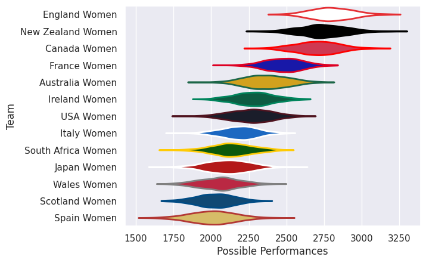

## Team Rankings

## Standings
### Current Standings

| Club               |   Played |   Wins |   Point Differential |   Losing Bonus Points | Try Bonus Points   |   Competition Points |
|:-------------------|---------:|-------:|---------------------:|----------------------:|:-------------------|---------------------:|
| New Zealand Women  |        6 |      5 |                  176 |                     1 |                    |                   21 |
| USA Women          |        5 |      4 |                    2 |                     0 |                    |                   16 |
| England Women      |        6 |      3 |                   71 |                     1 |                    |                   15 |
| Canada Women       |        5 |      3 |                   34 |                     0 |                    |                   14 |
| Wales Women        |        4 |      3 |                   70 |                     1 |                    |                   13 |
| Ireland Women      |        4 |      3 |                   37 |                     1 |                    |                   13 |
| Australia Women    |        5 |      3 |                   35 |                     1 |                    |                   13 |
| South Africa Women |        5 |      2 |                  -33 |                     0 |                    |                    8 |
| France Women       |        6 |      2 |                 -112 |                     0 |                    |                    8 |
| Italy Women        |        4 |      1 |                  -17 |                     0 |                    |                    4 |
| Japan Women        |        4 |      0 |                  -82 |                     1 |                    |                    1 |
| Scotland Women     |        5 |      0 |                 -161 |                     1 |                    |                    1 |
| Spain Women        |        1 |      0 |                  -20 |                     0 |                    |                    0 |

## Completed Match Review

| Model | Percent Correct Predictions | Spread Error |
| ------ | ------ | ------ |
| Club Level | 70.0% | 18.6 |
| Player Level: Lineup | nan% | nan |
| Player Level: Minutes | nan% | nan |

