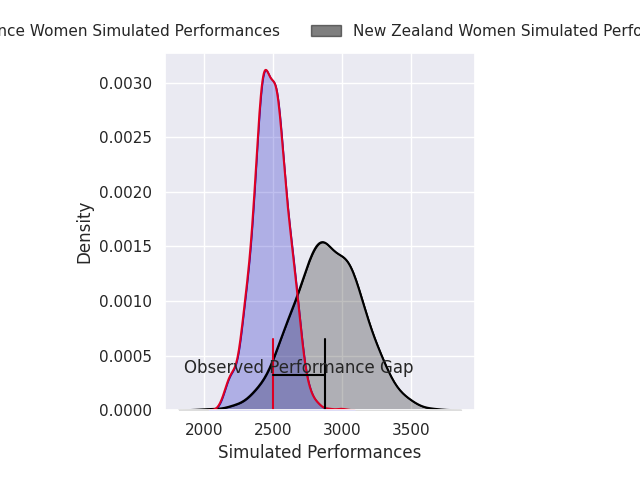
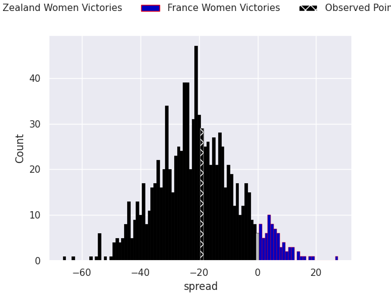
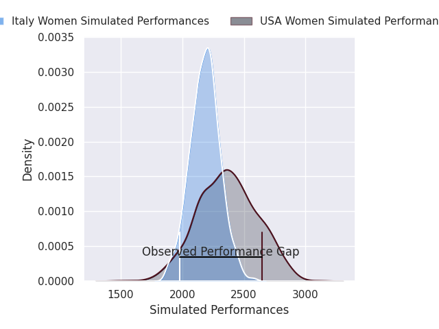
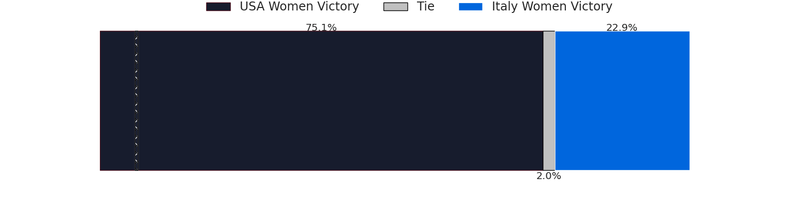
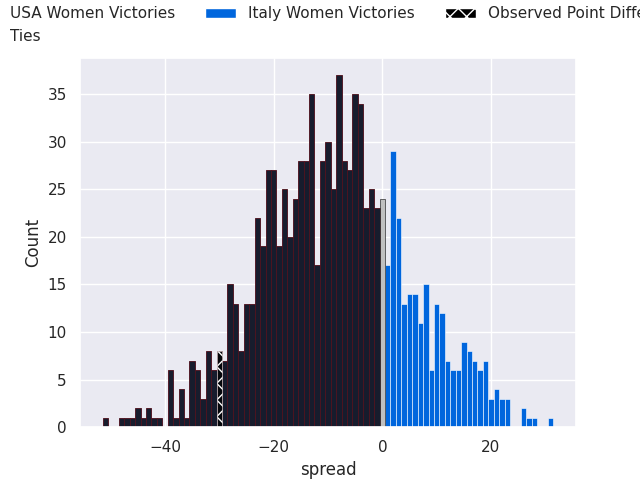

## Team Rankings

## Standings
### Current Standings

| Club               |   Played |   Wins |   Point Differential |   Losing Bonus Points | Try Bonus Points   |   Competition Points |
|:-------------------|---------:|-------:|---------------------:|----------------------:|:-------------------|---------------------:|
| England Women      |        3 |      2 |                   40 |                     0 |                    |                   10 |
| New Zealand Women  |        3 |      2 |                   59 |                     1 |                    |                    9 |
| USA Women          |        2 |      2 |                    6 |                     0 |                    |                    8 |
| France Women       |        3 |      2 |                    5 |                     0 |                    |                    8 |
| South Africa Women |        3 |      2 |                    1 |                     0 |                    |                    8 |
| Canada Women       |        3 |      1 |                   22 |                     0 |                    |                    6 |
| Wales Women        |        2 |      1 |                   29 |                     1 |                    |                    5 |
| Ireland Women      |        2 |      1 |                    3 |                     1 |                    |                    5 |
| Australia Women    |        3 |      1 |                  -16 |                     1 |                    |                    5 |
| Italy Women        |        2 |      1 |                   22 |                     0 |                    |                    4 |
| Japan Women        |        2 |      0 |                  -41 |                     1 |                    |                    1 |
| Spain Women        |        1 |      0 |                  -20 |                     0 |                    |                    0 |
| Scotland Women     |        3 |      0 |                 -110 |                     0 |                    |                    0 |

### Projected Remaining Table

| Club               |   To Play |   Projected Wins |   Projected Differential |   Projected Losing Bonus Points | Projected Try Bonus Points   |   Projected Competition Points |
|:-------------------|----------:|-----------------:|-------------------------:|--------------------------------:|:-----------------------------|-------------------------------:|
| New Zealand Women  |         3 |            2.81  |                   64.232 |                           0.127 |                              |                         11.397 |
| Australia Women    |         2 |            1.885 |                   41.764 |                           0.068 |                              |                          7.644 |
| England Women      |         3 |            1.768 |                   15.392 |                           0.375 |                              |                          7.585 |
| USA Women          |         3 |            1.561 |                   -1.59  |                           0.328 |                              |                          6.676 |
| Japan Women        |         2 |            1.33  |                   13.142 |                           0.302 |                              |                          5.716 |
| Canada Women       |         2 |            1.092 |                    5.537 |                           0.347 |                              |                          4.833 |
| South Africa Women |         2 |            1.081 |                    3.463 |                           0.392 |                              |                          4.818 |
| Ireland Women      |         2 |            0.868 |                   -3.463 |                           0.428 |                              |                          4.002 |
| Wales Women        |         2 |            0.623 |                  -13.142 |                           0.373 |                              |                          2.959 |
| Italy Women        |         2 |            0.468 |                  -19.339 |                           0.374 |                              |                          2.33  |
| France Women       |         3 |            0.175 |                  -64.232 |                           0.278 |                              |                          1.008 |
| Scotland Women     |         2 |            0.097 |                  -41.764 |                           0.189 |                              |                          0.613 |

### Projected Total Table

| Club               |   Played |   Wins |   Point Differential |   Losing Bonus Points | Try Bonus Points   |   Competition Points |
|:-------------------|---------:|-------:|---------------------:|----------------------:|:-------------------|---------------------:|
| New Zealand Women  |        6 |  4.81  |              123.232 |                 1.127 |                    |               20.397 |
| England Women      |        6 |  3.768 |               55.392 |                 0.375 |                    |               17.585 |
| USA Women          |        5 |  3.561 |                4.41  |                 0.328 |                    |               14.676 |
| South Africa Women |        5 |  3.081 |                4.463 |                 0.392 |                    |               12.818 |
| Australia Women    |        5 |  2.885 |               25.764 |                 1.068 |                    |               12.644 |
| Canada Women       |        5 |  2.092 |               27.537 |                 0.347 |                    |               10.833 |
| France Women       |        6 |  2.175 |              -59.232 |                 0.278 |                    |                9.008 |
| Ireland Women      |        4 |  1.868 |               -0.463 |                 1.428 |                    |                9.002 |
| Wales Women        |        4 |  1.623 |               15.858 |                 1.373 |                    |                7.959 |
| Japan Women        |        4 |  1.33  |              -27.858 |                 1.302 |                    |                6.716 |
| Italy Women        |        4 |  1.468 |                2.661 |                 0.374 |                    |                6.33  |
| Scotland Women     |        5 |  0.097 |             -151.764 |                 0.189 |                    |                0.613 |
| Spain Women        |        1 |  0     |              -20     |                 0     |                    |                0     |

## Completed Match Review

| Model | Percent Correct Predictions | Spread Error |
| ------ | ------ | ------ |
| Club Level | 60.0% | 16.0 |
| Player Level: Lineup | nan% | nan |
| Player Level: Minutes | nan% | nan |

## Future Predictions
### Week 4
#### USA Women V Italy Women on 2026/10/17

Average Margin: USA Women by 9.0

#### Australia Women V Scotland Women on 2026/10/17

Average Margin: Australia Women by 21.2

#### New Zealand Women V France Women on 2026/10/17

Average Margin: New Zealand Women by 21.5

#### Canada Women V England Women on 2026/10/17

Average Margin: Canada Women by 3.0

### Week 5
#### Canada Women V England Women on 2026/10/23

Average Margin: Canada Women by 2.5

#### New Zealand Women V France Women on 2026/10/23

Average Margin: New Zealand Women by 21.4

#### Australia Women V Scotland Women on 2026/10/23

Average Margin: Australia Women by 20.6

#### Japan Women V Wales Women on 2026/10/24

Average Margin: Japan Women by 6.6

#### South Africa Women V Ireland Women on 2026/10/24

Average Margin: South Africa Women by 1.5

#### USA Women V Italy Women on 2026/10/24

Average Margin: USA Women by 10.3

### Week 6
#### USA Women V England Women on 2026/10/30

Average Margin: England Women by 20.9

#### South Africa Women V Ireland Women on 2026/10/31

Average Margin: South Africa Women by 1.9

#### Japan Women V Wales Women on 2026/10/31

Average Margin: Japan Women by 6.5

#### New Zealand Women V France Women on 2026/10/31

Average Margin: New Zealand Women by 21.4

