## Team Rankings

## Standings
### Current Standings

| Club               |   Played |   Wins |   Point Differential |   Losing Bonus Points | Try Bonus Points   |   Competition Points |
|:-------------------|---------:|-------:|---------------------:|----------------------:|:-------------------|---------------------:|
| New Zealand Women  |        5 |      4 |                  147 |                     1 |                    |                   17 |
| USA Women          |        4 |      4 |                   45 |                     0 |                    |                   16 |
| Canada Women       |        5 |      3 |                   34 |                     0 |                    |                   14 |
| Australia Women    |        5 |      3 |                   35 |                     1 |                    |                   13 |
| England Women      |        5 |      2 |                   28 |                     1 |                    |                   11 |
| Wales Women        |        3 |      2 |                   46 |                     1 |                    |                    9 |
| Ireland Women      |        3 |      2 |                   16 |                     1 |                    |                    9 |
| South Africa Women |        4 |      2 |                  -12 |                     0 |                    |                    8 |
| France Women       |        5 |      2 |                  -83 |                     0 |                    |                    8 |
| Italy Women        |        4 |      1 |                  -17 |                     0 |                    |                    4 |
| Japan Women        |        3 |      0 |                  -58 |                     1 |                    |                    1 |
| Scotland Women     |        5 |      0 |                 -161 |                     1 |                    |                    1 |
| Spain Women        |        1 |      0 |                  -20 |                     0 |                    |                    0 |

### Projected Remaining Table

| Club               |   To Play |   Projected Wins |   Projected Differential |   Projected Losing Bonus Points | Projected Try Bonus Points   |   Projected Competition Points |
|:-------------------|----------:|-----------------:|-------------------------:|--------------------------------:|:-----------------------------|-------------------------------:|
| New Zealand Women  |         1 |            0.948 |                   21.851 |                           0.033 |                              |                          3.837 |
| England Women      |         1 |            0.923 |                   17.627 |                           0.042 |                              |                          3.764 |
| Ireland Women      |         1 |            0.569 |                    2.614 |                           0.196 |                              |                          2.528 |
| Wales Women        |         1 |            0.541 |                    2     |                           0.188 |                              |                          2.428 |
| Japan Women        |         1 |            0.421 |                   -2     |                           0.207 |                              |                          1.967 |
| South Africa Women |         1 |            0.403 |                   -2.614 |                           0.214 |                              |                          1.882 |
| USA Women          |         1 |            0.062 |                  -17.627 |                           0.141 |                              |                          0.419 |
| France Women       |         1 |            0.046 |                  -21.851 |                           0.078 |                              |                          0.274 |

### Projected Total Table

| Club               |   Played |   Wins |   Point Differential |   Losing Bonus Points | Try Bonus Points   |   Competition Points |
|:-------------------|---------:|-------:|---------------------:|----------------------:|:-------------------|---------------------:|
| New Zealand Women  |        6 |  4.948 |              168.851 |                 1.033 |                    |               20.837 |
| USA Women          |        5 |  4.062 |               27.373 |                 0.141 |                    |               16.419 |
| England Women      |        6 |  2.923 |               45.627 |                 1.042 |                    |               14.764 |
| Canada Women       |        5 |  3     |               34     |                 0     |                    |               14     |
| Australia Women    |        5 |  3     |               35     |                 1     |                    |               13     |
| Ireland Women      |        4 |  2.569 |               18.614 |                 1.196 |                    |               11.528 |
| Wales Women        |        4 |  2.541 |               48     |                 1.188 |                    |               11.428 |
| South Africa Women |        5 |  2.403 |              -14.614 |                 0.214 |                    |                9.882 |
| France Women       |        6 |  2.046 |             -104.851 |                 0.078 |                    |                8.274 |
| Italy Women        |        4 |  1     |              -17     |                 0     |                    |                4     |
| Japan Women        |        4 |  0.421 |              -60     |                 1.207 |                    |                2.967 |
| Scotland Women     |        5 |  0     |             -161     |                 1     |                    |                1     |
| Spain Women        |        1 |  0     |              -20     |                 0     |                    |                0     |

## Completed Match Review

| Model | Percent Correct Predictions | Spread Error |
| ------ | ------ | ------ |
| Club Level | 73.3% | 16.6 |
| Player Level: Lineup | nan% | nan |
| Player Level: Minutes | nan% | nan |

## Future Predictions
### Week 6
#### USA Women V England Women on 2026/10/30

Average Margin: England Women by 17.6

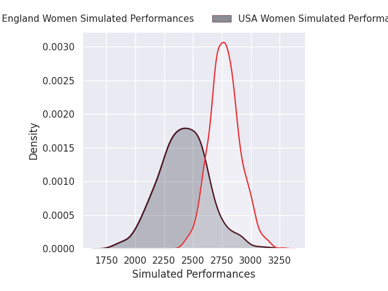
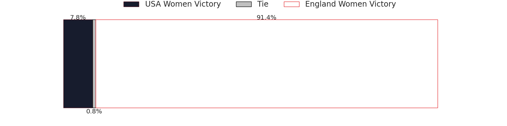
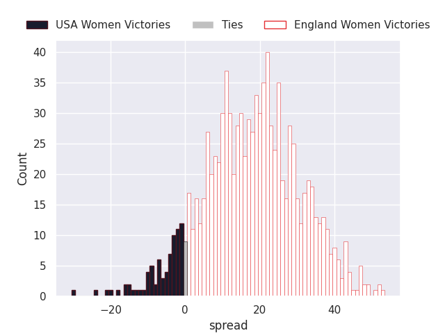

#### Japan Women V Wales Women on 2026/10/31

Average Margin: Wales Women by 2.0

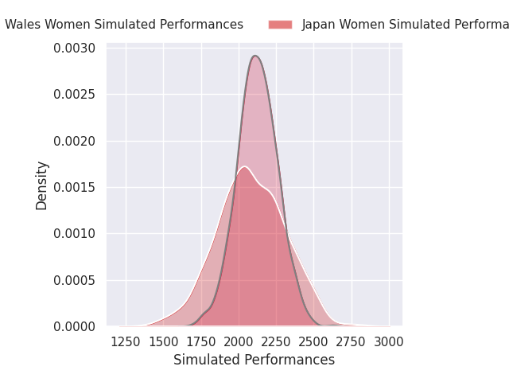

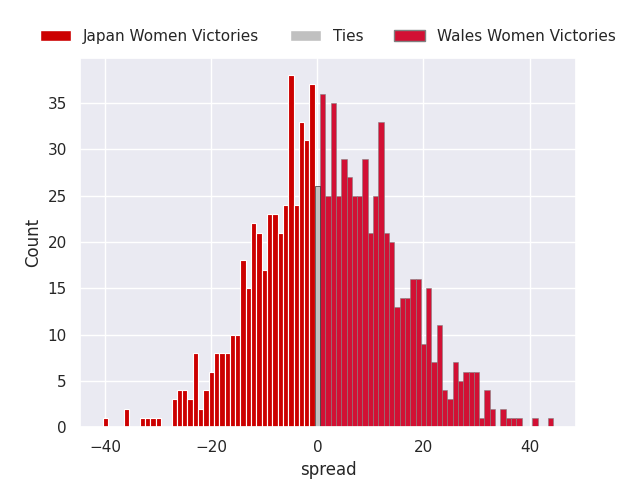

#### New Zealand Women V France Women on 2026/10/31

Average Margin: New Zealand Women by 21.9

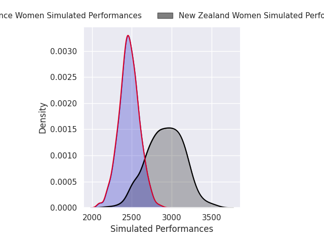
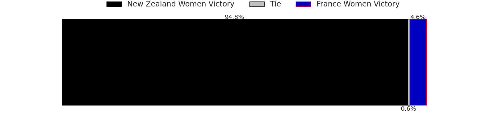
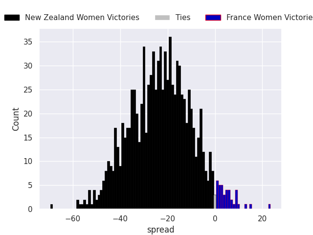

#### South Africa Women V Ireland Women on 2026/10/31

Average Margin: Ireland Women by 2.6

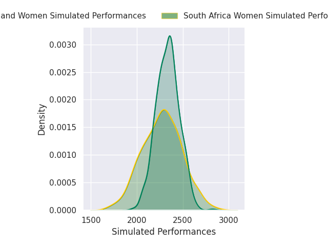
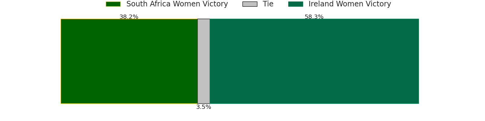
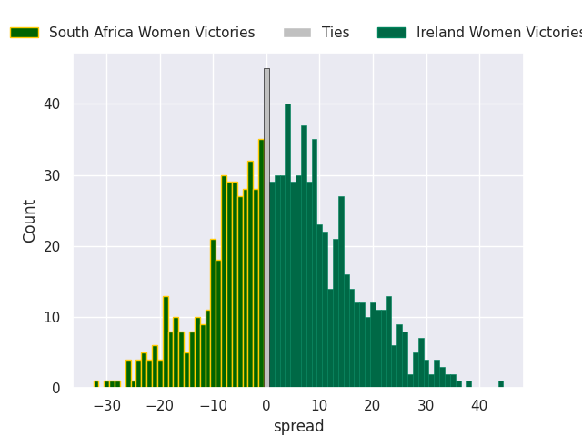

