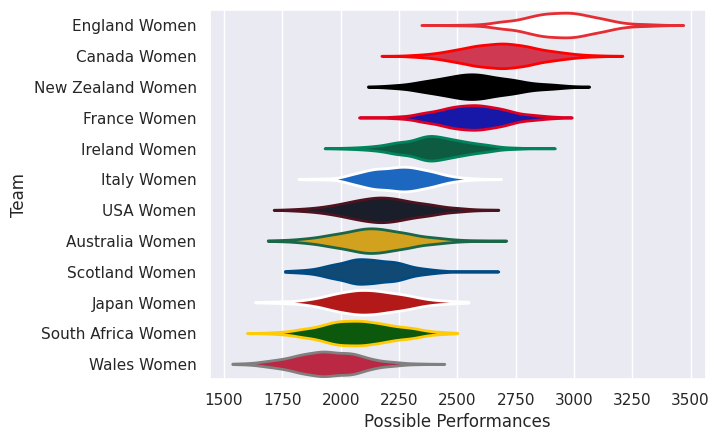

## Team Rankings

## Standings
### Current Standings

| Club               |   Played |   Wins |   Point Differential |   Losing Bonus Points | Try Bonus Points   |   Competition Points |
|:-------------------|---------:|-------:|---------------------:|----------------------:|:-------------------|---------------------:|
| England Women      |        3 |      2 |                   40 |                     0 |                    |                   10 |
| New Zealand Women  |        3 |      2 |                   59 |                     1 |                    |                    9 |
| USA Women          |        2 |      2 |                    6 |                     0 |                    |                    8 |
| France Women       |        3 |      2 |                    5 |                     0 |                    |                    8 |
| Canada Women       |        3 |      1 |                   22 |                     0 |                    |                    6 |
| Wales Women        |        2 |      1 |                   29 |                     1 |                    |                    5 |
| Ireland Women      |        2 |      1 |                    3 |                     1 |                    |                    5 |
| Australia Women    |        3 |      1 |                  -16 |                     1 |                    |                    5 |
| Italy Women        |        2 |      1 |                   22 |                     0 |                    |                    4 |
| South Africa Women |        2 |      1 |                  -19 |                     0 |                    |                    4 |
| Japan Women        |        2 |      0 |                  -41 |                     1 |                    |                    1 |
| Scotland Women     |        3 |      0 |                 -110 |                     0 |                    |                    0 |

## Completed Match Review

| Model | Percent Correct Predictions | Spread Error |
| ------ | ------ | ------ |
| Club Level | 60.0% | 20.4 |
| Player Level: Lineup | nan% | nan |
| Player Level: Minutes | nan% | nan |

