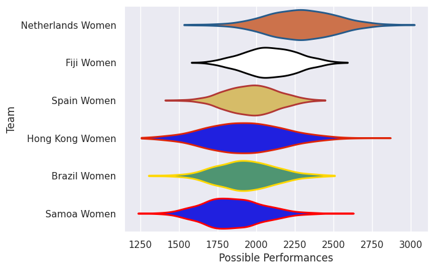

## Team Rankings

## Standings
### Current Standings

| Club              |   Played |   Wins |   Point Differential |   Losing Bonus Points | Try Bonus Points   |   Competition Points |
|:------------------|---------:|-------:|---------------------:|----------------------:|:-------------------|---------------------:|
| Fiji Women        |        3 |      3 |                   37 |                     0 |                    |                   12 |
| Netherlands Women |        3 |      2 |                   69 |                     1 |                    |                    9 |
| Spain Women       |        2 |      1 |                   34 |                     1 |                    |                    5 |
| Hong Kong Women   |        3 |      1 |                  -40 |                     0 |                    |                    4 |
| Samoa Women       |        3 |      1 |                  -93 |                     0 |                    |                    4 |
| Brazil Women      |        2 |      0 |                   -7 |                     2 |                    |                    2 |

## Completed Match Review

| Model | Percent Correct Predictions | Spread Error |
| ------ | ------ | ------ |
| Club Level | 50.0% | 19.4 |
| Player Level: Lineup | nan% | nan |
| Player Level: Minutes | nan% | nan |

