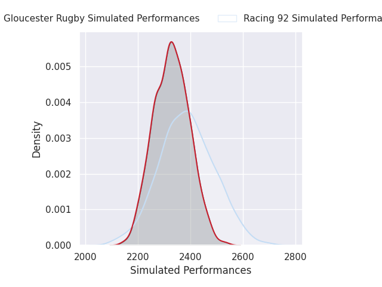
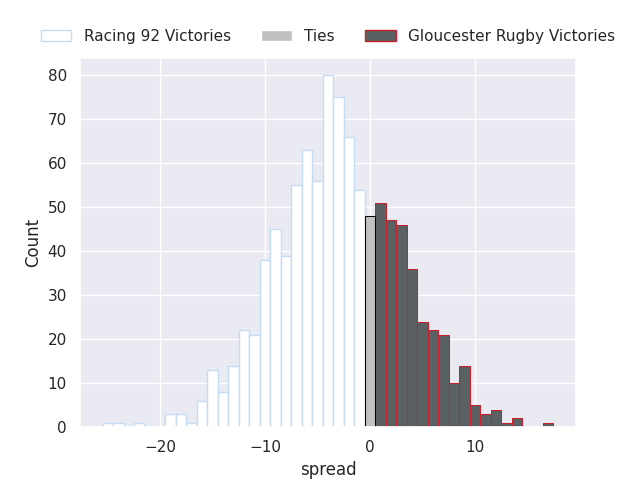

## Club Level Predictions

The first set of predictions treats a club as the smallest object, as the club develops its members, organizes a gameplan, and deploys its players as needed for each match. This club model is currently predicting Racing 92 to win by 2.93.

Our Over/Under is 48.5 - and combined with the spread above, we have a predicted scoreline of 26 to 23

Each club has a rating and a rating deviation (similar to a Glicko rating), and expected performances can be generated. This allows for simulated matches and spreads like the ones below.
### Projected Performances - Club Model

### Projected Spreads - Club Model

### Projected Results - Club Model

