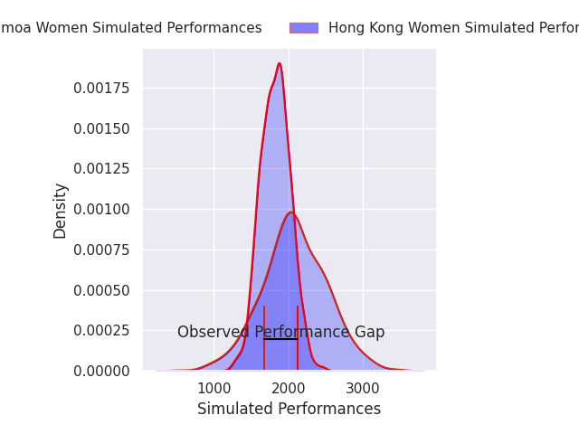
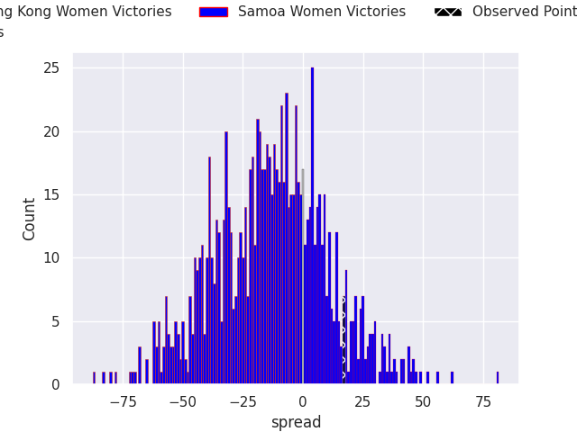
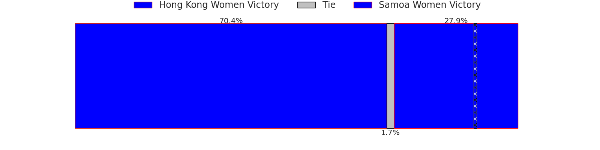

## Club Level Predictions

Now that the game has been played, lets see how the club predictions did. I predicted Hong Kong Women to win by 12.86, and Samoa Women won by 17.0. That's an absolute error of 29.9 for the margin of victory, while my average absolute error has been 14.8 over the past six months. This prediction was more accurate than 11.7% of my recent predictions.

For the Over/Under model, I predicted a total of 48.5 and we have an actual total of 51.0. That's an absolute error of 2.5 compared to a six month average of 14.8. This prediction was more accurate than 88.6% of my recent predictions.
### Projected Performances - Club Model

### Projected Spreads - Club Model

### Projected Results - Club Model

