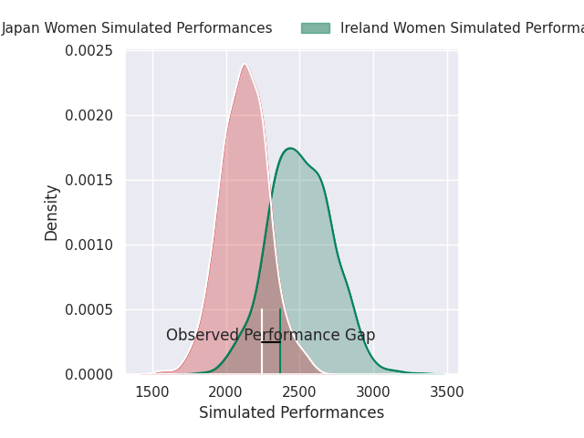
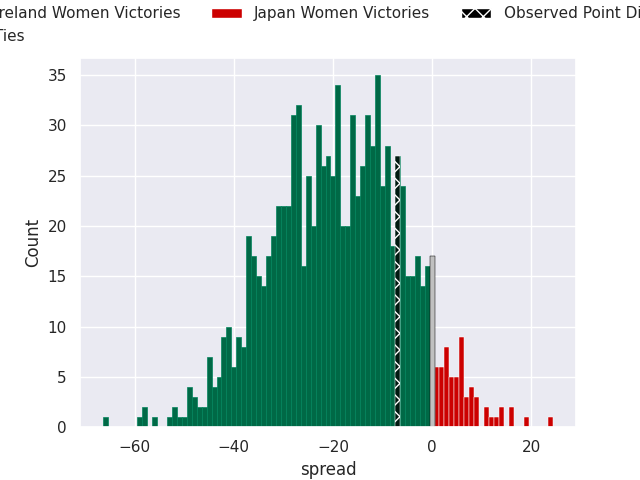
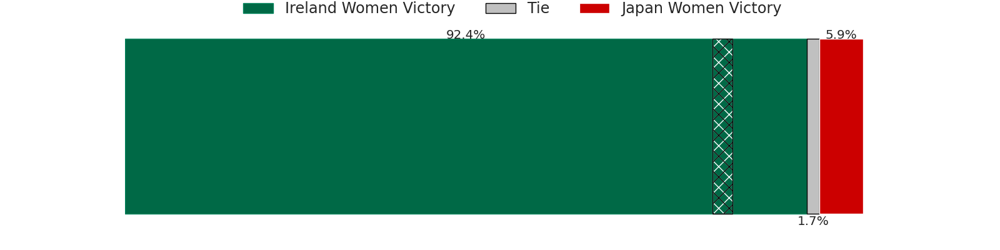

## Club Level Predictions

Now that the game has been played, lets see how the club predictions did. I predicted Ireland Women to win by 19.02, and Ireland Women won by 7.0. That's an absolute error of 12.0 for the margin of victory, while my average absolute error has been 14.8 over the past six months. This prediction was more accurate than 50.2% of my recent predictions.

For the Over/Under model, I predicted a total of 49.5 and we have an actual total of 55.0. That's an absolute error of 5.5 compared to a six month average of 14.8. This prediction was more accurate than 76.2% of my recent predictions.
### Projected Performances - Club Model

### Projected Spreads - Club Model

### Projected Results - Club Model

