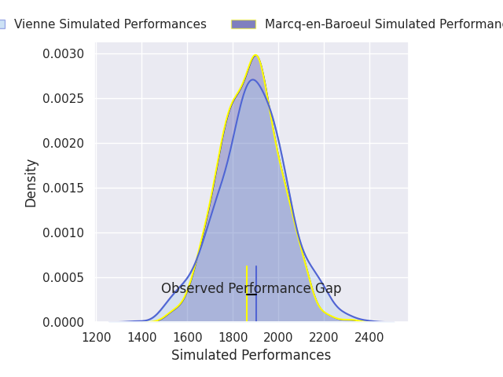
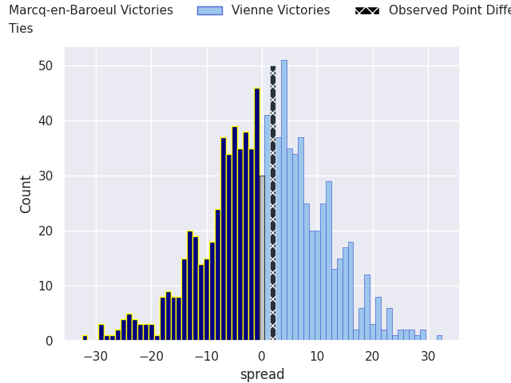

## Club Level Predictions

Now that the game has been played, lets see how the club predictions did. I predicted Vienne to win by 0.62, and Vienne won by 2.0. That's an absolute error of 1.4 for the margin of victory, while my average absolute error has been 14.6 over the past six months. This prediction was more accurate than 93.3% of my recent predictions.

For the Over/Under model, I predicted a total of 43.5 and we have an actual total of 48.0. That's an absolute error of 4.5 compared to a six month average of 14.9. This prediction was more accurate than 80.9% of my recent predictions.
### Projected Performances - Club Model

### Projected Spreads - Club Model

### Projected Results - Club Model

