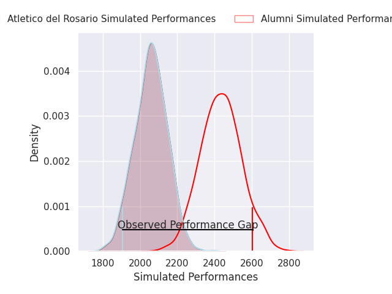
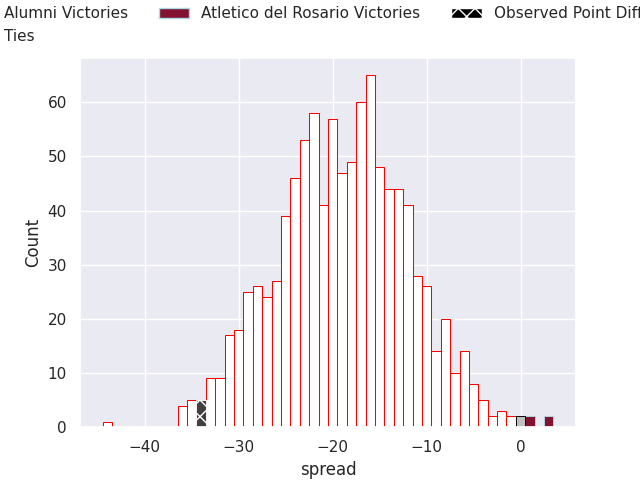
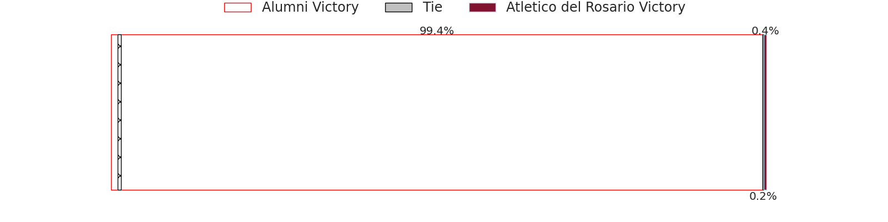
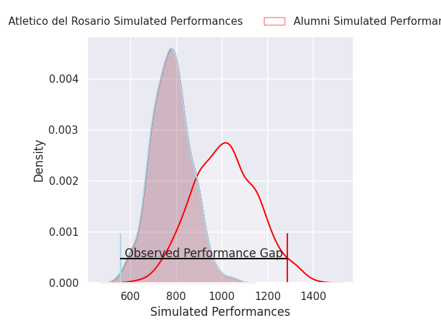
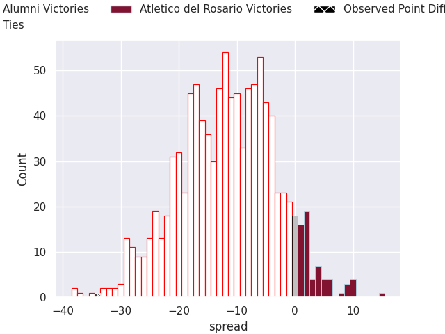
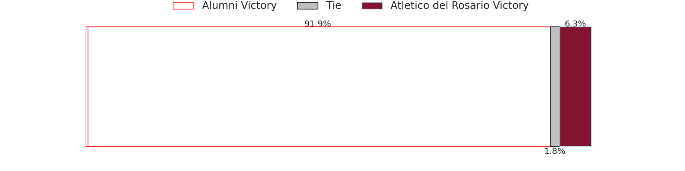

## Club Level Predictions

Now that the game has been played, lets see how the club predictions did. I predicted Alumni to win by 18.87, and Alumni won by 34.0. That's an absolute error of 15.1 for the margin of victory, while my average absolute error has been 14.6 over the past six months. This prediction was more accurate than 38.6% of my recent predictions.

For the Over/Under model, I predicted a total of 56.5 and we have an actual total of 74.0. That's an absolute error of 17.5 compared to a six month average of 14.9. This prediction was more accurate than 35.0% of my recent predictions.
### Projected Performances - Club Model

### Projected Spreads - Club Model

### Projected Results - Club Model

## Player Level Predictions

With the player model, I predicted Alumni to win by 11.76,  and Alumni won by 34.0. That's an absolute error of 22.2 for the margin of victory, while the average error as been 14.9 for the past six months. So this prediction was more accurate than 16.9% of my recent predictions.
### Projected Performances - Player Model

### Projected Spreads - Player Model

### Projected Results - Player Model

