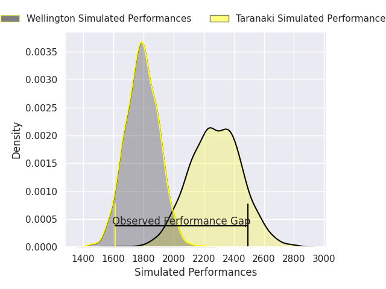
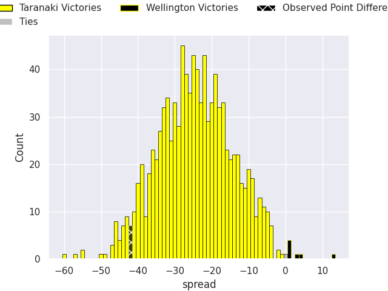
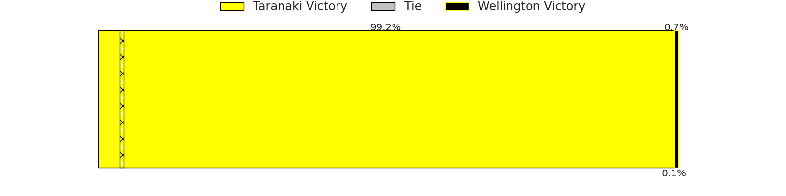

## Club Level Predictions

Now that the game has been played, lets see how the club predictions did. I predicted Taranaki to win by 24.42, and Taranaki won by 42.0. That's an absolute error of 17.6 for the margin of victory, while my average absolute error has been 14.6 over the past six months. This prediction was more accurate than 32.6% of my recent predictions.

For the Over/Under model, I predicted a total of 51.5 and we have an actual total of 94.0. That's an absolute error of 42.5 compared to a six month average of 14.9. This prediction was more accurate than 3.6% of my recent predictions.
### Projected Performances - Club Model

### Projected Spreads - Club Model

### Projected Results - Club Model

