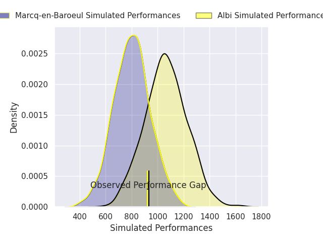
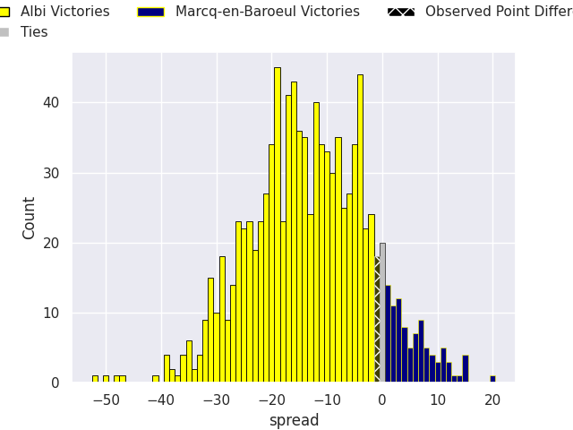
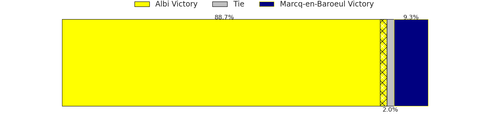

## Club Level Predictions

Now that the game has been played, lets see how the club predictions did. I predicted Albi to win by 19.13, and Albi won by 1.0. That's an absolute error of 18.1 for the margin of victory, while my average absolute error has been 14.6 over the past six months. This prediction was more accurate than 32.0% of my recent predictions.

For the Over/Under model, I predicted a total of 46.5 and we have an actual total of 13.0. That's an absolute error of 33.5 compared to a six month average of 14.8. This prediction was more accurate than 7.2% of my recent predictions.
### Projected Performances - Club Model

### Projected Spreads - Club Model

### Projected Results - Club Model

## Player Level Predictions

With the player model, I predicted Albi to win by 13.16,  and Albi won by 1.0. That's an absolute error of 12.2 for the margin of victory, while the average error as been 14.8 for the past six months. So this prediction was more accurate than 34.9% of my recent predictions.
### Projected Performances - Player Model

### Projected Spreads - Player Model

### Projected Results - Player Model

