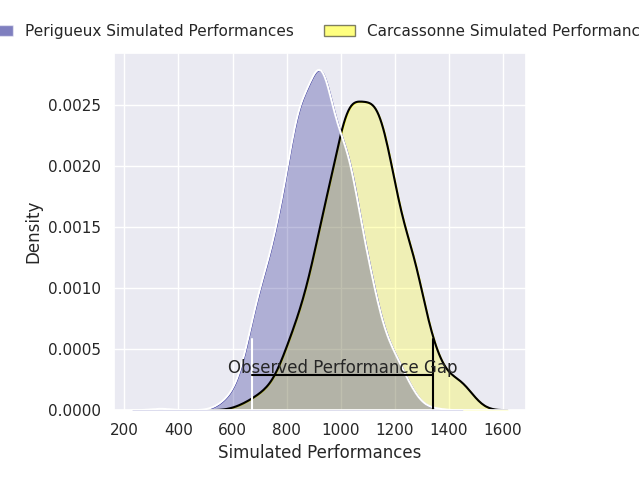
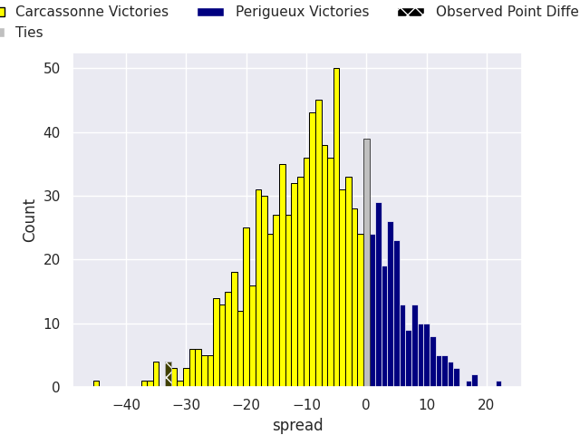
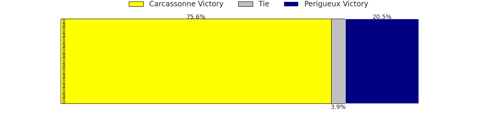

## Club Level Predictions

Now that the game has been played, lets see how the club predictions did. I predicted Carcassonne to win by 5.72, and Carcassonne won by 33.0. That's an absolute error of 27.3 for the margin of victory, while my average absolute error has been 14.6 over the past six months. This prediction was more accurate than 14.5% of my recent predictions.

For the Over/Under model, I predicted a total of 43.5 and we have an actual total of 57.0. That's an absolute error of 13.5 compared to a six month average of 14.8. This prediction was more accurate than 45.2% of my recent predictions.
### Projected Performances - Club Model

### Projected Spreads - Club Model

### Projected Results - Club Model

## Player Level Predictions

With the player model, I predicted Carcassonne to win by 8.08,  and Carcassonne won by 33.0. That's an absolute error of 24.9 for the margin of victory, while the average error as been 14.8 for the past six months. So this prediction was more accurate than 14.1% of my recent predictions.
### Projected Performances - Player Model

### Projected Spreads - Player Model

### Projected Results - Player Model

