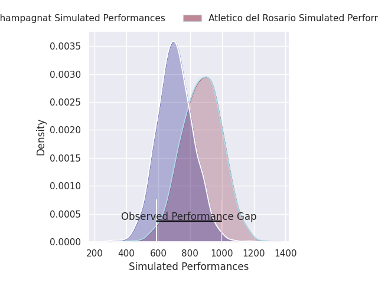
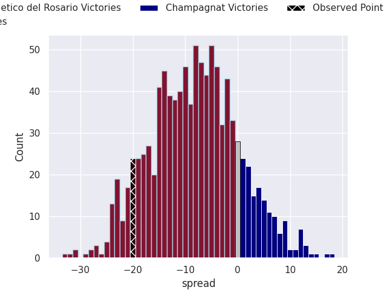

## Club Level Predictions

Now that the game has been played, lets see how the club predictions did. I predicted Atletico del Rosario to win by 4.16, and Atletico del Rosario won by 20.0. That's an absolute error of 15.8 for the margin of victory, while my average absolute error has been 14.6 over the past six months. This prediction was more accurate than 37.0% of my recent predictions.

For the Over/Under model, I predicted a total of 55.5 and we have an actual total of 64.0. That's an absolute error of 8.5 compared to a six month average of 14.8. This prediction was more accurate than 63.2% of my recent predictions.
### Projected Performances - Club Model

### Projected Spreads - Club Model

### Projected Results - Club Model

## Player Level Predictions

With the player model, I predicted Atletico del Rosario to win by 8.24,  and Atletico del Rosario won by 20.0. That's an absolute error of 11.8 for the margin of victory, while the average error as been 14.8 for the past six months. So this prediction was more accurate than 36.0% of my recent predictions.
### Projected Performances - Player Model

### Projected Spreads - Player Model

### Projected Results - Player Model

