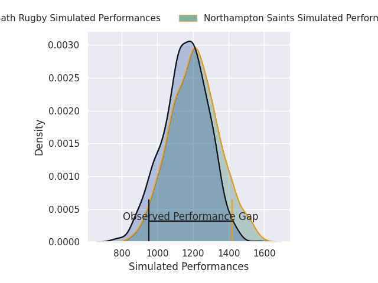
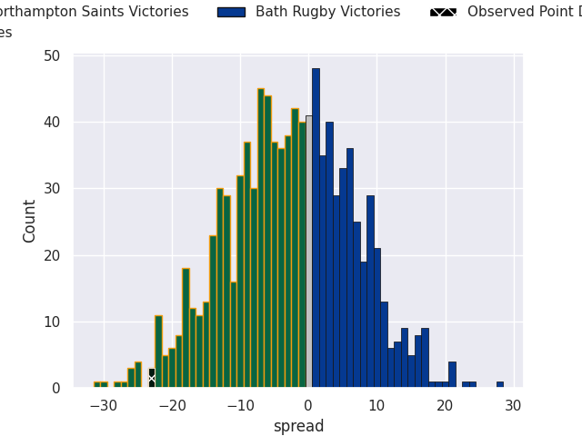
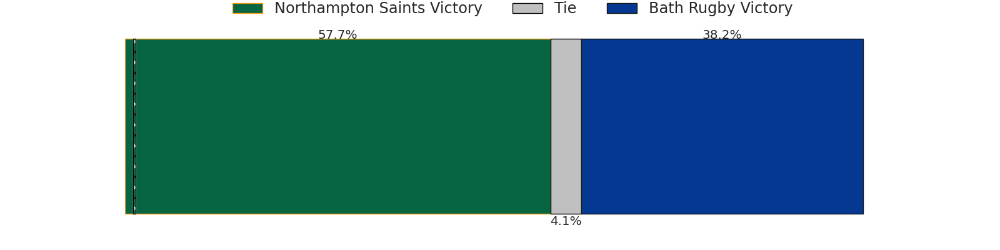

## Club Level Predictions

Now that the game has been played, lets see how the club predictions did. I predicted Northampton Saints to win by 2.4, and Northampton Saints won by 23.0. That's an absolute error of 20.6 for the margin of victory, while my average absolute error has been 14.6 over the past six months. This prediction was more accurate than 25.1% of my recent predictions.

For the Over/Under model, I predicted a total of 54.5 and we have an actual total of 119.0. That's an absolute error of 64.5 compared to a six month average of 14.8. This prediction was more accurate than 0.2% of my recent predictions.
### Projected Performances - Club Model

### Projected Spreads - Club Model

### Projected Results - Club Model

## Player Level Predictions

With the player model, I predicted Northampton Saints to win by 2.62,  and Northampton Saints won by 23.0. That's an absolute error of 20.4 for the margin of victory, while the average error as been 14.8 for the past six months. So this prediction was more accurate than 19.3% of my recent predictions.
### Projected Performances - Player Model

### Projected Spreads - Player Model

### Projected Results - Player Model

