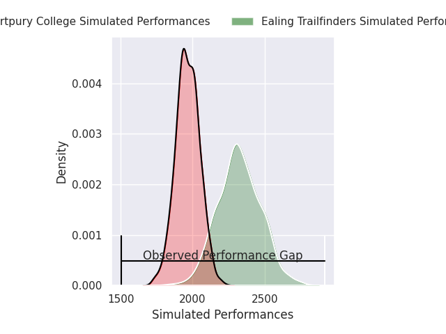
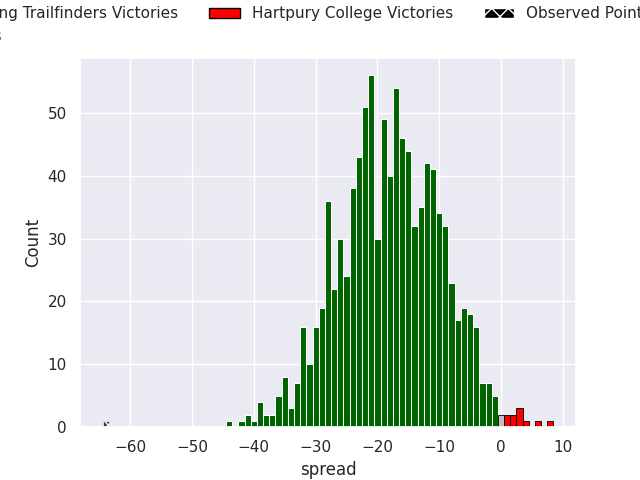

## Club Level Predictions

Now that the game has been played, lets see how the club predictions did. I predicted Ealing Trailfinders to win by 17.97, and Ealing Trailfinders won by 64.0. That's an absolute error of 46.0 for the margin of victory, while my average absolute error has been 14.6 over the past six months. This prediction was more accurate than 2.5% of my recent predictions.

For the Over/Under model, I predicted a total of 50.5 and we have an actual total of 78.0. That's an absolute error of 27.5 compared to a six month average of 14.9. This prediction was more accurate than 13.7% of my recent predictions.
### Projected Performances - Club Model

### Projected Spreads - Club Model

### Projected Results - Club Model

