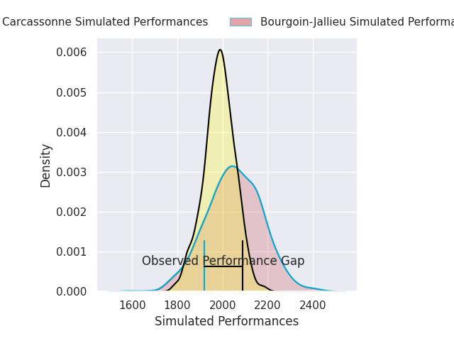
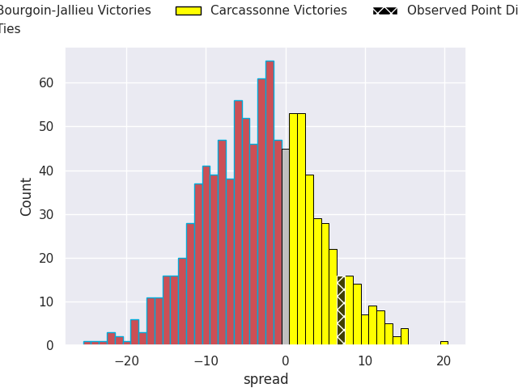
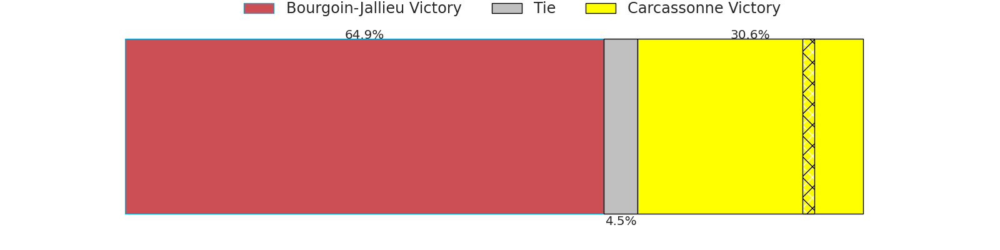
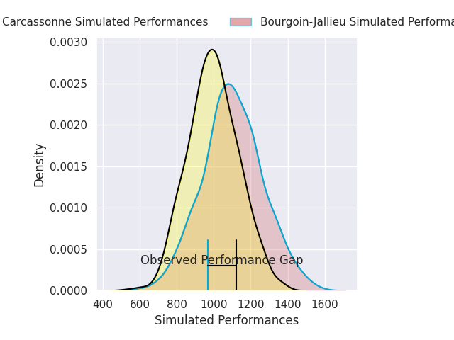
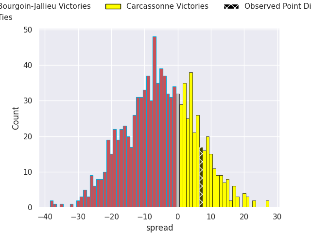
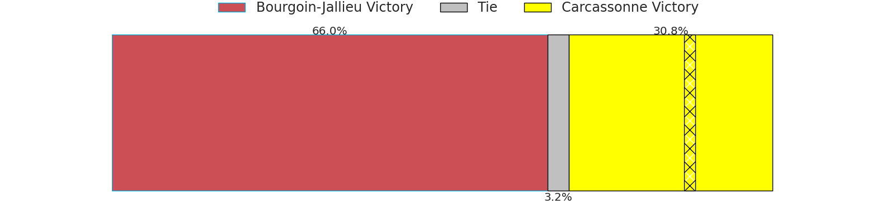

## Club Level Predictions

Now that the game has been played, lets see how the club predictions did. I predicted Bourgoin-Jallieu to win by 3.27, and Carcassonne won by 7.0. That's an absolute error of 10.3 for the margin of victory, while my average absolute error has been 14.4 over the past six months. This prediction was more accurate than 55.0% of my recent predictions.

For the Over/Under model, I predicted a total of 43.5 and we have an actual total of 61.0. That's an absolute error of 17.5 compared to a six month average of 15.0. This prediction was more accurate than 35.4% of my recent predictions.
### Projected Performances - Club Model

### Projected Spreads - Club Model

### Projected Results - Club Model

## Player Level Predictions

With the player model, I predicted Bourgoin-Jallieu to win by 5.14,  and Carcassonne won by 7.0. That's an absolute error of 12.1 for the margin of victory, while the average error as been 14.4 for the past six months. So this prediction was more accurate than 39.4% of my recent predictions.
### Projected Performances - Player Model

### Projected Spreads - Player Model

### Projected Results - Player Model

