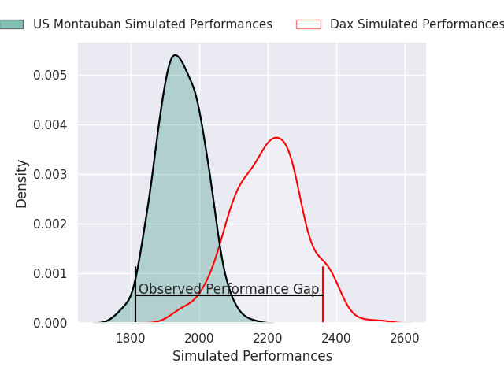
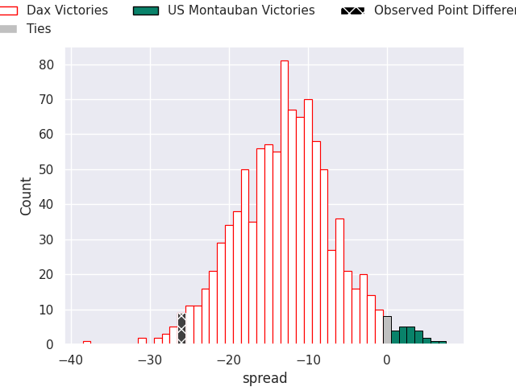
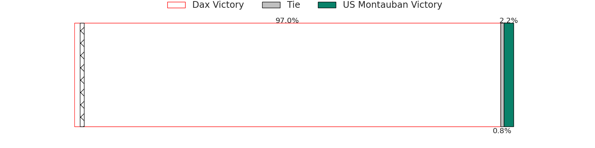
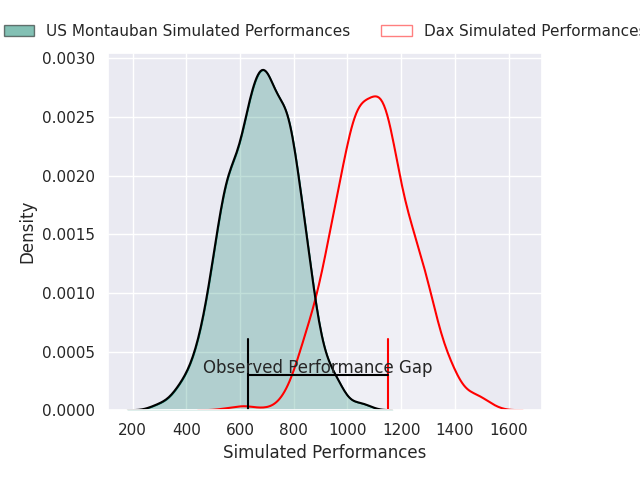
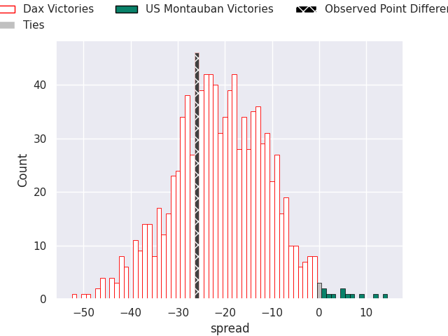
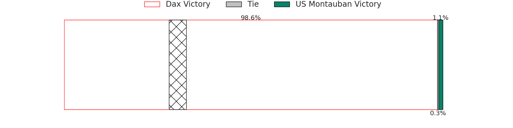

## Club Level Predictions

Now that the game has been played, lets see how the club predictions did. I predicted Dax to win by 12.8, and Dax won by 26.0. That's an absolute error of 13.2 for the margin of victory, while my average absolute error has been 14.4 over the past six months. This prediction was more accurate than 46.1% of my recent predictions.

For the Over/Under model, I predicted a total of 53.5 and we have an actual total of 82.0. That's an absolute error of 28.5 compared to a six month average of 15.0. This prediction was more accurate than 12.0% of my recent predictions.
### Projected Performances - Club Model

### Projected Spreads - Club Model

### Projected Results - Club Model

## Player Level Predictions

With the player model, I predicted Dax to win by 20.86,  and Dax won by 26.0. That's an absolute error of 5.1 for the margin of victory, while the average error as been 14.4 for the past six months. So this prediction was more accurate than 62.6% of my recent predictions.
### Projected Performances - Player Model

### Projected Spreads - Player Model

### Projected Results - Player Model

