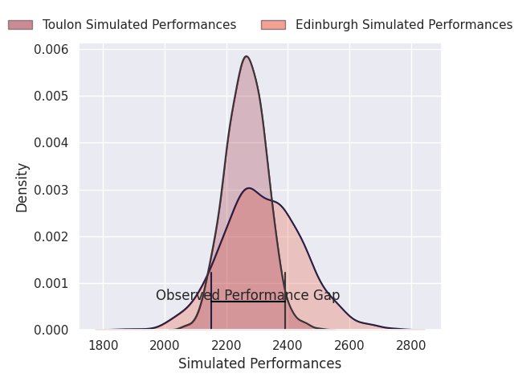
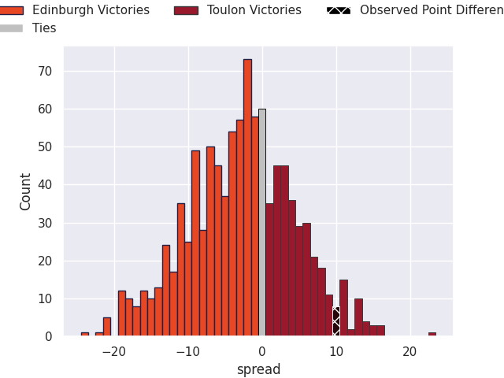
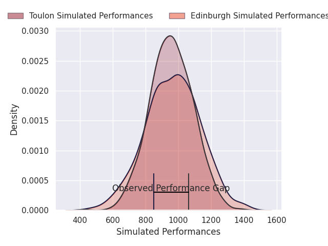
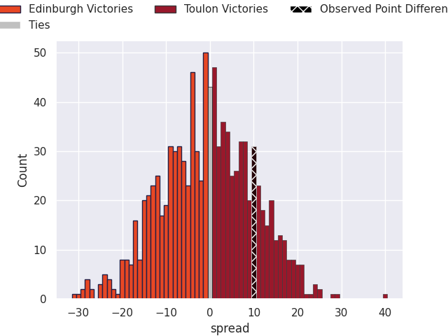

## Club Level Predictions

Now that the game has been played, lets see how the club predictions did. I predicted Edinburgh to win by 2.74, and Toulon won by 10.0. That's an absolute error of 12.7 for the margin of victory, while my average absolute error has been 14.4 over the past six months. This prediction was more accurate than 48.0% of my recent predictions.

For the Over/Under model, I predicted a total of 45.5 and we have an actual total of 44.0. That's an absolute error of 1.5 compared to a six month average of 14.9. This prediction was more accurate than 92.9% of my recent predictions.
### Projected Performances - Club Model

### Projected Spreads - Club Model

### Projected Results - Club Model

## Player Level Predictions

With the player model, I predicted Edinburgh to win by 0.45,  and Toulon won by 10.0. That's an absolute error of 10.4 for the margin of victory, while the average error as been 14.5 for the past six months. So this prediction was more accurate than 43.5% of my recent predictions.
### Projected Performances - Player Model

### Projected Spreads - Player Model

### Projected Results - Player Model

