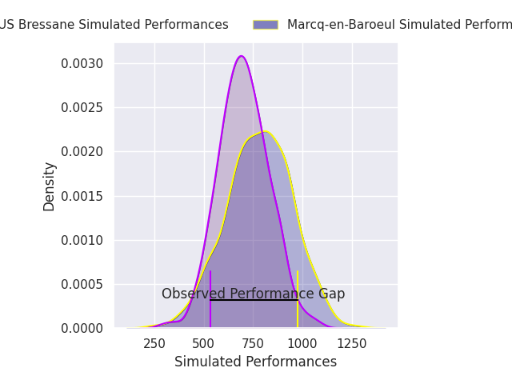
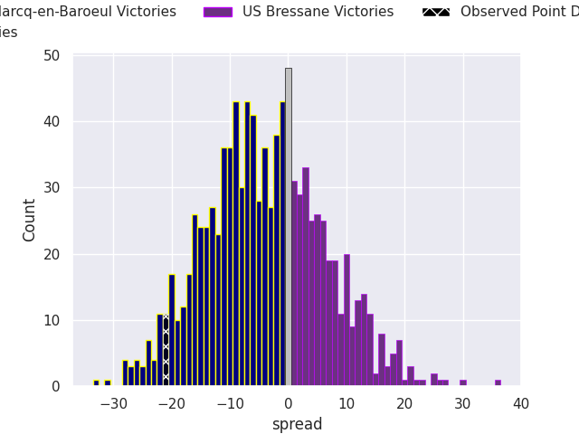
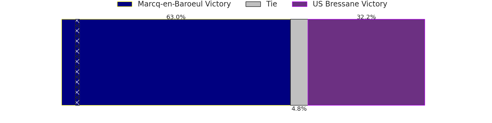

## Club Level Predictions

Now that the game has been played, lets see how the club predictions did. I predicted Marcq-en-Baroeul to win by 0.55, and Marcq-en-Baroeul won by 21.0. That's an absolute error of 20.4 for the margin of victory, while my average absolute error has been 14.4 over the past six months. This prediction was more accurate than 25.3% of my recent predictions.

For the Over/Under model, I predicted a total of 42.5 and we have an actual total of 21.0. That's an absolute error of 21.5 compared to a six month average of 15.0. This prediction was more accurate than 24.0% of my recent predictions.
### Projected Performances - Club Model

### Projected Spreads - Club Model

### Projected Results - Club Model

## Player Level Predictions

With the player model, I predicted Marcq-en-Baroeul to win by 3.88,  and Marcq-en-Baroeul won by 21.0. That's an absolute error of 17.1 for the margin of victory, while the average error as been 14.4 for the past six months. So this prediction was more accurate than 26.6% of my recent predictions.
### Projected Performances - Player Model

### Projected Spreads - Player Model

### Projected Results - Player Model

