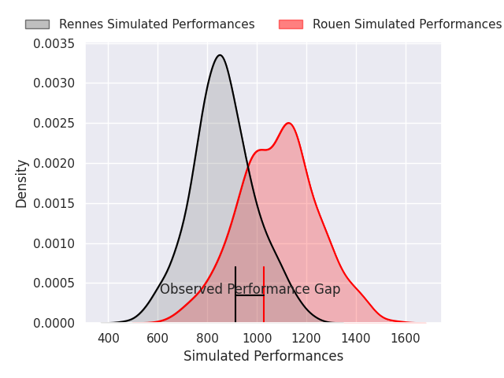
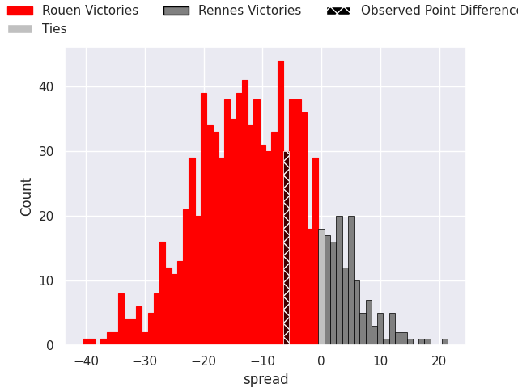
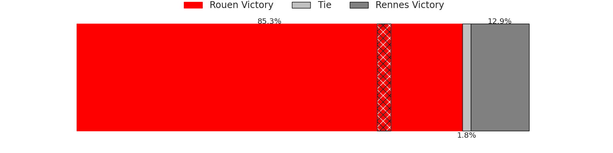

## Club Level Predictions

Now that the game has been played, lets see how the club predictions did. I predicted Rouen to win by 11.35, and Rouen won by 6.0. That's an absolute error of 5.4 for the margin of victory, while my average absolute error has been 14.4 over the past six months. This prediction was more accurate than 75.8% of my recent predictions.

For the Over/Under model, I predicted a total of 42.5 and we have an actual total of 54.0. That's an absolute error of 11.5 compared to a six month average of 14.9. This prediction was more accurate than 53.5% of my recent predictions.
### Projected Performances - Club Model

### Projected Spreads - Club Model

### Projected Results - Club Model

## Player Level Predictions

With the player model, I predicted Rouen to win by 10.99,  and Rouen won by 6.0. That's an absolute error of 5.0 for the margin of victory, while the average error as been 14.5 for the past six months. So this prediction was more accurate than 63.2% of my recent predictions.
### Projected Performances - Player Model

### Projected Spreads - Player Model

### Projected Results - Player Model

