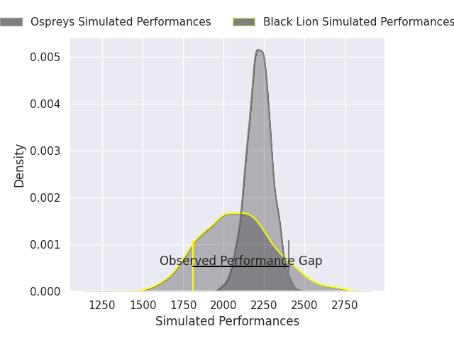
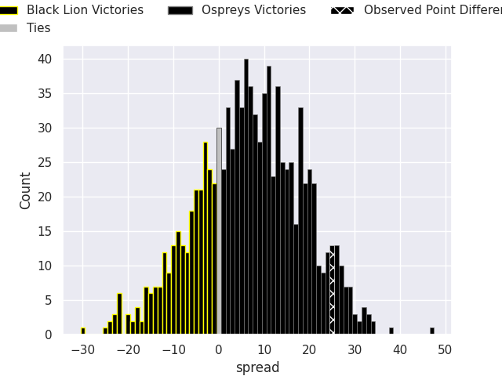
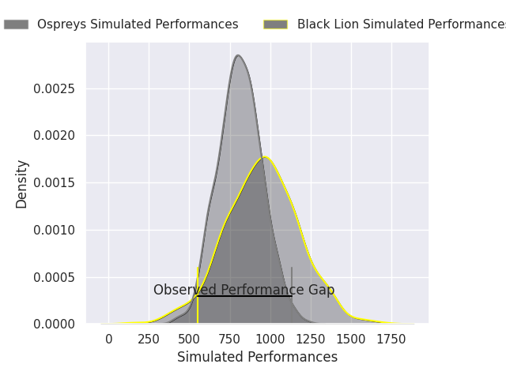
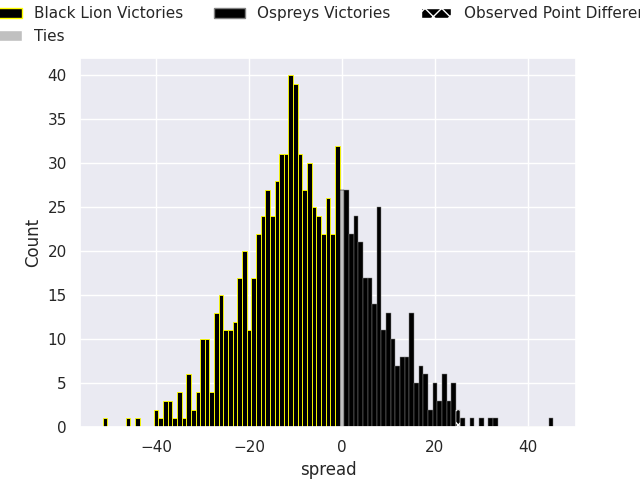

## Club Level Predictions

Now that the game has been played, lets see how the club predictions did. I predicted Ospreys to win by 6.88, and Ospreys won by 25.0. That's an absolute error of 18.1 for the margin of victory, while my average absolute error has been 14.4 over the past six months. This prediction was more accurate than 31.7% of my recent predictions.

For the Over/Under model, I predicted a total of 46.5 and we have an actual total of 53.0. That's an absolute error of 6.5 compared to a six month average of 15.0. This prediction was more accurate than 72.7% of my recent predictions.
### Projected Performances - Club Model

### Projected Spreads - Club Model

### Projected Results - Club Model

## Player Level Predictions

With the player model, I predicted Black Lion to win by 6.87,  and Ospreys won by 25.0. That's an absolute error of 31.9 for the margin of victory, while the average error as been 14.4 for the past six months. So this prediction was more accurate than 7.9% of my recent predictions.
### Projected Performances - Player Model

### Projected Spreads - Player Model

### Projected Results - Player Model

