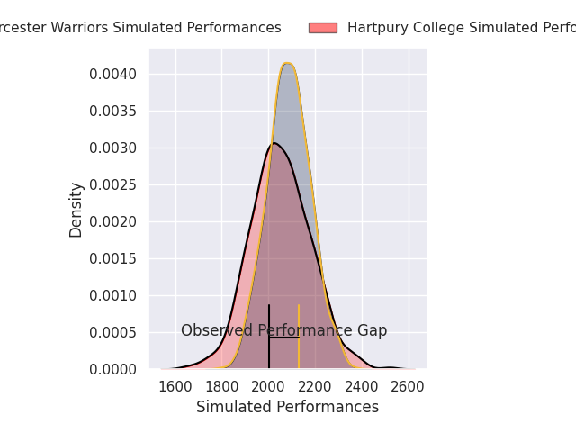
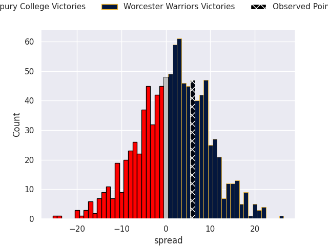

## Club Level Predictions

Now that the game has been played, lets see how the club predictions did. I predicted Worcester Warriors to win by 1.73, and Worcester Warriors won by 6.0. That's an absolute error of 4.3 for the margin of victory, while my average absolute error has been 14.4 over the past six months. This prediction was more accurate than 80.4% of my recent predictions.

For the Over/Under model, I predicted a total of 48.5 and we have an actual total of 62.0. That's an absolute error of 13.5 compared to a six month average of 15.0. This prediction was more accurate than 45.4% of my recent predictions.
### Projected Performances - Club Model

### Projected Spreads - Club Model

### Projected Results - Club Model

