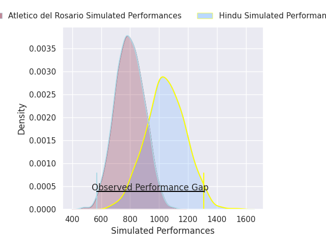
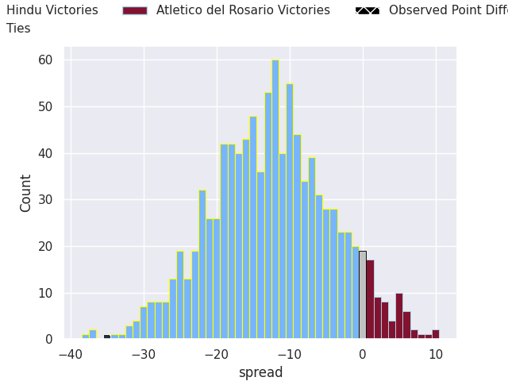

## Club Level Predictions

Now that the game has been played, lets see how the club predictions did. I predicted Hindu to win by 19.75, and Hindu won by 35.0. That's an absolute error of 15.2 for the margin of victory, while my average absolute error has been 14.4 over the past six months. This prediction was more accurate than 38.3% of my recent predictions.

For the Over/Under model, I predicted a total of 55.5 and we have an actual total of 101.0. That's an absolute error of 45.5 compared to a six month average of 15.0. This prediction was more accurate than 2.8% of my recent predictions.
### Projected Performances - Club Model

### Projected Spreads - Club Model

### Projected Results - Club Model

## Player Level Predictions

With the player model, I predicted Hindu to win by 12.5,  and Hindu won by 35.0. That's an absolute error of 22.5 for the margin of victory, while the average error as been 14.4 for the past six months. So this prediction was more accurate than 17.4% of my recent predictions.
### Projected Performances - Player Model

### Projected Spreads - Player Model

### Projected Results - Player Model

