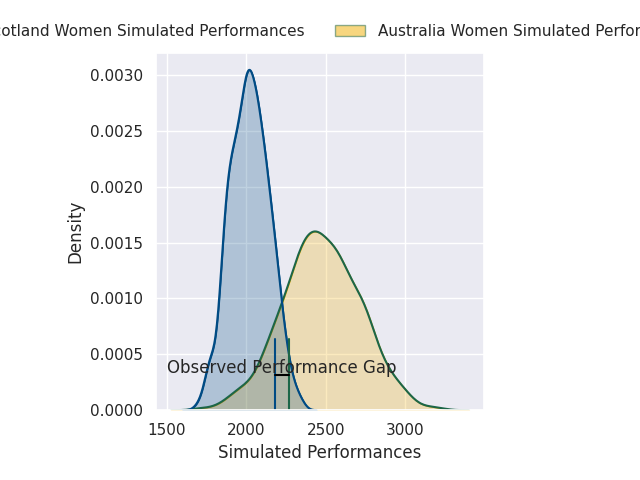
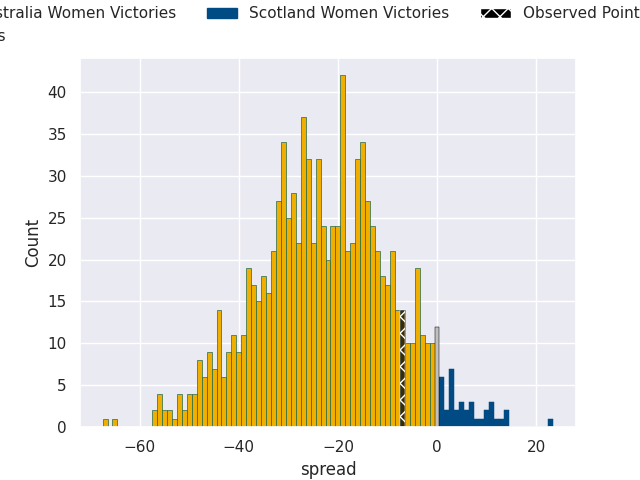
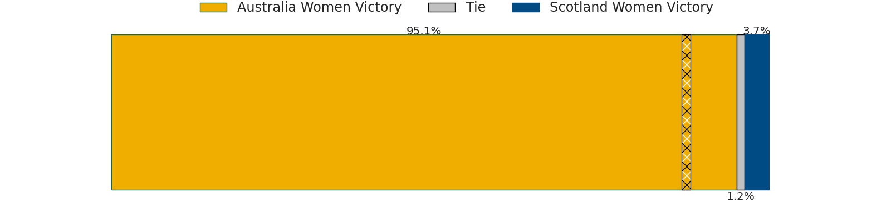

## Club Level Predictions

Now that the game has been played, lets see how the club predictions did. I predicted Australia Women to win by 22.61, and Australia Women won by 7.0. That's an absolute error of 15.6 for the margin of victory, while my average absolute error has been 14.5 over the past six months. This prediction was more accurate than 37.4% of my recent predictions.

For the Over/Under model, I predicted a total of 48.5 and we have an actual total of 69.0. That's an absolute error of 20.5 compared to a six month average of 14.8. This prediction was more accurate than 26.7% of my recent predictions.
### Projected Performances - Club Model

### Projected Spreads - Club Model

### Projected Results - Club Model

