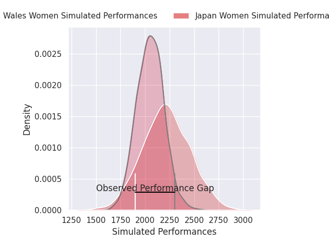
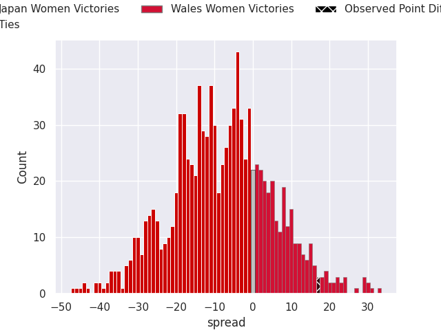

## Club Level Predictions

Now that the game has been played, lets see how the club predictions did. I predicted Japan Women to win by 8.16, and Wales Women won by 17.0. That's an absolute error of 25.2 for the margin of victory, while my average absolute error has been 14.5 over the past six months. This prediction was more accurate than 16.9% of my recent predictions.

For the Over/Under model, I predicted a total of 50.5 and we have an actual total of 17.0. That's an absolute error of 33.5 compared to a six month average of 14.9. This prediction was more accurate than 7.0% of my recent predictions.
### Projected Performances - Club Model

### Projected Spreads - Club Model

### Projected Results - Club Model

