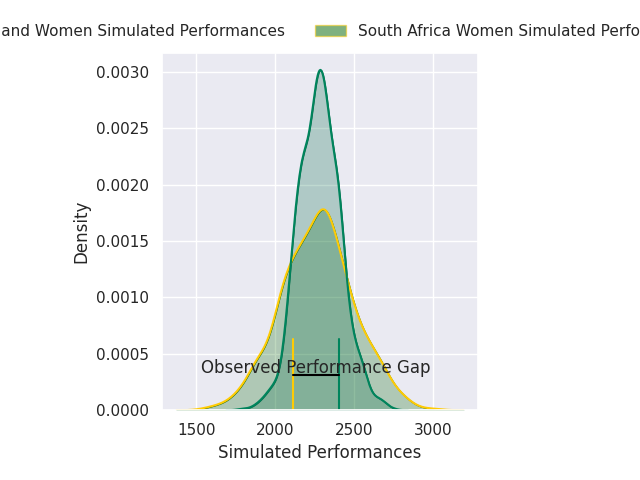
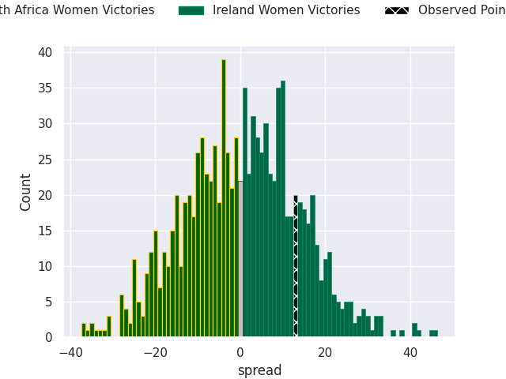

## Club Level Predictions

Now that the game has been played, lets see how the club predictions did. I predicted Ireland Women to win by 0.51, and Ireland Women won by 13.0. That's an absolute error of 12.5 for the margin of victory, while my average absolute error has been 14.5 over the past six months. This prediction was more accurate than 48.7% of my recent predictions.

For the Over/Under model, I predicted a total of 47.5 and we have an actual total of 67.0. That's an absolute error of 19.5 compared to a six month average of 14.8. This prediction was more accurate than 29.2% of my recent predictions.
### Projected Performances - Club Model

### Projected Spreads - Club Model

### Projected Results - Club Model

