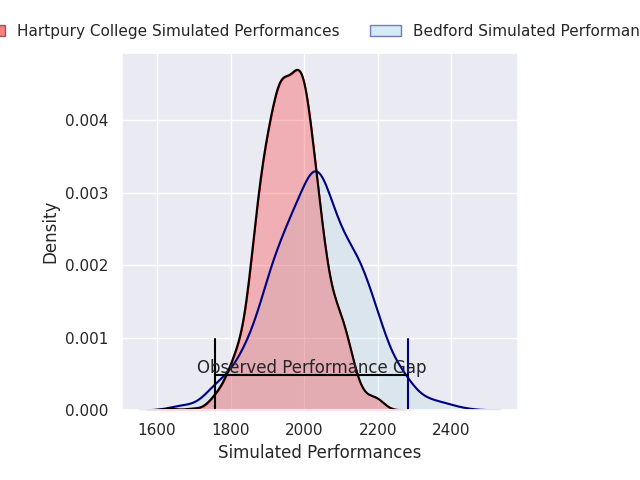
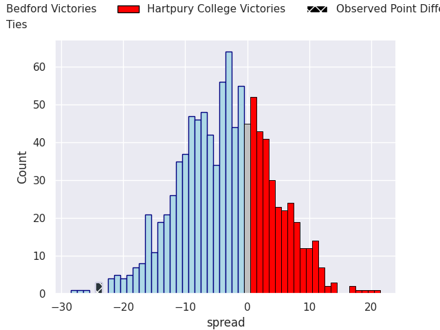

## Club Level Predictions

Now that the game has been played, lets see how the club predictions did. I predicted Bedford to win by 3.4, and Bedford won by 24.0. That's an absolute error of 20.6 for the margin of victory, while my average absolute error has been 14.5 over the past six months. This prediction was more accurate than 24.7% of my recent predictions.

For the Over/Under model, I predicted a total of 49.5 and we have an actual total of 66.0. That's an absolute error of 16.5 compared to a six month average of 14.6. This prediction was more accurate than 36.5% of my recent predictions.
### Projected Performances - Club Model

### Projected Spreads - Club Model

### Projected Results - Club Model

