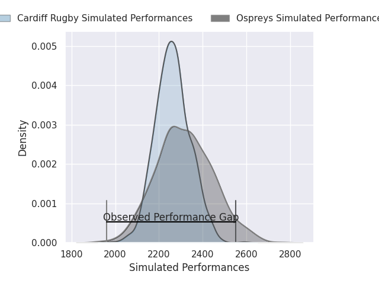
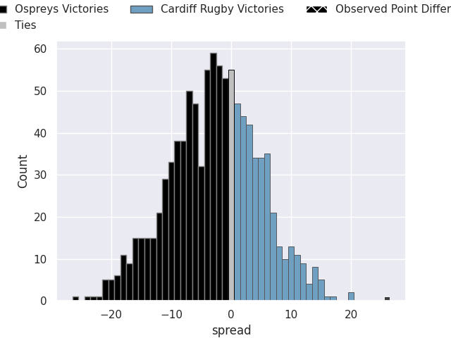
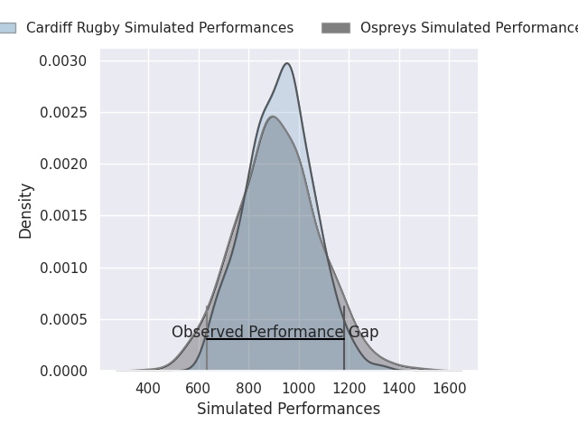
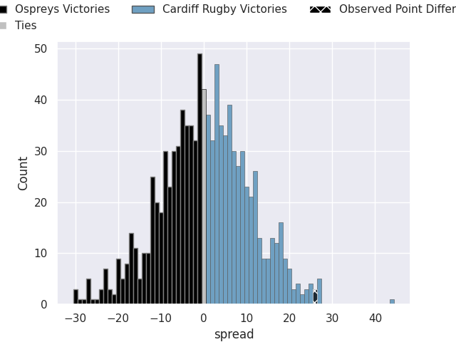
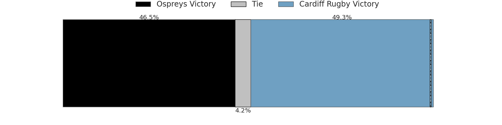

## Club Level Predictions

Now that the game has been played, lets see how the club predictions did. I predicted Ospreys to win by 2.75, and Cardiff Rugby won by 26.0. That's an absolute error of 28.8 for the margin of victory, while my average absolute error has been 14.5 over the past six months. This prediction was more accurate than 11.8% of my recent predictions.

For the Over/Under model, I predicted a total of 45.5 and we have an actual total of 26.0. That's an absolute error of 19.5 compared to a six month average of 14.6. This prediction was more accurate than 28.5% of my recent predictions.
### Projected Performances - Club Model

### Projected Spreads - Club Model

### Projected Results - Club Model

## Player Level Predictions

With the player model, I predicted Cardiff Rugby to win by 0.37,  and Cardiff Rugby won by 26.0. That's an absolute error of 25.6 for the margin of victory, while the average error as been 14.4 for the past six months. So this prediction was more accurate than 14.0% of my recent predictions.
### Projected Performances - Player Model

### Projected Spreads - Player Model

### Projected Results - Player Model

