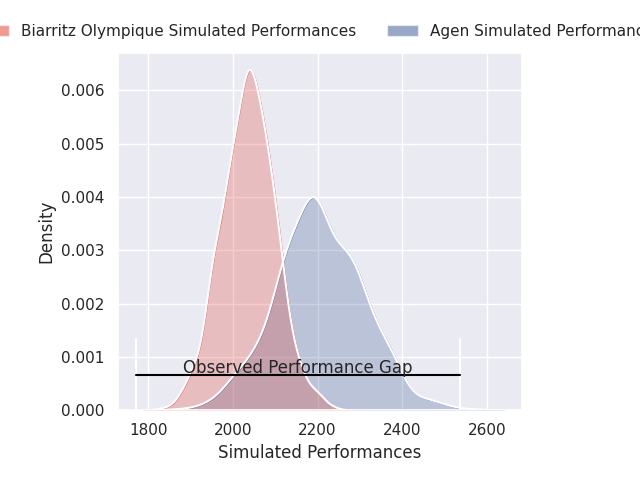
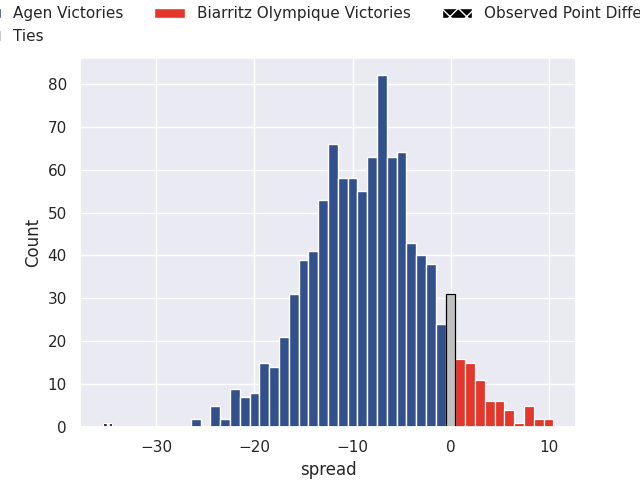
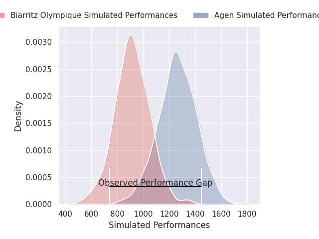
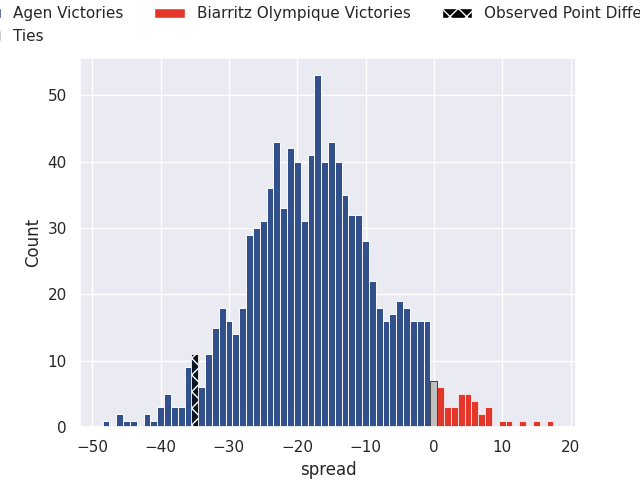
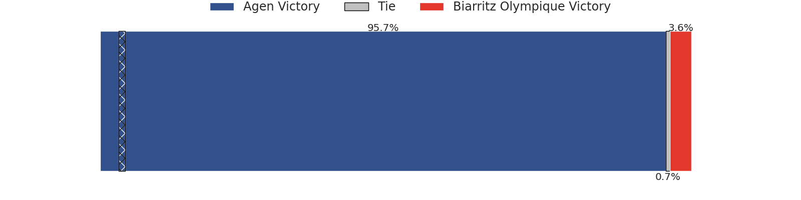

## Club Level Predictions

Now that the game has been played, lets see how the club predictions did. I predicted Agen to win by 8.39, and Agen won by 35.0. That's an absolute error of 26.6 for the margin of victory, while my average absolute error has been 14.5 over the past six months. This prediction was more accurate than 14.9% of my recent predictions.

For the Over/Under model, I predicted a total of 50.5 and we have an actual total of 69.0. That's an absolute error of 18.5 compared to a six month average of 14.4. This prediction was more accurate than 30.7% of my recent predictions.
### Projected Performances - Club Model

### Projected Spreads - Club Model

### Projected Results - Club Model

## Player Level Predictions

With the player model, I predicted Agen to win by 17.37,  and Agen won by 35.0. That's an absolute error of 17.6 for the margin of victory, while the average error as been 14.4 for the past six months. So this prediction was more accurate than 25.7% of my recent predictions.
### Projected Performances - Player Model

### Projected Spreads - Player Model

### Projected Results - Player Model

