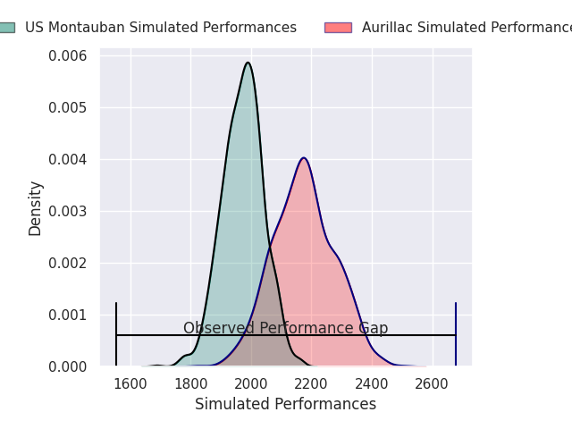
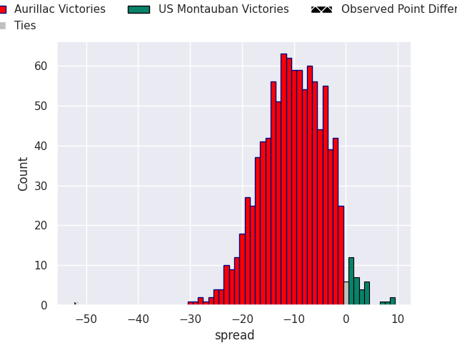
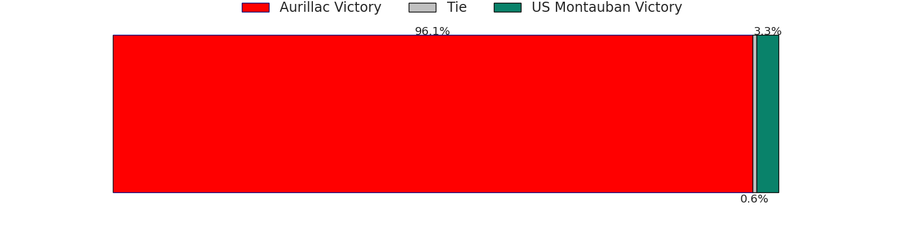
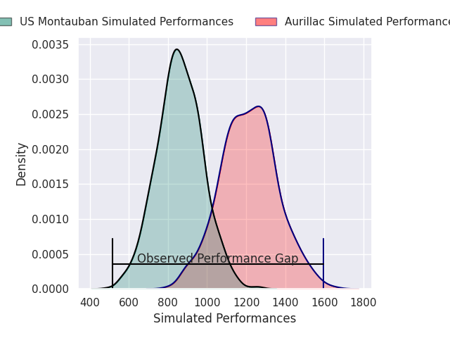
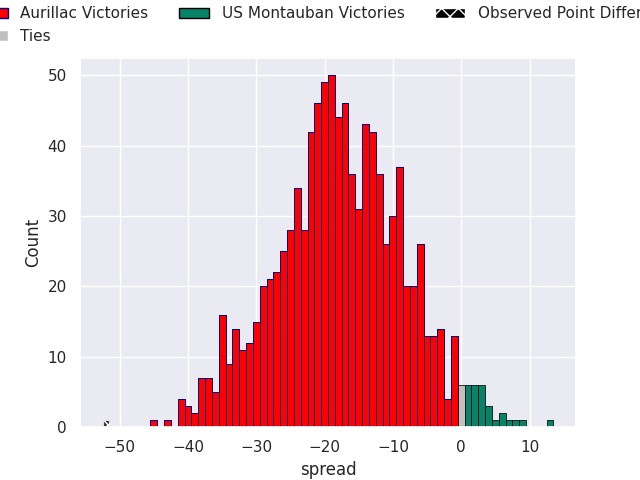
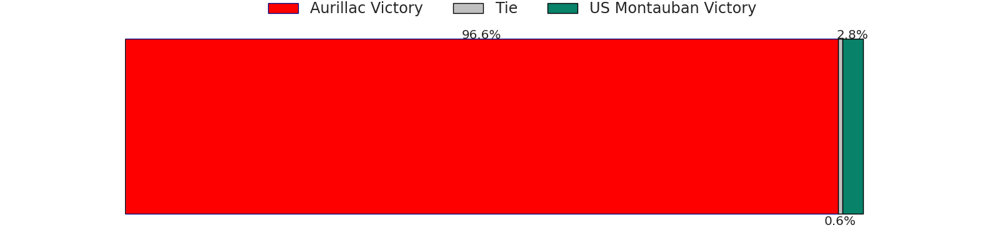

## Club Level Predictions

Now that the game has been played, lets see how the club predictions did. I predicted Aurillac to win by 10.07, and Aurillac won by 52.0. That's an absolute error of 41.9 for the margin of victory, while my average absolute error has been 14.5 over the past six months. This prediction was more accurate than 3.0% of my recent predictions.

For the Over/Under model, I predicted a total of 53.5 and we have an actual total of 68.0. That's an absolute error of 14.5 compared to a six month average of 14.4. This prediction was more accurate than 41.5% of my recent predictions.
### Projected Performances - Club Model

### Projected Spreads - Club Model

### Projected Results - Club Model

## Player Level Predictions

With the player model, I predicted Aurillac to win by 17.7,  and Aurillac won by 52.0. That's an absolute error of 34.3 for the margin of victory, while the average error as been 14.4 for the past six months. So this prediction was more accurate than 6.0% of my recent predictions.
### Projected Performances - Player Model

### Projected Spreads - Player Model

### Projected Results - Player Model

