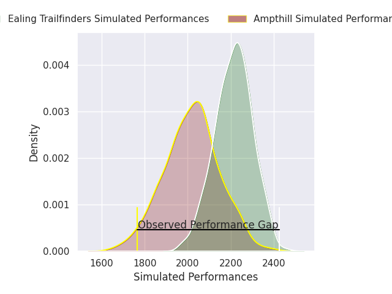
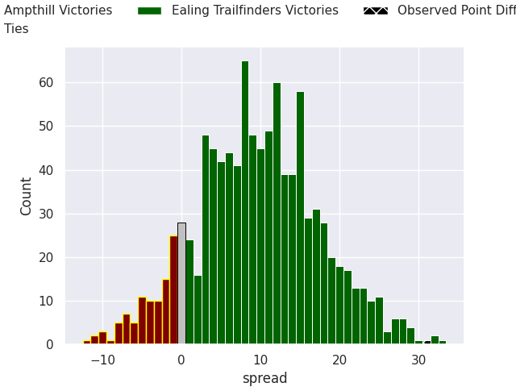
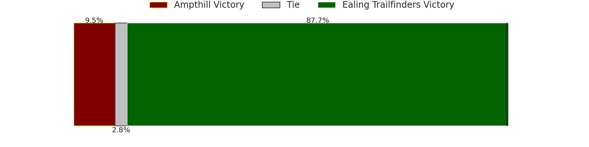

## Club Level Predictions

Now that the game has been played, lets see how the club predictions did. I predicted Ealing Trailfinders to win by 9.73, and Ealing Trailfinders won by 31.0. That's an absolute error of 21.3 for the margin of victory, while my average absolute error has been 14.5 over the past six months. This prediction was more accurate than 22.7% of my recent predictions.

For the Over/Under model, I predicted a total of 51.5 and we have an actual total of 69.0. That's an absolute error of 17.5 compared to a six month average of 14.6. This prediction was more accurate than 34.4% of my recent predictions.
### Projected Performances - Club Model

### Projected Spreads - Club Model

### Projected Results - Club Model

