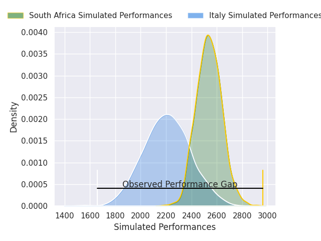
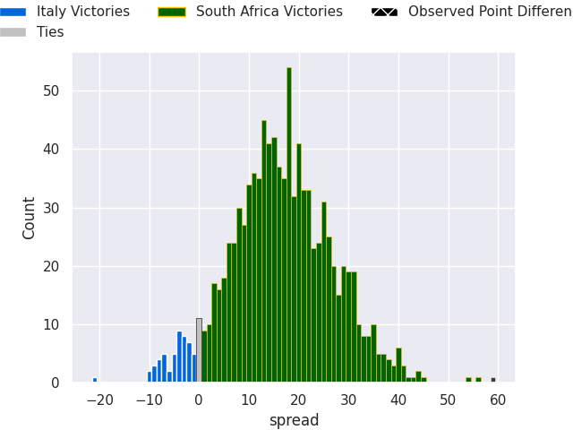
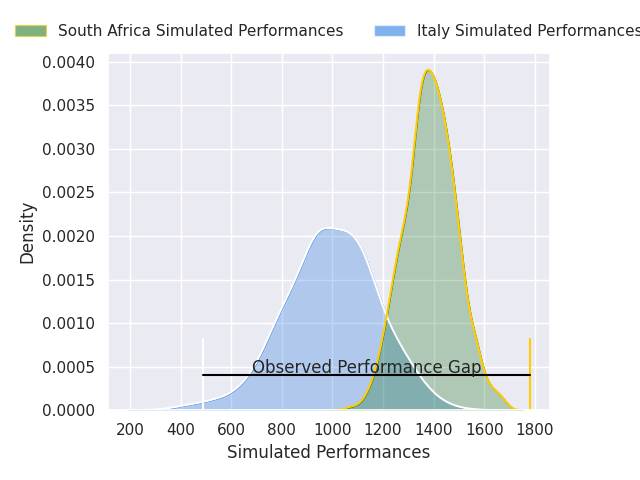
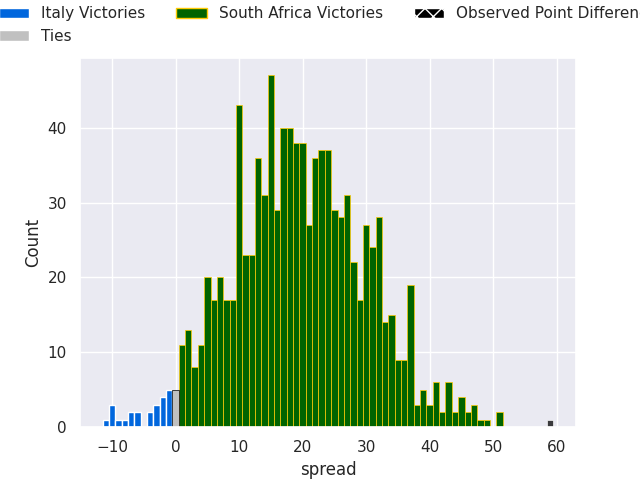

## Club Level Predictions

Now that the game has been played, lets see how the club predictions did. I predicted South Africa to win by 16.49, and South Africa won by 59.0. That's an absolute error of 42.5 for the margin of victory, while my average absolute error has been 14.5 over the past six months. This prediction was more accurate than 3.0% of my recent predictions.

For the Over/Under model, I predicted a total of 50.5 and we have an actual total of 73.0. That's an absolute error of 22.5 compared to a six month average of 14.4. This prediction was more accurate than 20.9% of my recent predictions.
### Projected Performances - Club Model

### Projected Spreads - Club Model

### Projected Results - Club Model

## Player Level Predictions

With the player model, I predicted South Africa to win by 19.51,  and South Africa won by 59.0. That's an absolute error of 39.5 for the margin of victory, while the average error as been 14.4 for the past six months. So this prediction was more accurate than 3.5% of my recent predictions.
### Projected Performances - Player Model

### Projected Spreads - Player Model

### Projected Results - Player Model

