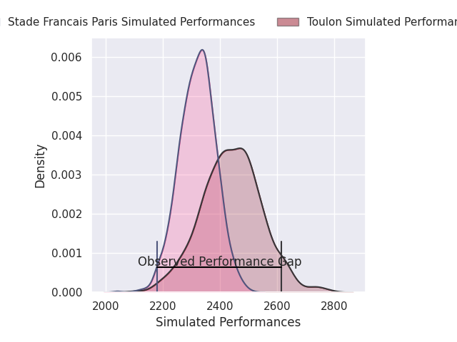
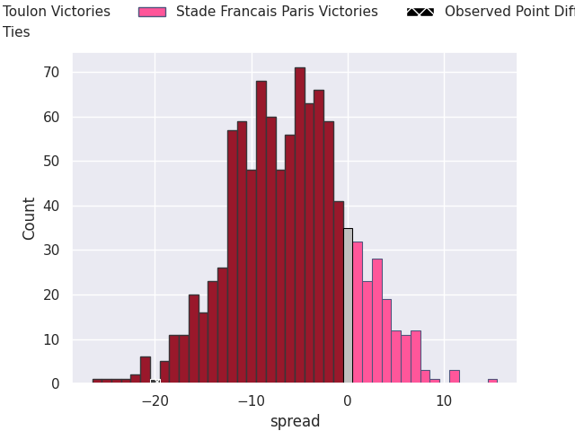
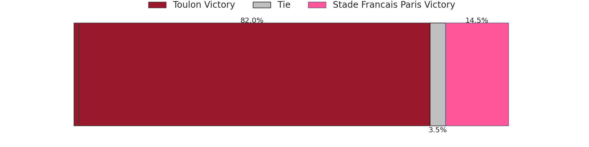

## Club Level Predictions

Now that the game has been played, lets see how the club predictions did. I predicted Toulon to win by 5.98, and Toulon won by 20.0. That's an absolute error of 14.0 for the margin of victory, while my average absolute error has been 14.5 over the past six months. This prediction was more accurate than 42.8% of my recent predictions.

For the Over/Under model, I predicted a total of 48.5 and we have an actual total of 66.0. That's an absolute error of 17.5 compared to a six month average of 14.3. This prediction was more accurate than 33.8% of my recent predictions.
### Projected Performances - Club Model

### Projected Spreads - Club Model

### Projected Results - Club Model

