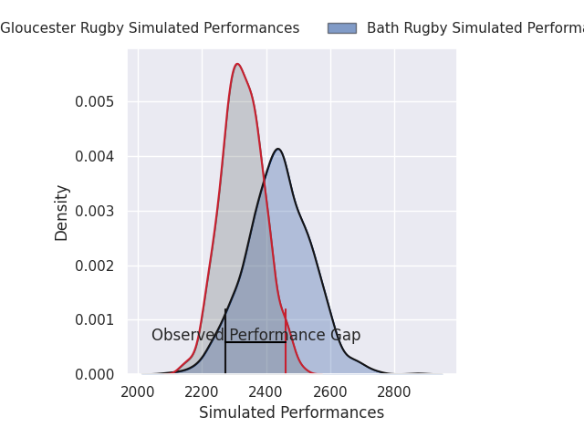
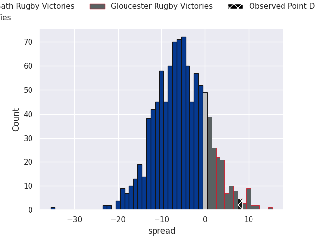
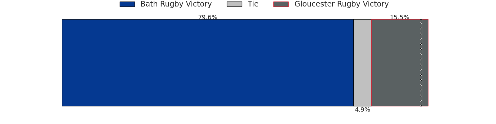
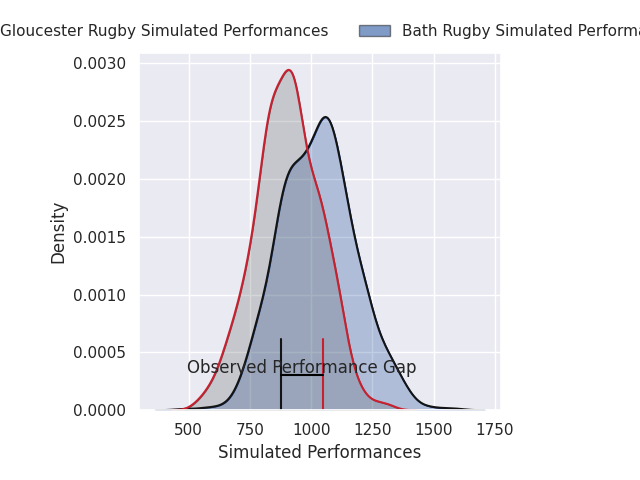
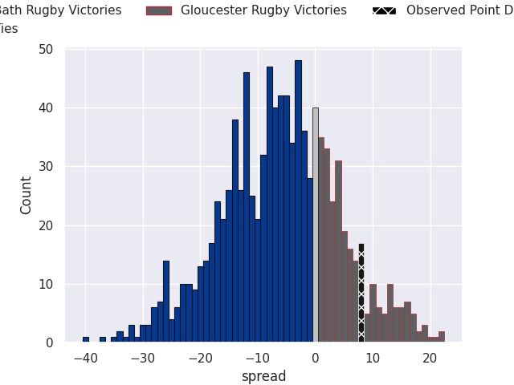
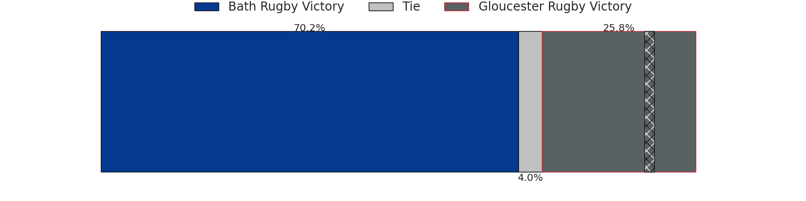

## Club Level Predictions

Now that the game has been played, lets see how the club predictions did. I predicted Bath Rugby to win by 5.53, and Gloucester Rugby won by 8.0. That's an absolute error of 13.5 for the margin of victory, while my average absolute error has been 14.4 over the past six months. This prediction was more accurate than 44.1% of my recent predictions.

For the Over/Under model, I predicted a total of 52.5 and we have an actual total of 80.0. That's an absolute error of 27.5 compared to a six month average of 14.3. This prediction was more accurate than 11.4% of my recent predictions.
### Projected Performances - Club Model

### Projected Spreads - Club Model

### Projected Results - Club Model

## Player Level Predictions

With the player model, I predicted Bath Rugby to win by 6.11,  and Gloucester Rugby won by 8.0. That's an absolute error of 14.1 for the margin of victory, while the average error as been 14.4 for the past six months. So this prediction was more accurate than 34.2% of my recent predictions.
### Projected Performances - Player Model

### Projected Spreads - Player Model

### Projected Results - Player Model

