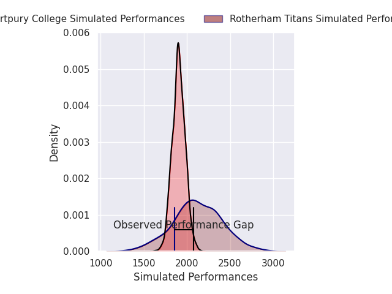
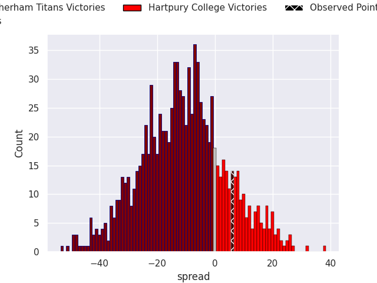

## Club Level Predictions

Now that the game has been played, lets see how the club predictions did. I predicted Rotherham Titans to win by 10.84, and Hartpury College won by 6.0. That's an absolute error of 16.8 for the margin of victory, while my average absolute error has been 14.4 over the past six months. This prediction was more accurate than 33.9% of my recent predictions.

For the Over/Under model, I predicted a total of 48.5 and we have an actual total of 58.0. That's an absolute error of 9.5 compared to a six month average of 14.3. This prediction was more accurate than 58.2% of my recent predictions.
### Projected Performances - Club Model

### Projected Spreads - Club Model

### Projected Results - Club Model

