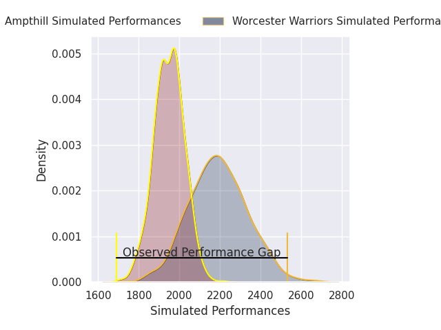
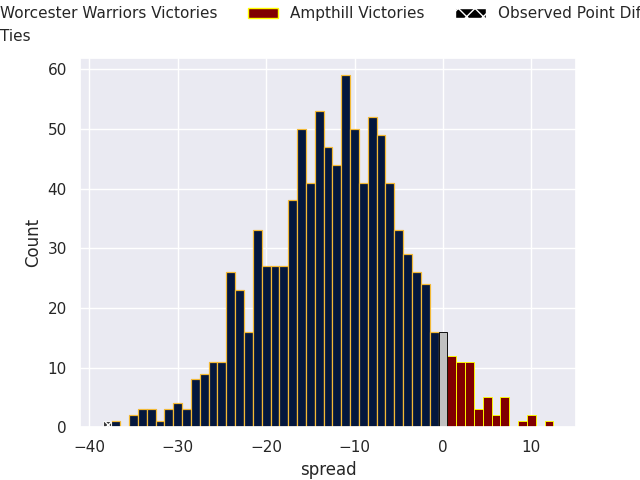

## Club Level Predictions

Now that the game has been played, lets see how the club predictions did. I predicted Worcester Warriors to win by 12.1, and Worcester Warriors won by 38.0. That's an absolute error of 25.9 for the margin of victory, while my average absolute error has been 14.5 over the past six months. This prediction was more accurate than 16.1% of my recent predictions.

For the Over/Under model, I predicted a total of 52.5 and we have an actual total of 76.0. That's an absolute error of 23.5 compared to a six month average of 14.4. This prediction was more accurate than 18.8% of my recent predictions.
### Projected Performances - Club Model

### Projected Spreads - Club Model

### Projected Results - Club Model

