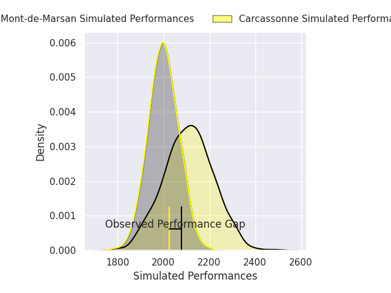
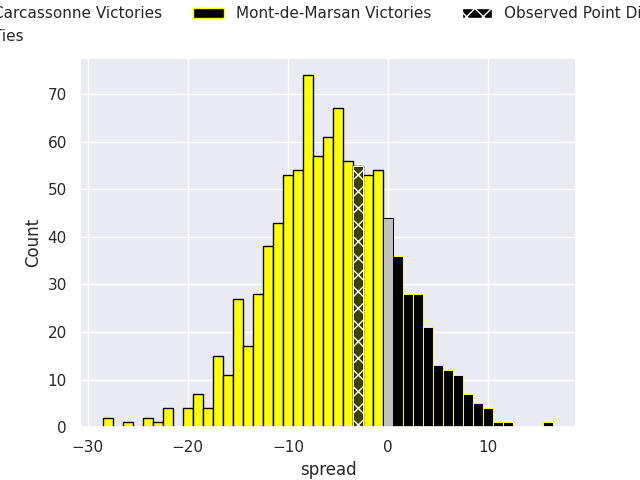
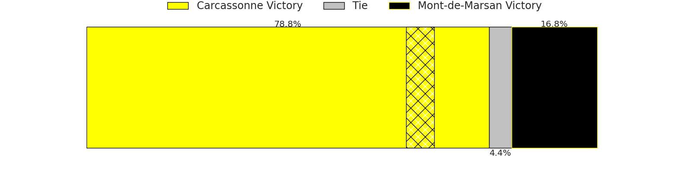
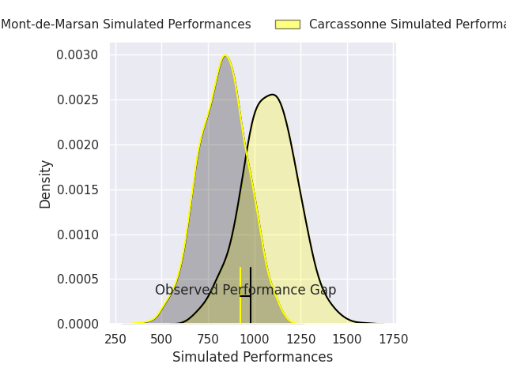
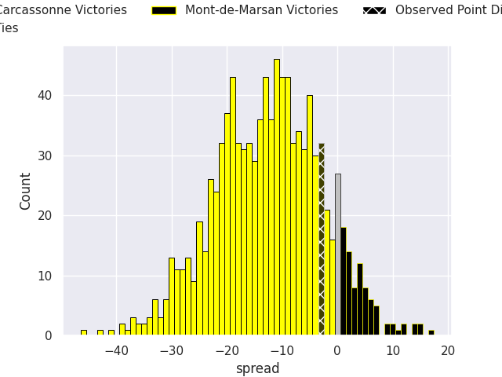
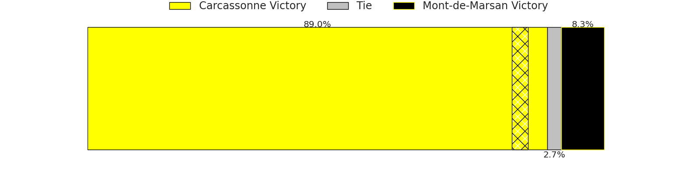

## Club Level Predictions

Now that the game has been played, lets see how the club predictions did. I predicted Carcassonne to win by 5.5, and Carcassonne won by 3.0. That's an absolute error of 2.5 for the margin of victory, while my average absolute error has been 14.7 over the past six months. This prediction was more accurate than 87.9% of my recent predictions.

For the Over/Under model, I predicted a total of 43.5 and we have an actual total of 65.0. That's an absolute error of 21.5 compared to a six month average of 14.3. This prediction was more accurate than 22.4% of my recent predictions.
### Projected Performances - Club Model

### Projected Spreads - Club Model

### Projected Results - Club Model

## Player Level Predictions

With the player model, I predicted Carcassonne to win by 12.49,  and Carcassonne won by 3.0. That's an absolute error of 9.5 for the margin of victory, while the average error as been 14.5 for the past six months. So this prediction was more accurate than 46.1% of my recent predictions.
### Projected Performances - Player Model

### Projected Spreads - Player Model

### Projected Results - Player Model

